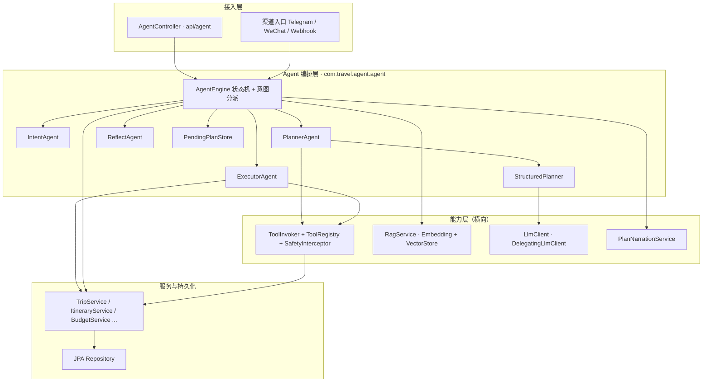
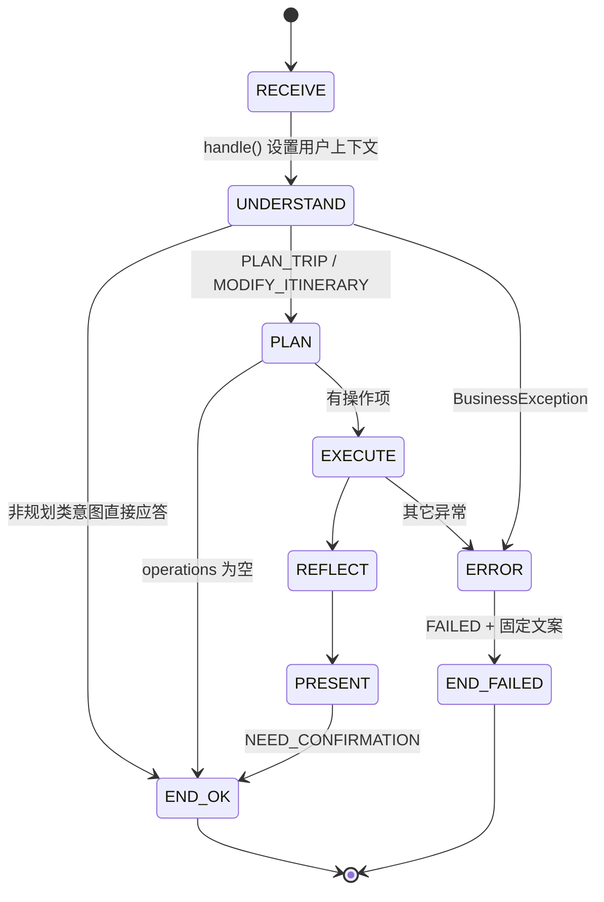
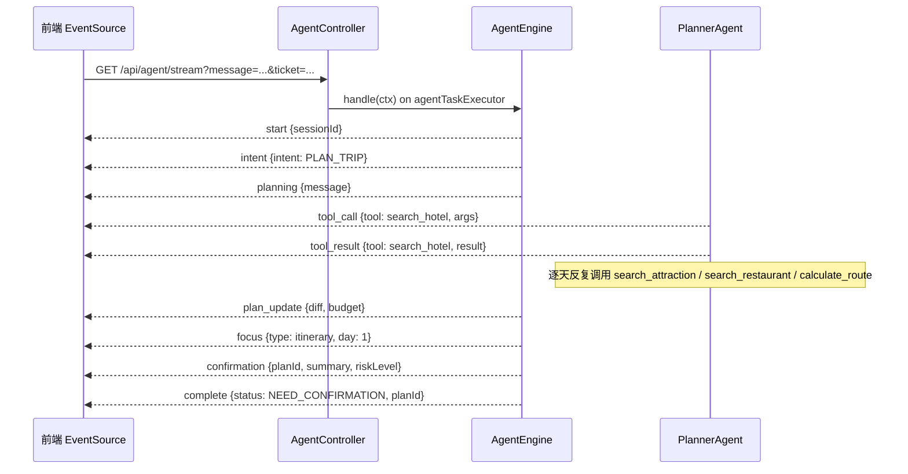
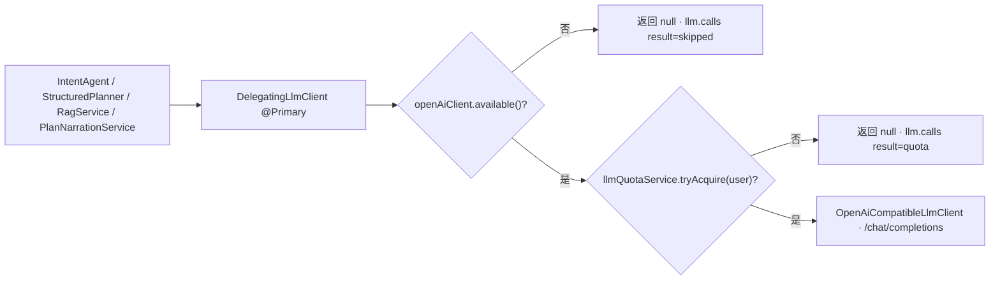

# 架构与核心设计（Agent 引擎 / RAG / 工具层 / SSE）

一句话导读：本文从源码出发，讲清一条用户消息如何穿过 Controller → AgentEngine 状态机 → 四 Agent → ToolInvoker / RagService / LlmClient，并以「preview → Diff → 确认 → commit」的方式落到数据库。

> 本文适用版本：以仓库当前 HEAD 为准。文中所有类名、方法名、事件名、枚举值均可在 `travel-agent-server/src/main/java/com/travel/agent/` 或 `travel-agent-web/src/` 中检索到；标注的 `文件:行号` 对应当前 HEAD。

1. [分层架构总览](#1-分层架构总览)
2. [Agent 状态机](#2-agent-状态机)
3. [四个 Agent 的职责](#3-四个-agent-的职责)
4. [AgentPlan / PlanOperation 与 Diff 生成](#4-agentplan--planoperation-与-diff-生成)
5. [Human-in-the-loop 三级风险](#5-human-in-the-loop-三级风险)
6. [工具层](#6-工具层)
7. [RAG 检索增强](#7-rag-检索增强)
8. [SSE 流式协议](#8-sse-流式协议)
9. [会话记忆与待确认方案](#9-会话记忆与待确认方案)
10. [LLM 配额、文案润色与多渠道复用](#10-llm-配额文案润色与多渠道复用)
11. [扩展指引](#11-扩展指引)

---

## 1. 分层架构总览

三层结构：**接入层**（REST / SSE / 渠道）、**Agent 编排层**（状态机 + 四 Agent）、**能力层**（工具 / RAG / LLM / Service / Repository）。Agent 编排层不直接碰数据库，写入一律经 `ExecutorAgent.commit` → Service → Repository。



| 组件 | 装配方式 | 说明 |
| --- | --- | --- |
| `AgentEngine` | `@Service`，构造注入 4 个 Agent + 多个 Service | 编排中枢，`AgentEngine.java:46-68` |
| 四 Agent | `@Component`，无状态 | 可并发调用 |
| `ToolRegistry` | `@Component`，构造注入 `List<AgentTool>` | 一次性收集所有工具 Bean 并注册，`ToolRegistry.java:17-21` |
| `McpToolBridge` | `@Component` + `SmartLifecycle` | 启动期向同一 `ToolRegistry` 追加 `mcp_*` 工具 |
| `AgentContext` | 每请求 `new`（`AgentController.buildContext:153-165`） | 携带用户、行程、会话、事件监听器 |
| `agentTaskExecutor` | `AsyncConfig` 的 `ThreadPoolTaskExecutor` | core 4 / max 16 / queue 100 / `AbortPolicy` |

---

## 2. Agent 状态机

### 2.1 枚举逐项

`AgentState` 声明了 **10 个**常量（`AgentState.java:4-15`）：

| 状态 | 是否被 setState | 位置 | 语义 |
| --- | --- | --- | --- |
| `RECEIVE` | 是（初始值） | `AgentContext.java:35` | 收到请求，上下文刚创建 |
| `UNDERSTAND` | 是 | `AgentEngine.java:72` | 载入会话记忆 + 意图识别 |
| `PLAN` | 是 | `AgentEngine.java:167` | PlannerAgent 生成 `AgentPlan` |
| `EXECUTE` | 是 | `AgentEngine.java:184` | ExecutorAgent.preview 生成 Diff |
| `REFLECT` | 是 | `AgentEngine.java:189` | ReflectAgent 做冲突/预算校验 |
| `PRESENT` | 是 | `AgentEngine.java:196` | 方案写入 PendingPlanStore 并推送事件 |
| `CONFIRM` | **否** | — | 主链路从不设置：确认是独立 HTTP 请求（`POST /api/agent/confirm`），不在流式状态机内 |
| `COMMIT` | **否** | — | 同上，由 `ExecutorAgent.commit` 执行，但不回写 `ctx.setState` |
| `REPLAN` | **否** | — | 从未使用，重规划走的是 `PLAN_TRIP` 意图重入 |
| `ERROR` | 是 | `AgentEngine.java:115,126` | 业务校验失败或内部异常 |

> **与 README 的差异**：README §4.1 画的是「8 个状态」的箭头图，暗示 CONFIRM / COMMIT 在主流程内转移。源码枚举其实是 **10 个**（多 `REPLAN`、`ERROR`），且 `CONFIRM`、`COMMIT`、`REPLAN` 三个值在主链路中**从未被 set**。

### 2.2 主流程与异常路径



异常处理在 `AgentEngine.doHandle`（`:112-136`）分两条完全不同的路：`BusinessException` 返回 intent `REJECTED` 且 `e.getMessage()` 原样透出（校验与越权类错误应让用户看到真实原因）；其它 `Exception` 返回 intent `ERROR` 且只给固定文案「抱歉，处理请求时出现问题…」（内部细节只进日志）。两条路都先 `ctx.emit("error", …)` 再 `ctx.emit("complete", …)`，因此前端总能收到终止事件。

### 2.3 意图分派

`doHandle` 用 switch 表达式把 `IntentResult` 常量映射到处理方法（`AgentEngine.java:93-110`）：

| Intent 常量 | 处理方法 | 是否走 PL/EX/RF |
| --- | --- | --- |
| `QUERY_KNOWLEDGE` | `answerKnowledge`（走 RAG） | 否 |
| `QUERY_BUDGET` / `RECORD_EXPENSE` | `answerBudget` / `answerRecordExpense` | 否 |
| `ADD_MEMO` / `QUERY_MEMO` | `answerAddMemo` / `answerQueryMemo` | 否 |
| `ADD_SCHEDULE` / `QUERY_SCHEDULE` | `answerAddSchedule` / `answerQuerySchedule` | 否 |
| `GEN_DAILY_REPORT` / `QUERY_HEALTH` | `answerDailyReport` / `answerQueryHealth` | 否 |
| `INVOKE_TOOL` | `answerInvokeTool`（走 ToolInvoker） | 否 |
| `PLAN_TRIP` / `MODIFY_ITINERARY` | `planAndPresent` | **是** |
| 其它（含 `CHITCHAT`） | 返回 `MessageTemplates.HELP` | 否 |

---

## 3. 四个 Agent 的职责

### 3.1 IntentAgent：规则 + LLM 双路径

```java
// IntentAgent.java:42-51
public IntentResult detect(AgentContext ctx, Trip trip) {
    String message = ctx.getMessage() == null ? "" : ctx.getMessage();
    if (llmClient.available()) {
        IntentResult result = llmDetect(ctx, trip, message);
        if (result != null && plausible(result, message)) {
            return result;
        }
    }
    return ruleDetect(ctx, trip, message);
}
```

| 路径 | 入口 | 前置条件 | 失败行为 |
| --- | --- | --- | --- |
| LLM | `IntentAgent.llmDetect` | `LlmClient.available()` 为真 | JSON 解析失败 / intent 不在 `INTENTS` 白名单 → `null`，回落规则 |
| 可信度复核 | `IntentAgent.plausible` | LLM 已给出结果 | 判为不可信 → 回落规则 |
| 规则 | `IntentAgent.ruleDetect` | 总是可用 | 兜底返回 `CHITCHAT` |

`plausible`（`:58-73`）只拦两类越界：`GEN_DAILY_REPORT` 但消息无「日报/今天/今日」；`INVOKE_TOOL` 但 `toolName` 不以 `mcp_` 开头或 `toolRegistry.get()` 为 null（防模型编造工具名）。规则路径优先级（`IntentAgent.java:174-288`）：**改写（1）> 记账（2）> 备忘（4）> 办公（5）> 强规划（6）> 疑问句（7）> 兜底闲聊**。其中「添加日程」判定格外严格（`:239-245`）：必须同时有 `scheduleNoun`（日程/会议/开会/排期…）**且**（`EXPLICIT_TIME` 明确时间点或排期动词），这样「今天开会好累」不会写成真实日程。`ctx.history` 只喂给 LLM 路径（`renderHistory`），规则路径不看历史，保证无模型时行为可预期。

### 3.2 PlannerAgent：规则路径 vs StructuredPlanner

`PlannerAgent.plan`（`:53-78`）先定城市再分流：`catalog.matchCity(message)` → 未命中且新建则 `lookupOnlineCity`（经 `search_city_online`）→ 仍未命中返回 `emptyPlan(intent, null, trip, unsupportedCityMessage(...))`，**明确告知不支持**而非静默替换默认城市。

| 维度 | 规则路径 | 结构化路径 |
| --- | --- | --- |
| 触发条件 | `llmProperties.usable()` 为假，或结构化返回 `null` | `llmProperties.usable()` 为真（`PlannerAgent.java:122,279`） |
| 实体来源 | `ToolInvoker.invoke` 调 `search_attraction` / `search_hotel` / `search_restaurant` | 目录对象直接进 prompt，模型只能从清单里选 |
| 事实来源 | 目录 `catalog` | 目录**覆盖**模型输出：坐标、票价、描述一律取目录值 |
| 天数/预算缺省 | 重规划沿用原行程 `totalDays()` / `getBudget()`，否则 3 天 / 5000 元 | 同左（`TripDraftView` 由 PlannerAgent 传入） |
| 交通条目 | `buildDailyDrafts` 内 `legTaxiCost` 逐段累加 | `appendTransportLegs` 逐天补算，口径一致 |

`StructuredPlanner` 的逐条校验（`StructuredPlanner.java`）：

| 校验点 | 失败处理 | 位置 |
| --- | --- | --- |
| 非合法 JSON / 无 `days` 数组 | 返回 `null` → 重试 → 仍失败回落规则 | `parseNewTrip:128-134` |
| `day` 超出 `[1, days]` / 条目数 > `MAX_ITEMS`（60） | 丢弃或截断并记 warning | `parseNewTrip:139-148` |
| 时间非 `HH:mm` 或 `start >= end` | 丢弃并记 warning | `convertItem:167-172` |
| 名称不在候选清单 | 丢弃并记 warning（先精确，再互为子串匹配） | `convertAttraction:183-187`、`match:407-420` |
| 酒店不在第 1 天 | 丢弃并记 warning | `convertHotel:207-210` |
| `type == "transport"` | 直接丢弃（交通由后端补算） | `convertItem:177` |

**重试策略**：首轮完全失败时把具体 warning 拼成反馈追加到 prompt 重试一次（`planNewTrip:80-94`）；部分有效则直接采用，warning 并入 `reasoning`。三个分支都打点 `structured.planning{path=new_trip|modification, result=first_try|after_retry|fallback}`（`count:290-292`）。

### 3.3 ExecutorAgent：preview / commit 事务边界

| 方法 | 副作用 | 事务 | 位置 |
| --- | --- | --- | --- |
| `preview(ctx, plan, trip)` | **无写库**，只读当前行程算 Diff | 无 | `ExecutorAgent.java:39-109` |
| `commit(plan, userId)` | 写行程 + 写操作历史 | `@Transactional` | `ExecutorAgent.java:115-164` |

`commit` 两个分支：**新建**（`plan.getTripId() == null && plan.getTripDraft() != null`）走 `tripService.createFromAgent` + `recordTripCreate`；**改已有**走 `getOwned` 归属校验 → 取 `before` → `itineraryService.applyOperations` → 取 `after` → `recordCommit`。事务边界的理由写在 `ExecutorAgent.java:111-114`：若「行程已改、撤销历史未写入」，用户会永久失去撤销能力；同理 `OperationHistoryService.save` 序列化失败时**主动抛异常**（`:72-75`），让事务整体回滚。`applyOperations`（`ItineraryService.java:89-122`）对每条操作调 `requireItemOfTrip` 做跨行程守卫，条目不属于当前行程就抛 `BusinessException(404)`。

### 3.4 ReflectAgent：冲突与预算校验

`review(plan, trip)` 返回 `List<String>`，两类检查：**预算**（`extras.total` 与行程预算比，超出给一条警告）、**时间冲突**（基于应用计划后的视图逐天两两比对，最多 5 条）。`effectiveItemsByDay`（`:74-121`）是关键设计：原条目去掉被 `REMOVE` 的、被 `MODIFY` 的用 `merge` 换新时间、再叠加 `ADD` 条目；`merge` 以原条目为底只用非空字段覆盖，`endOf` 对缺失结束时间按 **1 小时**估算，否则「只有开始时间」的条目永不参与判断。警告拼到用户文案尾部（`AgentEngine.java:189-194`）。

---

## 4. AgentPlan / PlanOperation 与 Diff 生成

### 4.1 数据结构

`AgentPlan`（`AgentPlan.java:20-34`）是 Planner 的完整输出，**只描述意图，不落库**：

| 字段 | 类型 | 说明 |
| --- | --- | --- |
| `planId` | `String` | `UUID.randomUUID()`，同时作为 `pending_plan` 主键 |
| `intent` / `target` | `String` | 来自 `IntentResult` |
| `tripId` | `Long` | 改已有行程时有值；新建为 `null` |
| `city` / `tripDraft` | `CityCatalog` / `TripDraft` | 命中的目录；新建行程草稿 |
| `operations` | `List<PlanOperation>` | 操作列表 |
| `reasoning` / `focus` | `String` / `AgentFocus` | 规划理由（会进操作历史）/ GUI 聚焦指令 |
| `extras` | `Map<String,Object>` | 规则路径放 `hotelName`/`total`/`days`；修改路径放 `weather`/`replacements`/`day` |

```java
// PlanOperation.java:14-25
public static final String ADD = "ADD_ITEM";
public static final String REMOVE = "REMOVE_ITEM";
public static final String MODIFY = "MODIFY_ITEM";

private String type;
private Long targetItemId;      // REMOVE / MODIFY 用
private ItineraryItem draft;    // ADD / MODIFY 的新值（尚未入库）
private ItineraryItem original; // REMOVE / MODIFY 的原值（用于 Diff）
private String detail;          // 人类可读描述
```

> **与 README 的差异**：README 称操作项是「ADD / MODIFY / REMOVE」，源码常量实际值是 `ADD_ITEM` / `MODIFY_ITEM` / `REMOVE_ITEM`——`ItineraryService.applyOperations` 的 switch 直接匹配这三个字面量（`:93-119`）。

### 4.2 Diff 如何生成

`ExecutorAgent.preview` 遍历操作生成 `AgentDtos.DiffChange` 并累计金额：

| 操作类型 | 投入 `changes` 的字段 | 预算影响 |
| --- | --- | --- |
| `ADD_ITEM` | `type="ADD"`、`itemType`、`title`、`detail`、`cost`、`dayIndex`、`startTime` | `added += draft.cost` |
| `REMOVE_ITEM` | `type="REMOVE"`、`itemId=targetItemId`、其余取 `original` | `removed += original.cost` |
| `MODIFY_ITEM` | `type="MODIFY"`、`itemId=targetItemId`、其余取 `draft` | `added += draft.cost` |

```java
// ExecutorAgent.java:81-85
BigDecimal before = trip != null ? budgetService.totalOf(itineraryService.listEntities(trip.getId()))
        : BigDecimal.ZERO;
BigDecimal after = before.subtract(removed).add(added);
AgentDtos.PlanDiff diff = AgentDtos.PlanDiff.builder()
        .changes(changes).budgetBefore(before).budgetAfter(after).build();
```

> **注意**：`MODIFY_ITEM` 在预算上只做加法（旧值不扣减），而 `applyOperations` 对 MODIFY 是**原地覆盖** `cost`。当前没有任何 Planner 路径产出 `MODIFY_ITEM`（`PlannerAgent` 用 REMOVE + ADD 表达替换），该口径差异不会现实触发；新增 MODIFY 路径时需在此补 `removed += original.cost`。`preview` 返回的 `status` 恒为 `STATUS_NEED_CONFIRMATION`，并带 `confirmation`（`planId` / `summary` / `riskLevel`）。

---

## 5. Human-in-the-loop 三级风险

`RiskLevel`（`RiskLevel.java:4-11`）三个值，注释直接写明策略：`LOW`（查询/推荐）自动执行、`MEDIUM`（修改行程）执行后确认、`HIGH`（大额消费/取消重要安排）执行前确认。判定只有一处（`SafetyInterceptor.evaluatePlanChange`，`SafetyInterceptor.java:31-39`）：

| 判定结果 | 条件 | 说明 |
| --- | --- | --- |
| `LOW` | 传入的 `readOnly` 为真，即 `plan.getOperations().isEmpty()` | 计划什么都没改（`planAndPresent` 此情况其实会提前 return，`AgentEngine.java:172-182`） |
| `HIGH` | `budgetAfter > tripBudget` | 变更后总花费超出行程预算 |
| `MEDIUM` | 其余（有操作且不超预算） | 普通行程变更 |

调用点在 `ExecutorAgent.preview`（`:89-91`），`risk.name()` 写进 `confirmation.riskLevel`（`:106-107`），前端据此决定确认框样式。**「只有一个出口」的设计**：`SafetyInterceptor` 类注释（`:6-15`）说明工具层只允许只读（由 `ToolRegistry` 强制），所以 `check()` **不做阻断**，只做审计日志 + 对「只读工具被标成 HIGH」打 warn；真正的风险拦截发生在方案层。

> **与 README 的差异**：README §4.2 把 MEDIUM 描述为「会改变行程 → 生成 Diff，确认后提交」，隐含「工具可以以 MEDIUM 执行后确认」。源码里没有任何工具是 MEDIUM/HIGH——8 个内置工具全部 `RiskLevel.LOW`，且写操作根本不能做成工具（见 §6.2）。所谓「执行后确认」实际是 `preview` 无副作用 + `commit` 需用户显式调用 confirm 接口。

---

## 6. 工具层

### 6.1 AgentTool 契约与只读闸门

```java
// AgentTool.java:6-26
public interface AgentTool {
    String getName();
    String getDescription();
    RiskLevel getRiskLevel();
    default boolean readOnly() { return true; }
    Object execute(Map<String, Object> args);
}
```

`ToolRegistry.register`（`:28-41`）是两个注册路径共用的唯一入口，两道闸门：同名跳过、`!readOnly()` 直接拒绝并 `log.error`。`all()` 返回内部 `LinkedHashMap`（非副本），注册顺序稳定。

### 6.2 8 个内置工具

全部 `@Component`、全部 `RiskLevel.LOW`：

| 工具名 | 实现类 | 入参 | 出参 | 数据来源 / 是否模拟 |
| --- | --- | --- | --- | --- |
| `search_attraction` | `SearchAttractionTool` | `city`、`venue`(indoor/outdoor)、`nearLat`/`nearLng`、`exclude`(逗号分隔) | `List<Attraction>`（上限 6） | 内置目录 `data/travel-catalog.json` 或联网生成目录；**静态数据** |
| `search_hotel` | `SearchHotelTool` | `city`、`preferSubway`、`maxPrice` | `List<Hotel>`（上限 5） | 同上；**静态数据** |
| `search_restaurant` | `SearchRestaurantTool` | `city`、`nearLat`、`nearLng` | `List<Restaurant>`（上限 5） | 同上；**静态数据** |
| `query_weather` | `QueryWeatherTool` | `city`、`date`(默认明天)、`mentionRain` | `WeatherInfo` | `WeatherService.forecast`：`travel.weather.real=true` 走 Open-Meteo，失败/超范围降级**确定性模拟** |
| `calculate_route` | `CalculateRouteTool` | `fromLat`/`fromLng`/`toLat`/`toLng` | `RouteInfo` | `RouteService.route`，**按坐标估算** |
| `calculate_budget` | `CalculateBudgetTool` | `tripId` | `BudgetSummary` | `BudgetService.summarize` 实时计算，**非模拟** |
| `get_itinerary` | `GetItineraryTool` | `tripId` | `List<ItineraryItemDTO>` | `ItineraryService.listByTrip`，**真实落库数据** |
| `search_city_online` | `OnlineCitySearchTool` | `city` | `CityCatalog` 或 `Map.of("found", false, "city", …)` | `OnlineCityService.getOrLoad`：LLM + 高德/OSM 定位，两级缓存（内存 24h + 文件 7 天） |

契约细节：`calculate_budget`/`calculate_route`/`search_attraction` 对必填参数直接拆箱，缺失参数抛 NPE → 被归为内部异常；三个 search 工具内部走 `catalogService.requireCity`，城市不在目录抛 `BusinessException`「暂不支持该目的地」。

### 6.3 MCP 桥接与 ToolInvoker

`McpToolBridge`（`SmartLifecycle`）在 `start()` 阶段逐个接入 `travel.mcp.servers`：

| 环节 | 位置 | 说明 |
| --- | --- | --- |
| 传输选择 | `connect:45-47` | 有 `url` → `HttpMcpTransport`；否则 `StdioMcpTransport(command, env, timeoutMs)` |
| 握手 / 列举 | `McpConnection.initialize` / `listTools` | `initialize` → `notifications/initialized`（协议版本 `2024-11-05`）→ `tools/list` |
| **注册名** | `connect:52` | `"mcp_" + sanitize(serverName) + "_" + sanitize(toolName)`，`sanitize` 转小写、非 `[a-z0-9_]` 替成 `_`、截断 20 字符 |
| 失败隔离 | `catch (Exception)` | 单个 server 失败只 `log.warn`，不影响应用与其余 server |

| 传输 | 请求配对 | 特性 |
| --- | --- | --- |
| `HttpMcpTransport` | 单端点 POST JSON-RPC，`id` 自增；响应支持 `application/json` 与 `text/event-stream` | 自动携带 `Mcp-Session-Id`；SSE 逐 `data:` 行找 id 匹配帧（`parseSse:79-100`） |
| `StdioMcpTransport` | 子进程按行收发，守护读线程按 `id` 唤醒 `CompletableFuture` | stderr 透传控制台；超时抛「MCP 子进程响应超时」；`close()` 先 `destroy()` 再 3 秒后 `destroyForcibly()` |

`McpAgentTool.execute` 把远端异常包成 `BusinessException(502, "外部工具 xxx 暂时不可用：…")`，这样 `AgentEngine` 会把原因**原样告诉用户**。`ToolInvoker.invoke`（`:22-33`）是所有 Agent 环节调用工具的唯一门面，一次做完四件事：`ctx.emit("tool_call")` → `safetyInterceptor.check` → `tool.execute` → `ctx.emit("tool_result")`；工具不存在时返回 `null` 而不抛异常，调用方需自行判空。

---

## 7. RAG 检索增强

### 7.1 两种 Embedding 与降级

| 实现 | 条件 | 维度 | 特点 |
| --- | --- | --- | --- |
| `LocalHashEmbeddingService` | 始终是 Bean | `DIM = 256` | 中文一元 + 二元组哈希投影（二元组权重 1.5、一元 1.0）后 L2 归一化；**词面匹配而非语义向量** |
| `OpenAiCompatibleEmbeddingService` | `@Primary` + `@ConditionalOnProperty(travel.embedding.enabled=true)` | 由响应决定，成功前回落 `fallback.dimension()` | 调 OpenAI 兼容 `/embeddings`（默认 `https://api.siliconflow.cn/v1`、`BAAI/bge-m3`），结果 L2 归一化 |

降级是**进程内一次性锁定**（`OpenAiCompatibleEmbeddingService.embed:52-86`）：一旦 `degraded = true`，本进程后续全部走本地哈希直到重启——`catch` 分支置 `degraded = true` 并 `log.warn`，然后 `return fallback.embed(text)`。类注释（`:20-23`）写明原因：混用两套向量空间会让余弦相似度全部归零，检索静默失效比报错更危险。

### 7.2 InMemoryVectorStore：Top-K 与城市过滤

`reload()`（`:36-51`）在 `ApplicationReadyEvent` 时全量加载：读所有 `RagDocument` 建 id→文档索引，再遍历 `RagChunk` 用 `EmbeddingCodec.parse` 解向量，装进 `CopyOnWriteArrayList<Entry>`；文档缺失或 `embedding` 为 null 的 chunk 跳过。`search`（`:53-67`）先城市过滤、再算余弦、排序取 Top-K：

```java
for (Entry entry : entries) {
    if (!matchesCity(entry.document().getCity(), city)) { continue; }
    double score = cosine(queryVector, entry.vector());
    results.add(new VectorSearchResult(entry.chunk(), entry.document(), score));
}
return results.stream()
        .sorted(Comparator.comparingDouble(VectorSearchResult::getScore).reversed())
        .limit(topK).toList();
```

城市过滤（`matchesCity:74-85`）四个分支：

| 条件 | 结果 | 理由 |
| --- | --- | --- |
| 查询未指定城市 | 参与 | 无目的地约束 |
| 文档 city 为空 | 参与 | 未标注城市 = 通用 |
| 文档 city ∈ `CITY_AGNOSTIC`（`{"通用","全部","通用知识"}`） | 参与 | 明确的通用知识 |
| 其余 | 必须与查询城市**完全相等**（trim 后） | 城市级知识 |

关键作用：内置 10 篇知识中 6 篇 city = `通用`（带娃出行、雨天替代、地铁贴士、博物馆预约、预算分配、安全应急）。没有「通用文档恒参与」，有行程时这些知识永远查不到，且目录外城市会得到空结果。`cosine` 在长度不一致时返回 **0**（`:87-96`），把不兼容向量降级为不相关。

### 7.3 RagService 与 RagBootstrap

`RagService.answer(question, city)`（`:32-65`）：`search(question, city, 3)`（Top-K 固定 **3**）→ 空结果直接返回「知识库中暂无相关资料…」→ 拼 context（`【标题】正文`）→ `llmClient.available()` 时让模型「仅根据提供的知识库内容回答」（`temperature = 0.3`）→ 模型返回 `null` 时**规则降级**：前 3 条片段各截断 160 字，拼成带「（来源：标题）」的列表。`sources` 无论走哪条路都随 `rag_result` 事件推给前端（`AgentEngine.java:247`）。

`RagBootstrap implements ApplicationRunner`，启动读 `classpath:rag/knowledge.json`（当前 **10 篇**），按指纹增量同步（`:48-113`，整个 `run` 带 `@Transactional`）：

| 情形 | 动作 |
| --- | --- |
| 标题+城市不存在 | 新建 `RagDocument`（记录 fingerprint）+ 切块写 `RagChunk` |
| 指纹相同 | 跳过 |
| 指纹不同（内容变了或存量库无指纹） | 先 `chunkRepository.deleteByDocumentId`，更新文档，再重建该篇所有 chunk |
| 已从 knowledge.json 移除 | **保留不删**（可能含用户手工添加的知识），仅日志提示 |

指纹是 `sha256(title + "\n" + city + "\n" + content)` 的 64 字符 hex（`fingerprint:116-128`）。切块规则：`content.split("\n\n")` 按空行分段，一段一个 chunk，写 embedding + `dim`。

### 7.4 切换 Embedding 必须重建

指纹只覆盖 `title + city + content`，**感知不到模型变化**（内容没变）。所以：

> 切换 `travel.embedding.model`（或从本地哈希切到真实 Embedding）后必须手工清空 `rag_document` / `rag_chunk` 让 `RagBootstrap` 重新入库；否则旧向量与新查询向量不在同一空间，检索静默失效。源码注释见 `RagBootstrap.java:34-35` 与 `OpenAiCompatibleEmbeddingService.java:22-23`。

---

## 8. SSE 流式协议

### 8.1 端点与执行

| 端点 | 方法 | 用途 | 凭证 |
| --- | --- | --- | --- |
| `GET /api/agent/stream` | `AgentController.stream:50-68` | 普通对话，EventSource | 查询参数 `ticket` |
| `POST /api/agent/stream` | `AgentController.streamPost:74-82` | 结构化规划表单（需求可达 2 万字符） | httpOnly Cookie |

两者共用 `doStream`（`:85-113`）：`new SseEmitter(180_000L)` + `ctx.addListener(...)` 推事件 + `CompletableFuture.runAsync(..., agentTaskExecutor)` 跑引擎。三个细节：**超时 180 秒**；线程池满时 `AbortPolicy` 抛 `RejectedExecutionException`，捕获后推一条 `error` 再 `complete()`，不让连接挂着；`SecurityConfig.java:58` 对 `DispatcherType.ASYNC` 放行，否则 SSE 结束时的 ASYNC dispatch 会被安全链拒绝。

### 8.2 事件类型与 payload

事件名是 `AgentContext.emit(String, Object)` 的第一个参数，全仓库共 **11 种**：

| 事件 | 触发位置 | payload 字段 |
| --- | --- | --- |
| `start` | `AgentEngine.handle:71` | `sessionId` |
| `intent` | `doHandle:89` | 整个 `IntentResult`：`intent`、`target`、`constraints`、`toolName`、`toolArgs` |
| `planning` | `planAndPresent:168` | `message`（「正在为你规划行程…」/「正在重新规划行程…」） |
| `tool_call` | `ToolInvoker.invoke:28` | `tool`、`args` |
| `tool_result` | `ToolInvoker.invoke:31` | `tool`、`result`（null 时序列化为字符串 `"null"`） |
| `rag_result` | `answerKnowledge:247` | `sources`（去重标题列表） |
| `plan_update` | `planAndPresent:204` | `diff`（`PlanDiff`）、`budget`（`BudgetSummary`） |
| `focus` | `planAndPresent:207` | `AgentFocus` |
| `confirmation` | `planAndPresent:210` | `ConfirmationRequest`：`planId`、`summary`、`riskLevel` |
| `complete` | `complete:521` | 整个 `AgentResult` |
| `error` | `AgentEngine:121,133` / `AgentController:109` | `message` |

前端事件白名单与后端完全对齐（`travel-agent-web/src/api/agent.ts:21-24`）。

### 8.3 典型序列



其它意图更短：`start → intent → [tool_call/tool_result]* → complete`；知识问答多一条 `rag_result`；异常时 `error` 后必有一条 `complete`。

> **与 README 的差异**：README §4.4 把事件写成一条固定长链，读起来像每次都全发。源码里 `planning`/`plan_update`/`focus`/`confirmation` 只在 `planAndPresent` 内、`rag_result` 只在 `QUERY_KNOWLEDGE` 时、`tool_call`/`tool_result` 只在实际调工具时发出——真实序列是**按意图分流后的子集**。

### 8.4 票据鉴权

`EventSource` 与 `` 无法带自定义请求头，凭证只能进查询串；放登录 JWT 会进浏览器历史与访问日志，所以改为短期只读票据：

| 属性 | 值 |
| --- | --- |
| 签发入口 | `POST /api/access-ticket`（`AccessTicketController.java:20`） |
| 内容 / 签名 | `media-read\|<expiresAt>\|<username>`；HMAC-SHA256，密钥由 `JwtService.deriveKey("media-read")` 派生 |
| 有效期 | `travel.jwt.ticket-ttl-seconds`，默认 **600 秒**；不落库 |
| 用途隔离 | scope 写进票据并参与校验，防挪用到其它场景 |

`JwtAuthenticationFilter.resolveUsername`（`:45-60`）按 **Authorization 头 → httpOnly Cookie → 查询参数 `ticket`** 取凭证，第三种**只接受票据**。前端 `api/ticket.ts` 缓存票据并提前 30 秒续期，合并并发请求。

> **与 README 的差异**：README §5 把签发路径写作 `POST /api/auth/access-ticket`。源码映射是 **`POST /api/access-ticket`**（不带 `auth` 前缀），前端 `api/ticket.ts:45` 也请求 `/access-ticket`。

### 8.5 focus 协议

`AgentDtos.AgentFocus`（`AgentDtos.java:44-51`）字段：`type`（注释列 `itinerary`/`map`/`budget`）、`tripId`、`day`、`itemId`、`latitude`、`longitude`。源码实际产出：

| 产出点 | `type` | 关键字段 |
| --- | --- | --- |
| `PlannerAgent` 新行程 / 修改行程（含结构化路径） | `itinerary` | `day = 1` 或 `被改动的那天` |
| `answerBudget` / `answerRecordExpense` | `budget` | `tripId` |
| `ExecutorAgent.commit` | `itinerary` | `tripId`、`day`、`itemId`（第一个 ADD 项） |

前端 `agentStore` 在 `focus` 事件时写 `lastFocus`，`complete` 时用 `result.focus ?? lastFocus` 兜底（`travel-agent-web/src/store/agentStore.ts:124-126,140`）。

---

## 9. 会话记忆与待确认方案

### 9.1 会话记忆

`conversationId` 由前端生成（首次发送时 `newConversationId()`，之后跨页面复用）。`ConversationService` 按「用户 + 会话」存取：

| 参数 | 值 | 位置 |
| --- | --- | --- |
| 喂给模型的条数 | `HISTORY_LIMIT = 10` | `ConversationService.java:28` |
| 单条入库上限 | `MAX_CONTENT_LENGTH = 1000` | `ConversationMessage.java:31` |
| 保留天数 | `RETENTION_DAYS = 7` | `ConversationService.java:30` |
| 清理节流 | 每小时最多一次 | `ConversationService.java:32,82-97` |
| conversationId 约束 | `[A-Za-z0-9_-]`，≤ 64 字符 | `ChatDtos.ChatRequest:28-30`、`AgentController.sanitizeConversationId:168-177` |

读写时机在 `AgentEngine.loadConversation`（`:143-153`）：**先载入历史，再追加本轮用户消息**——保证 `history` 不含本轮消息，避免 LLM 看到重复。出口 `finish`（`:156-164`）统一追加 `assistant` 消息并带上本轮 intent。两处都 `try/catch`，记忆读写失败不阻塞主流程。`conversationId` 为空时是单轮模式。服务端查询一律以 `userId` 隔离，不信任客户端传值。

### 9.2 待确认方案落库

`PendingPlanStore` 是落库实现（不再是进程内 Map），这样多实例下确认请求打到任意实例都能找到方案，重启也不丢。

| 项 | 值 |
| --- | --- |
| 实体 / 表 | `PendingPlanRecord` / `pending_plan` |
| 主键 | `plan_id`（即 `AgentPlan.planId`，Planner 生成的 UUID） |
| 关键列 | `user_id`、`trip_id`、`plan_json`、`preview_json`、`plan_revision`、`created_at` |
| TTL | `TTL_MINUTES = 30`；`put` 后顺带 `purgeExpired()`，防止表无限增长 |
| 方法语义 | `peek` 过期即删返回 null、`userId` 不匹配也返回 null；`take` = peek + 删除；`toPending` 反序列化失败则删该行，避免反复报错 |

`AgentEngine.confirm`（`:527-554`）用的是 **`peek` 而不是 `take`**：先 `peek` → 有 `tripId` 时重算 `ItineraryService.planRevision` 与存下的 `planRevision` 比对（不一致则 `remove` 并提示「行程在你确认前已经发生变化…」）→ `executorAgent.commit` → 成功后 `remove`。「提交成功后才移除」意味着提交失败时用户仍可重试，不必重新发起规划。`pendingPreview`（`:572-578`）供前端刷新后凭 `planId` 取回 `preview`，不存在时抛 `BusinessException(404)`，对应 `GET /api/agent/plans/{planId}`。

### 9.3 行程指纹校验与撤销

`ItineraryService.planRevision(trip, items)`（`:193-208`）产出 32 字符 hex（SHA-256 前 16 字节），输入是 `b=<budget>|s=<startDate>|e=<endDate>|<id>:<dayIndex>:<title>:<startTime>:<endTime>:<cost>:<itemType>|...`，条目按 `id` 排序（null 排最后）。生成时机在 `AgentEngine.planAndPresent`（`:197-201`）：算一次存进 `PendingPlanStore.PendingPlan.planRevision`；确认时再算一次比对。指纹覆盖「日期 + 预算 + 全部条目」——另一个标签页改了安排、预算或日期，这份 Diff 就失效。

| 操作 | 方法 | 结果 |
| --- | --- | --- |
| 取消方案 | `AgentEngine.cancel:556-566` | `peek` 到就 `remove`，返回「已取消该方案，行程未做任何修改。」 |
| 撤销上一步 | `AgentEngine.undo:580-588` → `OperationHistoryService.undoLatest` | 取最新 `STATUS_ACTIVE` 历史；`OP_TRIP_CREATE` 走删除整个行程，其余用 `before` 快照 `replaceAll` 还原 |

历史三类来源：`OP_AGENT_COMMIT`（Agent 确认提交）、`OP_MANUAL_EDIT`（界面手工改动，经 `withHistory` 包裹）、`OP_TRIP_CREATE`（Agent 新建行程）。

---

## 10. LLM 配额、文案润色与多渠道复用

### 10.1 客户端分层

所有调用方注入的都是 `LlmClient` 接口，实际拿到 `DelegatingLlmClient`（`@Primary`）：



`RuleBasedLlmClient` 是另一个 `LlmClient` 实现（`chat` 恒返 `null`、`available()` 恒 false）；由于 `DelegatingLlmClient` 是 `@Primary`，业务代码注入不到它，它代表的「未配置模型」语义由 `DelegatingLlmClient` 内部判断承担。

### 10.2 每日配额

`LlmQuotaService.tryAcquire(username)`（`:31-50`）：

| 条件 | 结果 |
| --- | --- |
| `travel.llm.quota-daily-limit <= 0`（默认 0） | 放行，不计数 |
| `username` 为空 | 放行（系统级后台调用不限额） |
| 当日已用 ≥ limit | false → `DelegatingLlmClient` 当作模型不可用返回 null |
| 其余 | `repository.increment(username, today)` 原子自增后放行 |

计数落 `LlmQuotaUsage`（用户名 + 日期唯一行），重启不丢、多实例共享。用户名来自 `UserContext`（ThreadLocal），两处设置：`JwtAuthenticationFilter` 在同步请求线程设（finally 清理），`AgentEngine.handle` 在执行线程补设（`:74-82`）——SSE 异步执行器与渠道线程看不见 filter 设的 ThreadLocal，不补设配额会失效。

| 指标 | 标签 | 含义 |
| --- | --- | --- |
| `llm.calls` | `result=ok/failed/skipped/quota` | 调用结果分布 |
| `llm.latency` | 无 | 每次真实调用耗时 Timer |
| `structured.planning` | `path`、`result` | 结构化规划命中与回落率 |

### 10.3 文案润色与降级

`PlanNarrationService.polish(template)`（`:34-55`）三层降级：不可用或空模板直接返回、`chat()` 返回 null 返回、`acceptable` 不通过返回、异常返回——**任何失败都原样返回模板**，调用方无需判空。

| 机制 | 值 / 逻辑 |
| --- | --- |
| 独立读超时 | `POLISH_READ_TIMEOUT_MS = 8000`（不走全局 30s） |
| 长度上限 | `MAX_OUTPUT_CHARS = 800` |
| 长度下限 | 不得短于 `max(20, template.length() / 3)` |
| 关键金额校验 | 模板里最大数字 ≥ 100 时，润色结果必须包含该数字（`containsKeyAmount`） |

调用点在 `AgentEngine.planAndPresent`：`preview.setMessage(planNarrationService.polish(composePlanMessage(plan)))`。`composePlanMessage` 先用 `MessageTemplates.planTrip` / `MessageTemplates.modify` 生成**事实准确的模板**，模型只做语言组织。

### 10.4 多渠道如何复用 AgentEngine

三个渠道都只做「协议适配 + 账号映射 + 调 `agentEngine.handle`」，编排逻辑零重复：

| 渠道 | 入口类 | 账号映射 | conversationId | 确认能力 |
| --- | --- | --- | --- | --- |
| Telegram | `TelegramBotService`（`SmartLifecycle` 长轮询） | `ChannelAccounts.resolveOrCreate("tg" + chatId, firstName)` | `"tg" + chatId`（超 64 用 `"tg64"`） | 不支持，只播报「请在网页端打开系统完成确认」 |
| 微信公众号 | `WeChatOfficialAccountController` | `resolveOrCreate("wx_" + openid, "微信旅友")` | `"wx" + openid`（超 64 用 `"wx64"`） | 不支持，同提示 |
| 通用 Webhook | `WebhookChannelController` | `userRepository.findByUsername`，**不自动注册**，不存在返回 404 | `"wh_" + username`（非法字符压成 `_`） | 不支持，同提示 |

`ChannelAccounts.resolveOrCreate` 首次消息自动开户，密码是随机 UUID（不外发），数据隔离与网页端一致。Webhook 的安全模型：端点 `permitAll`，`X-Webhook-Secret` 即唯一凭证，`MessageDigest.isEqual` 恒时比较，未启用或未配置密钥**一律 401**。

---

## 11. 扩展指引

| 目标 | 需要做的事 | 注意 |
| --- | --- | --- |
| 加一个新的只读工具 | 实现 `AgentTool`（`@Component`），`readOnly()` 保持默认 true | 自动被 `ToolRegistry` 构造期收集；名字不能与内置或 `mcp_*` 冲突 |
| 加一个会改数据的动作 | **不要**做成工具 | 新增 `PlanOperation` 类型 → `preview` 出 Diff → `applyOperations` 落库 → 写操作历史 |
| 加一个新意图 | `IntentResult` 常量 + `INTENTS` 列表 + `ruleDetect` 分支 + `doHandle` switch | 规则路径与 LLM prompt 必须同步 |
| 接真实 POI / 路径数据 | 替换 `TravelCatalogService` 或经 MCP 通道注册外部工具 | 工具名不变时 Agent 与 prompt 都不用改 |
| 换 Embedding 模型 | 改 `travel.embedding.*` | **必须**清空 `rag_document` / `rag_chunk` 重建（§7.5） |
| 换向量库 | 实现 `VectorStore`（`reload` + `search`） | 保持 `search` 的城市过滤语义（通用文档恒参与） |
| 调 SSE 事件 | 改 `AgentContext.emit` 调用点与前端 `EVENT_NAMES` | 两端白名单必须同时改，否则前端静默丢弃 |
| 加渠道 | 仿 `WebhookChannelController`：建 `AgentContext` → `handle` → 格式化回包 | 必须自设 `conversationId` 与 `userId`，否则会话记忆与配额失效 |
