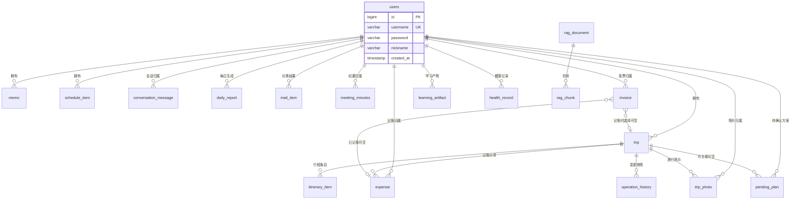

# 数据模型与表结构

本文面向**要改表结构、写查询或做数据迁移**的开发者，说明 AI 个人助理（`travel-agent-server`）的持久化设计：19 个 JPA 实体对应 19 张表，以及字段、索引、跨表约定与 Flyway 迁移策略。

> 约定：文中**表名、列名、索引名**逐字摘自 `entity/` 注解（`@Table` / `@Column` / `@Index` / `@UniqueConstraint`）或 `db/migration/` 脚本，可直接在源码中检索验证。唯一例外是仓库根目录的 `sql/init.sql`——独立 MySQL 初始化脚本，与实体有已知偏差，见第 8 节。

## 1. 数据模型总览

### 1.1 设计约定

| 约定 | 做法 | 涉及范围 |
| --- | --- | --- |
| 无 JPA 关联 | 全部实体只用 `Long xxxId` 扁平外键，没有 `@ManyToOne` / `@OneToMany` / `@JoinColumn` | 全部 19 张表 |
| 无数据库外键 | 引用完整性由 Service 层保证，DDL 里没有 `FOREIGN KEY` | 全部 |
| 无 CHECK 约束 | 状态/分类用实体常量 `public static final String`，库侧不校验 | `trip`、`expense`、`operation_history` 等 |
| 级联删除靠仓库方法 | `deleteByTripId` / `deleteByDocumentId` 在 `@Transactional` 内显式调用 | `trip` 系、RAG |
| 大文本一律 `TEXT` | `columnDefinition = "TEXT"` 显式声明，避免方言默认 255 | 多个表 |
| 时间戳应用侧兜底 | `@PrePersist` 在 `createdAt == null` 时填 `LocalDateTime.now()`，DDL 不加 DEFAULT | 多数表 |

后果：查询必须手写拆分（没有 N+1，也没有级联语义）；绕过 Service 层写数据会留下悬空外键（孤儿行）。

> 方言提示：`LocalDateTime` 在 H2 落为 `TIMESTAMP`、MySQL 落为 `DATETIME`；`boolean` 在 H2 是 `BOOLEAN`、MySQL 是 `TINYINT(1)`。下文表格统一写 `TIMESTAMP` / `BOOLEAN`。

### 1.2 ER 图



> 其余表的主字段见第 2–4 节字段表；`llm_quota_usage` 是唯一**不挂 `user_id`** 的表，按用户名文本 `user_name` 计数。

### 1.3 表清单与主键策略

| 表名（实体类） | 归属模块 | 主键 |
| --- | --- | --- |
| `users`（`User`） | 账号 | `id` |
| `trip`（`Trip`） | 旅行 | `id` |
| `itinerary_item`（`ItineraryItem`） | 旅行 | `id` |
| `expense`（`Expense`） | 记账 | `id` |
| `trip_photo`（`TripPhoto`） | 旅行 | `id` |
| `operation_history`（`OperationHistory`） | 撤销 | `id` |
| `pending_plan`（`PendingPlanRecord`） | Agent | `plan_id` |
| `memo`（`Memo`） | 备忘 | `id` |
| `schedule_item`（`ScheduleItem`） | 日程 | `id` |
| `conversation_message`（`ConversationMessage`） | 会话记忆 | `id` |
| `daily_report`（`DailyReport`） | 日报 | `id` |
| `mail_item`（`MailItem`） | 办公 | `id` |
| `meeting_minutes`（`MeetingMinutes`） | 办公 | `id` |
| `invoice`（`Invoice`） | 办公 | `id` |
| `learning_artifact`（`LearningArtifact`） | 学习 | `id` |
| `health_record`（`HealthRecord`） | 健康 | `id` |
| `rag_document`（`RagDocument`） | RAG | `id` |
| `rag_chunk`（`RagChunk`） | RAG | `id` |
| `llm_quota_usage`（`LlmQuotaUsage`） | 配额 | `id` |

18 张表用 `@GeneratedValue(strategy = GenerationType.IDENTITY)` 自增。唯一例外是 `pending_plan`：`@Id @Column(name = "plan_id", length = 64) private String planId`，由 `PlannerAgent` 生成后直接作主键，**没有 `id` 列**，仓库为 `JpaRepository<PendingPlanRecord, String>`。

## 2. 核心业务表

### 2.1 `users` — 用户（唯一约束 `username`）

账号体系与归属隔离的唯一真实源，所有业务表的 `user_id` 都指向本表 `id`。

| 字段 | DB 类型 | 可空 | 说明 |
| --- | --- | --- | --- |
| `id` | `BIGINT` | 否 | 主键，自增 |
| `username` | `VARCHAR(100)` | 否 | 登录名，唯一 |
| `password` | `VARCHAR(255)` | 否 | BCrypt 哈希，不存明文 |
| `nickname` | `VARCHAR(100)` | 是 | 展示名 |
| `created_at` | `TIMESTAMP` | 是 | 注册时间，`@PrePersist` 兜底 |

### 2.2 `trip` — 行程（索引 `idx_trip_user (user_id)`）

一次出行的主记录，是「行前规划 + 行中调整」的聚合根。

| 字段 | DB 类型 | 可空 | 说明 |
| --- | --- | --- | --- |
| `id` | `BIGINT` | 否 | 主键，自增 |
| `user_id` | `BIGINT` | 否 | 归属用户 |
| `name` | `VARCHAR(200)` | 是 | 行程名 |
| `destination` | `VARCHAR(200)` | 是 | 目的地 |
| `start_date` | `DATE` | 是 | 出发日 |
| `end_date` | `DATE` | 是 | 返程日 |
| `budget` | `DECIMAL(10,2)` | 是 | 预算；为空时预算分析不算 `remaining` |
| `status` | `VARCHAR(30)` | 是 | `PLANNING` / `CONFIRMED` / `CANCELLED`，`@PrePersist` 兜底 `PLANNING` |
| `departure_reminder_dismissed_at` | `TIMESTAMP` | 是 | 用户忽略出发提醒的时间；为空表示仍在提醒板 |
| `created_at` | `TIMESTAMP` | 是 | 创建时间 |

`status` 常量 `STATUS_PLANNING` / `STATUS_CONFIRMED` / `STATUS_CANCELLED`（取消保留记录，不计入足迹、不作为待出发行程）。`phase(today)` **不落库**：`CANCELLED` → 已取消；`startDate` 为空 → `UPCOMING`；`today > endDate` → `PAST`；`today < startDate` → `UPCOMING`；否则 `ONGOING`。`totalDays()` 含首尾（最小 1）。

### 2.3 `itinerary_item` — 行程条目（索引 `idx_itinerary_trip (trip_id)`）

某行程第 N 天的一条安排（酒店/景点/餐厅/交通）。

| 字段 | DB 类型 | 可空 | 说明 |
| --- | --- | --- | --- |
| `id` | `BIGINT` | 否 | 主键，自增 |
| `trip_id` | `BIGINT` | 否 | 所属行程 |
| `day_index` | `INT` | 否 | 第几天（从 1 开始） |
| `item_type` | `VARCHAR(30)` | 否 | `hotel` / `attraction` / `restaurant` / `transport` |
| `title` | `VARCHAR(200)` | 否 | 条目标题 |
| `start_time` | `TIMESTAMP` | 是 | 开始时间 |
| `end_time` | `TIMESTAMP` | 是 | 结束时间 |
| `latitude` | `DOUBLE` | 是 | 纬度 |
| `longitude` | `DOUBLE` | 是 | 经度 |
| `cost` | `DECIMAL(10,2)` | 是 | 计划成本，参与预算 `planned` 口径 |
| `tags` | `VARCHAR(200)` | 是 | 逗号分隔，如 `室内,文化,亲子` |
| `description` | `TEXT` | 是 | 详情 |

`tags` 口径（天气驱动调整依赖它）：`hasTag(t)` 用 `List.of(tags.split(","))` 判断且**不做 trim**，写入不能带空格；`isOutdoor()` 判 `室外`、`isIndoor()` 判 `室内`。

### 2.4 `expense` — 记账（`idx_expense_trip (trip_id)`、`idx_expense_user (user_id)`）

个人记账，与 `trip.budget`、`itinerary_item.cost` 组成三套预算口径。

| 字段 | DB 类型 | 可空 | 说明 |
| --- | --- | --- | --- |
| `id` | `BIGINT` | 否 | 主键，自增 |
| `trip_id` | `BIGINT` | 否 | 所属行程（必填，但无外键） |
| `user_id` | `BIGINT` | 否 | 归属用户 |
| `category` | `VARCHAR(30)` | 否 | 分类常量；空白或非法值改写成 `其他` |
| `amount` | `DECIMAL(10,2)` | 否 | 金额，业务校验 `> 0` |
| `note` | `VARCHAR(200)` | 是 | 备注（空白写成 `null`） |
| `spent_at` | `DATE` | 否 | 消费日期，为空时 `ExpenseService.add` 填当天 |
| `payment_method` | `VARCHAR(20)` | 是 | `微信支付` / `支付宝` / `现金` / `银行卡`，非法值改写成 `现金` |
| `created_at` | `TIMESTAMP` | 是 | 记录时间 |

`category` 常量：`CAT_FOOD = 餐饮`、`CAT_TRANSPORT = 交通`、`CAT_HOTEL = 住宿`、`CAT_TICKET = 门票`、`CAT_SHOPPING = 购物`、`CAT_OTHER = 其他`。`payment_method` 列可空，读取侧把 `null` 当 `现金` 聚合，历史脏数据不会丢账。

### 2.5 `trip_photo` — 行程照片元数据（`idx_trip_photo_trip (trip_id)`、`idx_trip_photo_user (user_id)`）

文件落在磁盘（`travel.photos.dir`），**库内只存元数据，不存二进制**。

| 字段 | DB 类型 | 可空 | 说明 |
| --- | --- | --- | --- |
| `id` | `BIGINT` | 否 | 主键，自增 |
| `trip_id` | `BIGINT` | 否 | 所属行程 |
| `user_id` | `BIGINT` | 否 | 归属用户 |
| `stored_name` | `VARCHAR(120)` | 否 | 磁盘文件名（UUID + 扩展名），不暴露原始名 |
| `original_name` | `VARCHAR(200)` | 是 | 上传时的原始文件名 |
| `content_type` | `VARCHAR(80)` | 是 | MIME 类型 |
| `size_bytes` | `BIGINT` | 是 | 字节数，配额统计用它求和 |
| `created_at` | `TIMESTAMP` | 是 | 上传时间 |

配额：单行程张数 `travel.photos.max-per-trip`（默认 200）；单用户总容量 `travel.photos.max-bytes-per-user`（默认 524288000，即 500MB），由 JPQL 求和实现：

```sql
select coalesce(sum(p.sizeBytes), 0) from TripPhoto p where p.userId = :userId
```

### 2.6 `operation_history` — 操作历史（索引 `idx_history_trip_status (trip_id, status)`）

任何会改变行程的入口都写一条 before/after 快照，`undoLatest` 据此回滚；复合索引服务「取该行程最新的 ACTIVE 记录」。

| 字段 | DB 类型 | 可空 | 说明 |
| --- | --- | --- | --- |
| `id` | `BIGINT` | 否 | 主键，自增；同时充当撤销顺序 |
| `trip_id` | `BIGINT` | 否 | 所属行程 |
| `user_id` | `BIGINT` | 是 | 操作发起人 |
| `operation_type` | `VARCHAR(50)` | 是 | `AGENT_COMMIT` / `TRIP_CREATE` / `MANUAL_EDIT` |
| `before_state` | `TEXT` | 是 | 变更前快照（行程条目 DTO 列表的 JSON 数组） |
| `after_state` | `TEXT` | 是 | 变更后快照 |
| `agent_reason` | `TEXT` | 是 | 变更原因 |
| `status` | `VARCHAR(20)` | 是 | `ACTIVE` / `UNDONE`，`@PrePersist` 兜底 `ACTIVE` |
| `created_at` | `TIMESTAMP` | 是 | 记录时间 |

撤销效果：`AGENT_COMMIT` 用 `before_state` 整体替换行程项；`TRIP_CREATE` **删除整个行程**；`MANUAL_EDIT` 还原到本次手工操作前。`TRIP_CREATE` 的 `before_state` 是 `List.of()` 序列化出的 `[]`，所以撤销必须走删除行程分支。

### 2.7 `pending_plan` — 待确认的 Agent 方案（`idx_pending_plan_user (user_id)`、`idx_pending_plan_created (created_at)`）

把「等待用户点确认」的方案落库：原先放进程内 `Map`，多实例下确认请求可能落到没有该方案的实例，落库后重启也不丢。

| 字段 | DB 类型 | 可空 | 说明 |
| --- | --- | --- | --- |
| `plan_id` | `VARCHAR(64)` | 否 | **主键**，由 `PlannerAgent` 生成 |
| `user_id` | `BIGINT` | 否 | 归属用户，取出时校验 |
| `trip_id` | `BIGINT` | 是 | 关联行程；新建行程型方案为空 |
| `plan_json` | `TEXT` | 否 | `AgentPlan` 的 JSON |
| `preview_json` | `TEXT` | 否 | 预览结果的 JSON |
| `plan_revision` | `VARCHAR(64)` | 是 | 生成方案时的行程指纹，见 5.4 |
| `created_at` | `TIMESTAMP` | 否 | 生成时间，调用方显式赋值，TTL 判定基准 |

生命周期：`PendingPlanStore.TTL_MINUTES = 30`。`peek` 发现过期就删并返回 `null`；`put` 后顺带 `purgeExpired()`（`deleteByCreatedAtBefore(now - 30min)`）；`take` 取成功即删除。

## 3. 个人助理模块表

### 3.1 `memo` — 备忘 / 待办（索引 `idx_memo_user (user_id)`）

查询 `findByUserIdOrderByDoneAscCreatedAtDesc`：未完成在前，其余按创建时间倒序。

| 字段 | DB 类型 | 可空 | 说明 |
| --- | --- | --- | --- |
| `id` | `BIGINT` | 否 | 主键，自增 |
| `user_id` | `BIGINT` | 否 | 归属用户 |
| `content` | `TEXT` | 否 | 备忘正文 |
| `done` | `BOOLEAN` | 否 | 是否完成（JPA 原生 `boolean`） |
| `created_at` | `TIMESTAMP` | 是 | 创建时间 |

### 3.2 `schedule_item` — 日程条目（索引 `idx_schedule_user (user_id)`）

| 字段 | DB 类型 | 可空 | 说明 |
| --- | --- | --- | --- |
| `id` | `BIGINT` | 否 | 主键，自增 |
| `user_id` | `BIGINT` | 否 | 归属用户 |
| `title` | `VARCHAR(200)` | 否 | 标题 |
| `sched_date` | `DATE` | 否 | Java 属性 `date`，首次发生日期 |
| `sched_time` | `TIME` | 是 | Java 属性 `time` |
| `note` | `VARCHAR(300)` | 是 | 备注 |
| `done` | `BOOLEAN` | 否 | 是否完成 |
| `recurrence` | `VARCHAR(10)` | 是 | `NONE` / `DAILY` / `WEEKLY` / `MONTHLY` |
| `repeat_until` | `DATE` | 是 | 重复结束日（含）；为空表示长期重复 |
| `reminder_dismissed_at` | `TIMESTAMP` | 是 | 用户忽略该日程提醒的时间 |
| `created_at` | `TIMESTAMP` | 是 | 创建时间 |

`nextOccurrence` 带 `@Transient`，**不落库**——下次发生日期按当前时间实时计算，提醒板由前端轮询拉取。

### 3.3 `conversation_message` — 会话记忆（`idx_conv_user_session (user_id, conversation_id)`、`idx_conv_created_at (created_at)`）

只存「谁在哪个会话里说了什么」，供后续轮次意图识别做指代消解。由 `V2__conversation_message.sql` 建表。

| 字段 | DB 类型 | 可空 | 说明 |
| --- | --- | --- | --- |
| `id` | `BIGINT` | 否 | 主键，自增 |
| `user_id` | `BIGINT` | 否 | 归属用户 |
| `conversation_id` | `VARCHAR(64)` | 否 | 前端生成并随请求携带 |
| `role` | `VARCHAR(16)` | 否 | `user` / `assistant` |
| `content` | `TEXT` | 否 | 内容，入库前截断到 `MAX_CONTENT_LENGTH = 1000` |
| `intent` | `VARCHAR(32)` | 是 | 该轮识别出的意图（仅用户消息） |
| `created_at` | `TIMESTAMP` | 是 | 消息时间 |

生命周期：取历史 `findTop20ByUserIdAndConversationIdOrderByCreatedAtDesc`，反转后只喂 `HISTORY_LIMIT = 10` 条；`RETENTION_DAYS = 7` 天前的消息由 `deleteByCreatedAtBefore` 清理，节流为每 `PURGE_INTERVAL_MS`（1 小时）最多一次；`conversationId` 为空（单轮模式）不落库。

### 3.4 `daily_report` — 每日日报（索引 `idx_daily_report_user (user_id)`）

| 字段 | DB 类型 | 可空 | 说明 |
| --- | --- | --- | --- |
| `id` | `BIGINT` | 否 | 主键，自增 |
| `user_id` | `BIGINT` | 否 | 归属用户 |
| `report_date` | `DATE` | 否 | Java 属性 `date`，对应日期 |
| `content` | `TEXT` | 否 | 日报正文 |
| `created_at` | `TIMESTAMP` | 是 | 生成时间 |

同一用户同一天**逻辑上只应有一条**（`findByUserIdAndDate` 定位），但库里没有唯一约束，是应用层约定。

### 3.5 `mail_item` — 邮件分类结果（索引 `idx_mail_user (user_id)`）

| 字段 | DB 类型 | 可空 | 说明 |
| --- | --- | --- | --- |
| `id` | `BIGINT` | 否 | 主键，自增 |
| `user_id` | `BIGINT` | 否 | 归属用户 |
| `sender` | `VARCHAR(200)` | 是 | 发件人 |
| `subject` | `VARCHAR(300)` | 是 | 主题 |
| `body` | `TEXT` | 是 | 正文 |
| `category` | `VARCHAR(20)` | 是 | `重要` / `会议` / `账单` / `通知` / `垃圾` / `其他` |
| `summary` | `TEXT` | 是 | LLM 摘要 |
| `suggested_reply` | `TEXT` | 是 | LLM 建议回复 |
| `created_at` | `TIMESTAMP` | 是 | 创建时间 |

### 3.6 `meeting_minutes` — 会议纪要（索引 `idx_minutes_user (user_id)`）

| 字段 | DB 类型 | 可空 | 说明 |
| --- | --- | --- | --- |
| `id` | `BIGINT` | 否 | 主键，自增 |
| `user_id` | `BIGINT` | 否 | 归属用户 |
| `title` | `VARCHAR(200)` | 否 | 标题 |
| `raw_text` | `TEXT` | 是 | 原始记录 |
| `content` | `TEXT` | 是 | 结构化纪要 |
| `created_at` | `TIMESTAMP` | 是 | 创建时间 |

### 3.7 `invoice` — 发票整理（索引 `idx_invoice_user (user_id)`）

本表是模型中唯一两处「跨模块软外键」的载体：`expense_id` → `expense.id`、`trip_id` → `trip.id`，均可空且无数据库约束。

| 字段 | DB 类型 | 可空 | 说明 |
| --- | --- | --- | --- |
| `id` | `BIGINT` | 否 | 主键，自增 |
| `user_id` | `BIGINT` | 否 | 归属用户 |
| `title` | `VARCHAR(200)` | 是 | 发票抬头 |
| `vendor` | `VARCHAR(200)` | 是 | 销售方/开票方 |
| `category` | `VARCHAR(20)` | 是 | `交通` / `餐饮` / `办公` / `住宿` / `其他` |
| `amount` | `DECIMAL(10,2)` | 是 | 金额 |
| `invoice_date` | `DATE` | 是 | 开票日期 |
| `raw_text` | `TEXT` | 是 | 粘贴或 OCR 出的原始文本 |
| `source_file` | `VARCHAR(120)` | 是 | 原始文件名（存于 `travel.invoices.dir`）；为空表示手工粘贴 |
| `source_type` | `VARCHAR(20)` | 是 | `PDF` / `IMAGE` / `TEXT` |
| `expense_id` | `BIGINT` | 是 | 已生成的记账记录；**非空表示已记账，防重复入账** |
| `trip_id` | `BIGINT` | 是 | 记账时选择的行程 |
| `created_at` | `TIMESTAMP` | 是 | 创建时间 |

### 3.8 `learning_artifact` — 学习产物（索引 `idx_artifact_user_kind (user_id, kind)`）

| 字段 | DB 类型 | 可空 | 说明 |
| --- | --- | --- | --- |
| `id` | `BIGINT` | 否 | 主键，自增 |
| `user_id` | `BIGINT` | 否 | 归属用户 |
| `kind` | `VARCHAR(20)` | 否 | `FRAMEWORK` / `PATH` / `SUMMARY` |
| `topic` | `VARCHAR(200)` | 否 | 主题 |
| `content` | `TEXT` | 否 | 正文 |
| `created_at` | `TIMESTAMP` | 是 | 创建时间 |

### 3.9 `health_record` — 健康日报（索引 `idx_health_user_date (user_id, record_date)`）

| 字段 | DB 类型 | 可空 | 说明 |
| --- | --- | --- | --- |
| `id` | `BIGINT` | 否 | 主键，自增 |
| `user_id` | `BIGINT` | 否 | 归属用户 |
| `record_date` | `DATE` | 否 | Java 属性 `date`，记录日期 |
| `steps` | `INT` | 是 | 步数 |
| `sleep_hours` | `DOUBLE` | 是 | 睡眠小时数 |
| `resting_heart_rate` | `INT` | 是 | 静息心率 |
| `weight` | `DOUBLE` | 是 | 体重（`sql/init.sql` 写的是 `DECIMAL(5,1)`，见第 8 节） |
| `created_at` | `TIMESTAMP` | 是 | 创建时间 |

## 4. RAG 与运行时状态表

### 4.1 `rag_document` — 知识库文档

`rag/knowledge.json` 的一篇文档在库内的投影，由 `V4__rag_fingerprint.sql` 建表（含 `fingerprint` 列）。实体**没有声明 `@Index`**，`findByCity` 走全表扫描（知识库体量小）。

| 字段 | DB 类型 | 可空 | 说明 |
| --- | --- | --- | --- |
| `id` | `BIGINT` | 否 | 主键，自增 |
| `title` | `VARCHAR(200)` | 是 | 标题 |
| `city` | `VARCHAR(100)` | 是 | 城市 |
| `category` | `VARCHAR(50)` | 是 | 分类，如 `attraction` |
| `content` | `TEXT` | 是 | 全文 |
| `source` | `VARCHAR(200)` | 是 | 来源，新建时默认 `内置知识库` |
| `fingerprint` | `VARCHAR(64)` | 是 | `sha256(title \n city \n content)` 的 64 位 hex，增量同步依据 |
| `updated_at` | `TIMESTAMP` | 是 | 更新时间；`@PrePersist` 兜底，指纹变更时显式覆盖 |

`(title, city)` 是同步时的**逻辑唯一键**（`RagBootstrap` 用 `title + "|" + city` 建索引），数据库层面没有唯一约束。

### 4.2 `rag_chunk` — 知识块 + 向量（索引 `idx_rag_chunk_document (document_id)`）

| 字段 | DB 类型 | 可空 | 说明 |
| --- | --- | --- | --- |
| `id` | `BIGINT` | 否 | 主键，自增 |
| `document_id` | `BIGINT` | 否 | 所属文档 |
| `content` | `TEXT` | 是 | 段落原文（按 `\n\n` 切分，空白段跳过） |
| `embedding` | `TEXT` | 是 | 向量以 JSON 数组字符串存储，如 `[0.12,0.33,...]` |
| `dim` | `INT` | 是 | 向量维度，取自 `embeddingService.dimension()` |

相似度不在数据库侧算：检索把 `embedding` 读回内存反序列化后算余弦相似度（注释明示生产可换 Pgvector）。

### 4.3 `llm_quota_usage` — LLM 每日配额计数（`idx_llm_quota_date (usage_date)`、UNIQUE `uk_llm_quota_user_date (user_name, usage_date)`）

按「用户名 + 日期」计数，多实例共享、重启不丢，由 `V3__llm_quota.sql` 建表。**原子自增依赖该唯一约束**。

| 字段 | DB 类型 | 可空 | 说明 |
| --- | --- | --- | --- |
| `id` | `BIGINT` | 否 | 主键，自增 |
| `user_name` | `VARCHAR(64)` | 否 | 用户名（不是 `user_id`） |
| `usage_date` | `DATE` | 否 | 计数日期 |
| `used_count` | `INT` | 否 | 当日已用次数，脚本默认 0 |

```sql
-- LlmQuotaUsageRepository.increment（nativeQuery，H2 MODE=MySQL 与 MySQL 通用）
INSERT INTO llm_quota_usage (user_name, usage_date, used_count)
VALUES (:userName, :usageDate, 1)
ON DUPLICATE KEY UPDATE used_count = used_count + 1
```

放行语义（`LlmQuotaService.tryAcquire`）：`quota-daily-limit <= 0`（默认 0）不限额且不写库；无用户上下文不限额；已用 `used >= limit` 则拒绝且不计数；否则原子自增。

## 5. 跨表一致性约束

以下约束**全部由代码保证，数据库层面没有外键或 CHECK**，绕过 Service 层改数据会破坏它们。

### 5.1 删除行程的级联清理

`TripService.delete(tripId, userId)` 在一个 `@Transactional` 里按序执行：

```java
// 1. 先删磁盘文件（元数据删了文件就找不回来了）
tripPhotoRepository.findByTripIdOrderByCreatedAtDesc(trip.getId())
        .forEach(photo -> photoStorage.deleteQuietly(photo.getStoredName()));
// 2. 再删四张子表
tripPhotoRepository.deleteByTripId(trip.getId());
expenseRepository.deleteByTripId(trip.getId());
operationHistoryRepository.deleteByTripId(trip.getId());
itineraryItemRepository.deleteByTripId(trip.getId());
// 3. 最后删主表
tripRepository.delete(trip);
```

顺序不能反：子表与照片元数据先于行程删除，反过来会留下悬空 `trip_id`；磁盘文件必须用删除前的查询结果拿 `stored_name`。`pending_plan` 不在此列（按 TTL 过期），`invoice` 也不在此列（`trip_id` 可空，已记账的 `expense_id` 会指向被删账单）。`deleteByTripId` 均为单条 DELETE，但**不做归属校验**：调用方必须先 `getOwned(tripId, userId)`。

### 5.2 记账分项之和 == `totalSpent`

`ExpenseService.overview(userId)` 要求「按行程分组的分项加起来等于 `totalSpent`」，为此把已删除行程的账单并入 `trip_id = 0` 的分组：

```java
private static final Long ORPHAN_TRIP_ID = 0L;
private static final String ORPHAN_TRIP_NAME = "已删除的行程";
Long tripKey = e.getTripId() != null && tripMap.containsKey(e.getTripId())
        ? e.getTripId() : ORPHAN_TRIP_ID;   // 行程已删除也要计入，否则分项之和对不上
byTrip.merge(tripKey, amount, BigDecimal::add);
```

恒等式：`sum(byTrip[*]) == totalSpent == sum(expense.amount where user_id = ?)`。同理 `byPaymentMethod` 把 `null` 归到 `现金`。

### 5.3 before/after 快照与撤销链

写入统一走 `OperationHistoryService.save(...)`：条目列表转 DTO 后序列化成 JSON 存入 `before_state` / `after_state`。快照序列化失败会抛 `IllegalStateException` 回滚业务变更（不吞异常）；手工改动经 `withHistory(...)` 在同一事务内取 before → 变更 → 取 after 并写 `MANUAL_EDIT`；撤销用 `findFirstByTripIdAndStatusOrderByIdDesc(tripId, "ACTIVE")` 定位，还原前校验 `userId` 归属，还原后置 `UNDONE`。

### 5.4 行程指纹 `planRevision`

`ItineraryService.planRevision(trip, items)` 把行程可变状态拍成 SHA-256：

```
b=<budget>|s=<startDate>|e=<endDate>
|id:day_index:title:start_time:end_time:cost:item_type   （按 id 升序，每条行程项一段）
```

生成方案时写入 `pending_plan.plan_revision`；确认时 `AgentEngine` 用当前数据重算比对，不一致就拒绝提交，防止按过期 Diff 覆盖新数据。`plan_revision` 可空（老方案跳过校验），`VARCHAR(64)` 刚好容纳 SHA-256 hex，不要改短。

### 5.5 RAG 指纹增量同步

`RagBootstrap.run`（`@Transactional`，`ApplicationRunner`）把 `rag/knowledge.json`（当前 10 篇，字段 `title/city/category/source/content`）同步进库，按 `title|city` 找存量文档，用指纹决定动作：

| 情形 | 动作 | 副作用 |
| --- | --- | --- |
| 新标题 | 新建 `rag_document` + 切块写 `rag_chunk` | `created++` |
| 指纹相同 | 跳过 | `skipped++` |
| 指纹不同（改了内容，或存量库无指纹） | 更新文档 + `deleteByDocumentId` 后重建该篇全部 chunk | `updated++`，`updated_at` 显式刷新 |
| 已从 JSON 移除 | **保留不删**（可能含手工添加的知识），仅打日志 | 无 |

指纹算法：SHA-256(`title + "\n" + city + "\n" + content`) 取 64 位小写 hex。指纹**只覆盖文本、不覆盖向量空间**：切换 Embedding 模型后指纹不变、同步全部跳过，新旧向量混在一个空间里不可比，必须手工清空 `rag_document` + `rag_chunk` 重建（见 7.3）。

## 6. Flyway 迁移策略与 `ddl-auto`

### 6.1 现状：没有 V1，基线由 `baseline-on-migrate` 建立

`travel-agent-server/src/main/resources/db/migration/` 下只有三个脚本，**不存在 `V1__*.sql`**：

| 脚本 | 内容 | 策略 |
| --- | --- | --- |
| `V2__conversation_message.sql` | `CREATE TABLE IF NOT EXISTS conversation_message` | 自建表，索引交给 `ddl-auto` |
| `V3__llm_quota.sql` | `CREATE TABLE IF NOT EXISTS llm_quota_usage` | 自建表，索引与唯一约束交给 `ddl-auto` |
| `V4__rag_fingerprint.sql` | `CREATE TABLE IF NOT EXISTS rag_document`（含 `fingerprint`） | 新库直接建全表；老库 `IF NOT EXISTS` 跳过，列由 `ddl-auto` 补 |

对应配置（`application.yml`）：

```yaml
spring:
  jpa:
    hibernate:
      ddl-auto: update
  flyway:
    enabled: true
    baseline-on-migrate: true
    baseline-version: 1
    locations: classpath:db/migration
```

**基线是怎么建立的（如实说明）**：

1. 最初的表结构**从来没被写进 V1 脚本**——它是 Hibernate `ddl-auto: update` 按实体注解直接建出来的。
2. `baseline-version: 1` + `baseline-on-migrate: true` 让 Flyway 面对一个**非空、但没有 `flyway_schema_history`** 的库时不报错，而是在版本 1 打基线标记，之后从 `V2` 往后执行。
3. 因此 `V1` 语义上是「由 JPA 实体定义的隐式基线」，不是一个文件。**这正是本文逐字校对实体注解的原因：实体注解才是事实上的 schema 定义。**
4. 全新库启动顺序：Flyway 先跑（此时表还不存在，`V2`/`V3`/`V4` 的 `CREATE TABLE IF NOT EXISTS` 真正建表）→ Hibernate 再用 `ddl-auto: update` 按实体补齐缺失列与索引。脚本**故意不写 `CREATE INDEX`**：MySQL 不支持 `CREATE INDEX IF NOT EXISTS`，而实体 `@Index` 会让 `ddl-auto` 把索引补齐，两种方言都能安全通过。

### 6.2 H2 与 `mysql` profile 的差异

**`ddl-auto` 两边都是 `update`，没有差异**；差异只在数据源、H2 控制台与方言细节：

| 配置项 | 默认（H2） | `mysql` profile |
| --- | --- | --- |
| 数据源 URL | `jdbc:h2:file:./data/travel-agent;MODE=MySQL;AUTO_SERVER=TRUE` | `jdbc:mysql://${MYSQL_HOST:localhost}:${MYSQL_PORT:3306}/${MYSQL_DATABASE:travel_agent}?...` |
| driver / 账号 | `org.h2.Driver`，`sa` / 空密码 | `com.mysql.cj.jdbc.Driver`，`${MYSQL_USERNAME:root}` / `${MYSQL_PASSWORD:root}` |
| `spring.jpa.hibernate.ddl-auto` | `update` | `update`（`application-mysql.yml` 重复声明同一值） |
| `spring.h2.console.enabled` | `true`（`/h2-console`） | `false` |
| Flyway | 继承 `baseline-on-migrate: true` | 同左（未覆盖） |

因为 `MODE=MySQL`，H2 接受 `AUTO_INCREMENT`、`ON DUPLICATE KEY UPDATE`，所以 `V2`/`V3` 脚本与 `increment` 的 native SQL 在两个 profile 下都能跑。**改脚本时不要引入只有 MySQL 认识的语法。**

### 6.3 `ddl-auto: update` 的边界与新增字段做法

| 会做 | 不会做 |
| --- | --- |
| 新建缺失的表 | 删除 / 重命名列 |
| 新建缺失的列 | 修改已有列的类型 |
| 新建缺失的索引 | 迁移或回填已有数据 |
| — | 建外键约束（实体没有关联，本来也不会） |

因此「改列类型」「重命名列」必须写 `V*__` 脚本。新增可空列：实体加字段 → 新增脚本 → 更新本文表节。

```sql
-- H2 与 MySQL 8 支持 ADD COLUMN IF NOT EXISTS
ALTER TABLE trip ADD COLUMN IF NOT EXISTS remark VARCHAR(200);
```

新增新表照 `V2`/`V3`/`V4` 的范式：只写 `CREATE TABLE IF NOT EXISTS`、**不写 `CREATE INDEX`**，索引交给实体 `@Index`。新增 `NOT NULL` 列要拆两步——先加可空列并回填明确业务默认值，再收紧。通用红线：脚本一旦被某个环境的 `flyway_schema_history` 记录过就**不能再改内容**（checksum 校验会拒绝启动），只能新增版本；已发布脚本不要重命名；文件名匹配 `V<版本>__<描述>.sql`（两个下划线）、版本号单调递增；本地 H2 文件库在 `travel-agent-server/data/` 下，重置它比写回滚脚本更快（见 7.2）。

## 7. 引导数据与常用 SQL

### 7.1 三个引导数据来源

| 引导数据 | 载体 | 写入时机 / 类 | 是否落库 |
| --- | --- | --- | --- |
| 演示账号 `demo / demo123` | `DataInitializer` | `ApplicationRunner`：`travel.demo-account.enabled=true`（默认）且 `existsByUsername("demo")` 为假时创建，密码经 `PasswordEncoder` 加密，昵称 `演示用户` | 是（`users`） |
| RAG 知识库 | `rag/knowledge.json`（10 篇） | `RagBootstrap.run`：启动时按指纹增量同步、切块、Embedding | 是（`rag_document` + `rag_chunk`） |
| 旅行目录 | `data/travel-catalog.json`（4 个城市：上海/北京/杭州/石家庄） | `TravelCatalogService.load`（`@PostConstruct`）读进内存 `CopyOnWriteArrayList<CityCatalog>` | **否**（纯内存） |

刷新方式不同：旅行目录改完重启即可；知识库改完由指纹自动增量；演示账号只在库空时创建一次。`TravelCatalogService.register(...)` 运行时注册的联网城市**重启即丢**。生产部署务必设 `DEMO_ACCOUNT=false`。

### 7.2 重置本地 H2 数据库

```powershell
# 1) 先停掉后端进程（AUTO_SERVER=TRUE 时仍有进程持有文件，删不掉）
# 2) 备份再删除：data/ 目录下是 travel-agent.mv.db
Remove-Item -Recurse -Force travel-agent-server/data -ErrorAction SilentlyContinue
# 3) 重启后端：Flyway 打 baseline + 执行 V2/V3/V4，
#    Hibernate ddl-auto=update 补齐其余 16 张表，DataInitializer 重建 demo 账号
```

启动后可在 `/h2-console`（`spring.h2.console.enabled=true`）连 `jdbc:h2:file:./data/travel-agent` 核对：

```sql
SELECT COUNT(*) FROM information_schema.tables WHERE table_schema = 'PUBLIC';
```

只想清数据、保留结构时（无外键，顺序无关，建议子表在前）：

```sql
DELETE FROM rag_chunk;         DELETE FROM rag_document;
DELETE FROM operation_history; DELETE FROM expense;
DELETE FROM trip_photo;        DELETE FROM itinerary_item;
DELETE FROM pending_plan;      DELETE FROM conversation_message;
DELETE FROM llm_quota_usage;   DELETE FROM trip;
```

注意 `DELETE FROM trip;` 只删主表会留下孤儿账单——它们会继续出现在「已删除的行程」分组里（见 5.2），不会消失。

### 7.3 清空重建 RAG 知识库

**必须两张表都清**，只清一张会留下悬空 chunk 或空文档：

```sql
DELETE FROM rag_chunk;
DELETE FROM rag_document;
```

重启后 `RagBootstrap` 会全量重建，启动日志给出「新增 N 篇 / 更新 N 篇 / 跳过 N 篇 / 写入 M 个知识块」。必须重建的场景：切换 Embedding 模型（`travel.embedding.model`）、切换 `travel.embedding.enabled`（真实 API ↔ 本地 bigram 哈希）、手工改过 `content` 却没更新 `fingerprint`、以及想让已从 JSON 移除的文档彻底消失（同步逻辑故意保留，只能手工删）。

### 7.4 账单汇总查询

```sql
-- 某用户总支出与笔数
SELECT COUNT(*) AS cnt, COALESCE(SUM(amount), 0) AS total_spent
FROM expense WHERE user_id = 1;

-- 按行程分组，对齐 overview 的 byTrip（含孤儿账单兜底）
SELECT COALESCE(t.id, 0) AS trip_id,
       COALESCE(t.name, '已删除的行程') AS trip_name,
       COALESCE(SUM(e.amount), 0) AS total
FROM expense e
LEFT JOIN trip t ON t.id = e.trip_id AND t.user_id = e.user_id
WHERE e.user_id = 1
GROUP BY COALESCE(t.id, 0), COALESCE(t.name, '已删除的行程')
ORDER BY total DESC;
```

## 8. 源码与脚本的已知不一致

`sql/init.sql` 是面向 MySQL 的独立初始化脚本（文件头明示「默认 H2 模式由 JPA ddl-auto 自动建表，无需执行本文件」），它**没有跟随实体演进**。核对结果如下，**一律以实体注解为准**：

| 表 / 对象 | `sql/init.sql` | 实体注解（以此为准） |
| --- | --- | --- |
| `trip.departure_reminder_dismissed_at` | 缺失 | 存在，`TIMESTAMP` 可空 |
| `schedule_item.recurrence` / `repeat_until` / `reminder_dismissed_at` | 全部缺失 | 三列存在 |
| `schedule_item` 索引 | `idx_schedule_user (user_id, sched_date)` | `idx_schedule_user (user_id)` |
| `operation_history` 索引 | `idx_history_trip (trip_id)` | `idx_history_trip_status (trip_id, status)` |
| `operation_history.before_state` / `after_state` | `JSON` | `TEXT` |
| `itinerary_item` 索引 | `idx_item_trip` | `idx_itinerary_trip` |
| `expense.payment_method` | `DEFAULT '现金'` | 无 DDL 默认值，由 `ExpenseService.add` 应用层兜底 |
| `daily_report` 索引 | `idx_report_user (user_id, report_date)` | `idx_daily_report_user (user_id)` |
| `health_record` 索引 | `idx_health_user (user_id, record_date)` | `idx_health_user_date (user_id, record_date)`（列同、名不同） |
| `health_record.weight` | `DECIMAL(5, 1)` | `Double` → `DOUBLE` |
| `learning_artifact` 索引 | `idx_learning_user (user_id, kind)` | `idx_artifact_user_kind (user_id, kind)` |
| `rag_chunk` 索引 | `idx_chunk_doc` | `idx_rag_chunk_document` |
| `rag_document.fingerprint` | 缺失 | 存在，`VARCHAR(64)` |
| `invoice.source_file` / `source_type` / `expense_id` / `trip_id` | 缺失 | 存在 |
| `conversation_message` / `llm_quota_usage` / `pending_plan` / `trip_photo` | 整表缺失 | 存在，由 `ddl-auto: update` 自动补齐 |
| 状态/分类枚举 | 无 CHECK | 无 CHECK（一致：都是应用层校验） |

结论：MySQL 全新部署**不要用 `sql/init.sql` 建业务表**，直接让 Flyway + `ddl-auto` 跑起来即可；该脚本只适合建空库（`CREATE DATABASE ... utf8mb4`）或当 schema 骨架参考。

第二处不一致在注释而非代码：`LlmQuotaService` 类注释写的键是 `travel.llm.quota.daily-limit`，而 `application.yml` 的实际键是 `travel.llm.quota-daily-limit`（对应 `LlmProperties.quotaDailyLimit`，环境变量 `LLM_DAILY_QUOTA`）。**以 `application.yml` 为准**。

## 9. 统计与验收

| 统计项 | 数量 | 核对方式 |
| --- | --- | --- |
| `entity/` 下实体文件 | **19** | `glob entity/*.java` |
| 本文收录的 `@Entity` 表 | **19** | 与实体文件一一对应 |
| `repository/` 下 Repository 接口 | **19** | 与实体一一对应 |
| 显式 `@Index` 声明 | **21** 条，分布在 17 个实体上 | 源码 `@Index(` 计数（各表索引已在 2–4 节标题中逐条列出） |
| `@UniqueConstraint` | **2** 条 | `users.username`（未命名）、`uk_llm_quota_user_date` |
| Flyway 脚本 | **3** 个（V2/V3/V4） | 无 V1，基线见 6.1 |

**验收结论**：实体文件 19 个 ↔ 本文表格 19 张，一一对应，无多余、无遗漏；每个表名、列名、索引名都能在 `entity/` 或 `db/migration/` 中检索命中。

改结构时的检查清单：

1. 改实体注解 → 同步新增 `V*__` 脚本 → 更新本文对应表节；
2. 已发布的迁移脚本不改内容（checksum 校验会拒绝启动）；
3. 新增列优先可空；`NOT NULL` 拆成「加可空列 + 回填 + 收紧」；
4. 脚本里不写 `CREATE INDEX`，交给实体 `@Index` 与 `ddl-auto`；
5. 不引入 H2 `MODE=MySQL` 不支持的语法，否则默认 profile 起不来。
