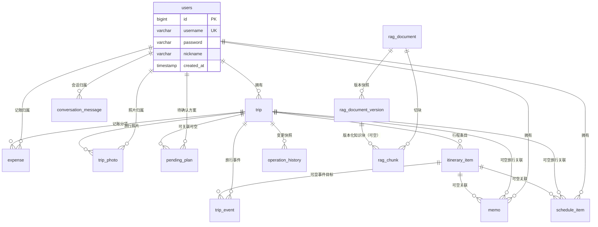

# 数据模型与表结构

> 状态：当前事实 | 适用版本：0.1.0（Spring Boot 3.5.12 / Node 20） | 最后验证：2026-11-19 | 事实来源：travel-agent-server/src/main/java/com/travel/agent/entity/、travel-agent-server/src/main/resources/db/migration/、sql/init.sql

本文面向**要改表结构、写查询或做数据迁移**的开发者，说明 AI 智能旅行助手（`travel-agent-server`）的持久化设计：**19 个 JPA 实体对应 19 张映射表**，另有 **6 张已代码下线的旧模块表**（数据保留、不再映射），库内共 **25 张表**，以及字段、索引、跨表约定与 Flyway 迁移策略。

> 约定：文中**表名、列名、索引名**逐字摘自 `entity/` 注解（`@Table` / `@Column` / `@Index` / `@UniqueConstraint`）或 `db/migration/` 脚本，可直接在源码中检索验证。唯一例外是仓库根目录的 `sql/init.sql`——独立 MySQL 初始化脚本，与实体有已知偏差，见第 8 节。

## 1. 数据模型总览

### 1.1 设计约定

| 约定 | 做法 | 涉及范围 |
| --- | --- | --- |
| 无 JPA 关联 | 全部实体只用 `Long xxxId` 扁平外键，没有 `@ManyToOne` / `@OneToMany` / `@JoinColumn` | 全部 19 张映射表（旧表不再有实体） |
| 无数据库外键 | 引用完整性由 Service 层保证，DDL 里没有 `FOREIGN KEY` | 全部 |
| 无 CHECK 约束 | 状态/分类用实体常量 `public static final String`，库侧不校验 | `trip`、`expense`、`operation_history` 等 |
| 级联删除靠仓库方法 | `deleteByTripId` / `deleteByDocumentId` 在 `@Transactional` 内显式调用 | `trip` 系、RAG |
| 大文本一律 `TEXT` | `columnDefinition = "TEXT"` 显式声明，避免方言默认 255 | 多个表 |
| 时间戳应用侧兜底 | `@PrePersist` 在 `createdAt == null` 时填 `LocalDateTime.now()`，DDL 不加 DEFAULT | 多数表 |

后果：查询必须手写拆分（没有 N+1，也没有级联语义）；绕过 Service 层写数据会留下悬空外键（孤儿行）。

> 方言提示：`LocalDateTime` 在 H2 落为 `TIMESTAMP`、MySQL 落为 `DATETIME`；`boolean` 在 H2 是 `BOOLEAN`、MySQL 是 `TINYINT(1)`。下文表格统一写 `TIMESTAMP` / `BOOLEAN`。

### 1.2 ER 图



> 旧模块表 `daily_report` / `mail_item` / `meeting_minutes` / `invoice` / `learning_artifact` / `health_record`
> **不在上图**：实体与 Service 已删除，表与历史数据保留，等待后续 forward-only 迁移按环境决定是否退役。

> 其余表的主字段见第 2–4 节字段表；`llm_quota_usage` 是唯一**不挂 `user_id`** 的表，按用户名文本 `user_name` 计数。

### 1.3 表清单与主键策略

| 表名（实体类） | 归属模块 | 主键 |
| --- | --- | --- |
| `users`（`User`） | 账号 | `id` |
| `trip`（`Trip`） | 旅行 | `id` |
| `itinerary_item`（`ItineraryItem`） | 旅行 | `id` |
| `trip_event`（`TripEvent`） | 旅行事件 | `id` |
| `expense`（`Expense`） | 记账 | `id` |
| `trip_photo`（`TripPhoto`） | 旅行 | `id` |
| `operation_history`（`OperationHistory`） | 撤销 | `id` |
| `pending_plan`（`PendingPlanRecord`） | Agent | `plan_id` |
| `memo`（`Memo`） | 备忘（可关联旅行） | `id` |
| `schedule_item`（`ScheduleItem`） | 日程（可关联旅行） | `id` |
| `conversation_message`（`ConversationMessage`） | 会话记忆 | `id` |
| `rag_document`（`RagDocument`） | RAG | `id` |
| `rag_chunk`（`RagChunk`） | RAG | `id` |
| `rag_document_version`（`RagDocumentVersion`） | RAG | `id` |
| `llm_quota_usage`（`LlmQuotaUsage`） | 配额 | `id` |
| `agent_run`（`AgentRun`） | Agent 追踪 | `id` |
| `agent_task`（`AgentTask`） | Agent 任务图 | `id` |
| `tool_call_trace`（`ToolCallTrace`） | Agent 追踪 | `id` |
| `plan_execution`（`PlanExecution`） | Agent 同步台账 | `id` |
| `daily_report` | **已退役：日报** | `id` |
| `mail_item` | **已退役：办公邮件** | `id` |
| `meeting_minutes` | **已退役：办公纪要** | `id` |
| `invoice` | **已退役：发票** | `id` |
| `learning_artifact` | **已退役：学习产物** | `id` |
| `health_record` | **已退役：健康** | `id` |

> 上表前 19 张由 JPA 实体映射；后 6 张**已代码下线，数据保留，退役由后续 forward-only 迁移按环境决定**。
> 24 张表用 `@GeneratedValue(strategy = GenerationType.IDENTITY)` 自增；唯一例外是 `pending_plan`：
> `@Id @Column(name = "plan_id", length = 64) private String planId`，由 `PlannerAgent` 生成后直接作主键，
> **没有 `id` 列**，仓库为 `JpaRepository<PendingPlanRecord, String>`。

## 2. 核心业务表

### 2.1 `users` — 用户（唯一约束 `username`）

账号体系与归属隔离的唯一真实源，所有业务表的 `user_id` 都指向本表 `id`。

| 字段 | DB 类型 | 可空 | 说明 |
| --- | --- | --- | --- |
| `id` | `BIGINT` | 否 | 主键，自增 |
| `username` | `VARCHAR(100)` | 否 | 登录名，唯一 |
| `password` | `VARCHAR(255)` | 否 | BCrypt 哈希，不存明文 |
| `nickname` | `VARCHAR(100)` | 是 | 展示名 |
| `created_at` | `TIMESTAMP` | 是 | 注册时间，`@PrePersist` 兜底 |

### 2.2 `trip` — 行程（索引 `idx_trip_user (user_id)`）

一次出行的主记录，是「行前规划 + 行中调整」的聚合根。

| 字段 | DB 类型 | 可空 | 说明 |
| --- | --- | --- | --- |
| `id` | `BIGINT` | 否 | 主键，自增 |
| `user_id` | `BIGINT` | 否 | 归属用户 |
| `name` | `VARCHAR(200)` | 是 | 行程名 |
| `destination` | `VARCHAR(200)` | 是 | 目的地 |
| `start_date` | `DATE` | 是 | 出发日 |
| `end_date` | `DATE` | 是 | 返程日 |
| `budget` | `DECIMAL(10,2)` | 是 | 预算；为空时预算分析不算 `remaining` |
| `party_size` | `INT` | 否 | 同行人数（含儿童，1..20，默认 1，V17 迁移回填 1）；酒店按双人间 `ceil(人数/2)` 计房数、餐饮/门票按人头计、交通整车不计人数（`BudgetService.roomsFor/perPerson`） |
| `status` | `VARCHAR(30)` | 是 | `PLANNING` / `CONFIRMED` / `CANCELLED`，`@PrePersist` 兜底 `PLANNING` |
| `version` | `BIGINT` | 是 | `@Version` 乐观锁（DDL 默认 `0`，`V13` 补列）；并发修改由 `GlobalExceptionHandler` 转 `409` |
| `departure_reminder_dismissed_at` | `TIMESTAMP` | 是 | 用户忽略出发提醒的时间；为空表示仍在提醒板 |
| `created_at` | `TIMESTAMP` | 是 | 创建时间 |

`status` 常量 `STATUS_PLANNING` / `STATUS_CONFIRMED` / `STATUS_CANCELLED`（取消保留记录，不计入足迹、不作为待出发行程）。`phase(today)` **不落库**：`CANCELLED` → 已取消；`startDate` 为空 → `UPCOMING`；`today > endDate` → `PAST`；`today < startDate` → `UPCOMING`；否则 `ONGOING`。`totalDays()` 含首尾（最小 1）。

### 2.3 `itinerary_item` — 行程条目（索引 `idx_itinerary_trip (trip_id)`）

某行程第 N 天的一条安排（酒店/景点/餐厅/交通）。

| 字段 | DB 类型 | 可空 | 说明 |
| --- | --- | --- | --- |
| `id` | `BIGINT` | 否 | 主键，自增 |
| `trip_id` | `BIGINT` | 否 | 所属行程 |
| `day_index` | `INT` | 否 | 第几天（从 1 开始） |
| `item_type` | `VARCHAR(30)` | 否 | `hotel` / `attraction` / `restaurant` / `transport` |
| `title` | `VARCHAR(200)` | 否 | 条目标题 |
| `start_time` | `TIMESTAMP` | 是 | 开始时间 |
| `end_time` | `TIMESTAMP` | 是 | 结束时间 |
| `latitude` | `DOUBLE` | 是 | 纬度 |
| `longitude` | `DOUBLE` | 是 | 经度 |
| `cost` | `DECIMAL(10,2)` | 是 | 计划成本，参与预算 `planned` 口径 |
| `tags` | `VARCHAR(200)` | 是 | 逗号分隔，如 `室内,文化,亲子` |
| `description` | `TEXT` | 是 | 详情 |
| `status` | `VARCHAR(20)` | 否 | P1：`PENDING`（默认）/ `IN_PROGRESS` / `COMPLETED` / `SKIPPED`；`V19` 补列并回填 `PENDING` |
| `started_at` | `TIMESTAMP` | 是 | P1：实际开始时间；未开始为 `null` |
| `completed_at` | `TIMESTAMP` | 是 | P1：完成/跳过时间 |
| `visited_at` | `TIMESTAMP` | 是 | P1：实际到访时间；**只有 `COMPLETED` 写它**，足迹与回顾只认该字段 |

状态口径（`ItineraryItem` / `ItineraryService.updateStatus`）：

- `PENDING`：可被自动重规划调整；重置时清空三个实际时间。
- `IN_PROGRESS`：写 `started_at`，清空 `completed_at` / `visited_at`；不再被自动替换。
- `COMPLETED`：写 `started_at` / `completed_at` / `visited_at`（实际到访 = 完成时间），追加 `CHECK_IN` 事件。
- `SKIPPED`：写 `completed_at`，`visited_at` 保持空；不计入完成率，也不算「去过」。
- 状态变化走 `OperationHistoryService.withHistory`，`before` 快照在变更前生成，撤销可还原。

`tags` 口径（天气驱动调整依赖它）：`hasTag(t)` 用 `List.of(tags.split(","))` 判断且**不做 trim**，写入不能带空格；`isOutdoor()` 判 `室外`、`isIndoor()` 判 `室内`。

### 2.4 `expense` — 记账（`idx_expense_trip (trip_id)`、`idx_expense_user (user_id)`）

个人记账，与 `trip.budget`、`itinerary_item.cost` 组成三套预算口径。

| 字段 | DB 类型 | 可空 | 说明 |
| --- | --- | --- | --- |
| `id` | `BIGINT` | 否 | 主键，自增 |
| `trip_id` | `BIGINT` | 否 | 所属行程（必填，但无外键） |
| `user_id` | `BIGINT` | 否 | 归属用户 |
| `category` | `VARCHAR(30)` | 否 | 分类常量；空白或非法值改写成 `其他` |
| `amount` | `DECIMAL(10,2)` | 否 | 金额，业务校验 `> 0` |
| `note` | `VARCHAR(200)` | 是 | 备注（空白写成 `null`） |
| `spent_at` | `DATE` | 否 | 消费日期，为空时 `ExpenseService.add` 填当天 |
| `payment_method` | `VARCHAR(20)` | 是 | `微信支付` / `支付宝` / `现金` / `银行卡`，非法值改写成 `现金` |
| `created_at` | `TIMESTAMP` | 是 | 记录时间 |

`category` 常量：`CAT_FOOD = 餐饮`、`CAT_TRANSPORT = 交通`、`CAT_HOTEL = 住宿`、`CAT_TICKET = 门票`、`CAT_SHOPPING = 购物`、`CAT_OTHER = 其他`。`payment_method` 列可空，读取侧把 `null` 当 `现金` 聚合，历史脏数据不会丢账。

### 2.5 `trip_photo` — 行程照片元数据（`idx_trip_photo_trip (trip_id)`、`idx_trip_photo_user (user_id)`）

文件落在磁盘（`travel.photos.dir`），**库内只存元数据，不存二进制**。

| 字段 | DB 类型 | 可空 | 说明 |
| --- | --- | --- | --- |
| `id` | `BIGINT` | 否 | 主键，自增 |
| `trip_id` | `BIGINT` | 否 | 所属行程 |
| `user_id` | `BIGINT` | 否 | 归属用户 |
| `stored_name` | `VARCHAR(120)` | 否 | 磁盘文件名（UUID + 扩展名），不暴露原始名 |
| `original_name` | `VARCHAR(200)` | 是 | 上传时的原始文件名 |
| `content_type` | `VARCHAR(80)` | 是 | MIME 类型 |
| `size_bytes` | `BIGINT` | 是 | 字节数，配额统计用它求和 |
| `created_at` | `TIMESTAMP` | 是 | 上传时间 |

配额：单行程张数 `travel.photos.max-per-trip`（默认 200）；单用户总容量 `travel.photos.max-bytes-per-user`（默认 524288000，即 500MB），由 JPQL 求和实现：

```sql
select coalesce(sum(p.sizeBytes), 0) from TripPhoto p where p.userId = :userId
```

### 2.6 `operation_history` — 操作历史（索引 `idx_history_trip_status (trip_id, status)`）

任何会改变行程的入口都写一条 before/after 快照，`undoLatest` 据此回滚；复合索引服务「取该行程最新的 ACTIVE 记录」。

| 字段 | DB 类型 | 可空 | 说明 |
| --- | --- | --- | --- |
| `id` | `BIGINT` | 否 | 主键，自增；同时充当撤销顺序 |
| `trip_id` | `BIGINT` | 否 | 所属行程 |
| `user_id` | `BIGINT` | 是 | 操作发起人 |
| `operation_type` | `VARCHAR(50)` | 是 | `AGENT_COMMIT` / `TRIP_CREATE` / `MANUAL_EDIT` |
| `before_state` | `TEXT` | 是 | 变更前快照（行程条目 DTO 列表的 JSON 数组） |
| `after_state` | `TEXT` | 是 | 变更后快照 |
| `agent_reason` | `TEXT` | 是 | 变更原因 |
| `status` | `VARCHAR(20)` | 是 | `ACTIVE` / `UNDONE`，`@PrePersist` 兜底 `ACTIVE` |
| `created_at` | `TIMESTAMP` | 是 | 记录时间 |

撤销效果：`AGENT_COMMIT` 用 `before_state` 整体替换行程项；`TRIP_CREATE` **删除整个行程**；`MANUAL_EDIT` 还原到本次手工操作前。`TRIP_CREATE` 的 `before_state` 是 `List.of()` 序列化出的 `[]`，所以撤销必须走删除行程分支。

### 2.7 `pending_plan` — 待确认的 Agent 方案（`idx_pending_plan_user (user_id)`、`idx_pending_plan_created (created_at)`）

把「等待用户点确认」的方案落库：原先放进程内 `Map`，多实例下确认请求可能落到没有该方案的实例，落库后重启也不丢。

| 字段 | DB 类型 | 可空 | 说明 |
| --- | --- | --- | --- |
| `plan_id` | `VARCHAR(64)` | 否 | **主键**，由 `PlannerAgent` 生成 |
| `user_id` | `BIGINT` | 否 | 归属用户，取出时校验 |
| `trip_id` | `BIGINT` | 是 | 关联行程；新建行程型方案为空 |
| `plan_json` | `TEXT` | 否 | `AgentPlan` 的 JSON |
| `preview_json` | `TEXT` | 否 | 预览结果的 JSON |
| `plan_revision` | `VARCHAR(64)` | 是 | 生成方案时的行程指纹，见 5.4 |
| `status` | `VARCHAR(16)` | 否 | `PENDING` / `CONFIRMING`（`V6` 新增）；确认链靠条件更新 `PENDING → CONFIRMING` 抢所有权，`@PrePersist` 兜底 `PENDING` |
| `version` | `BIGINT` | 是 | `@Version` 乐观锁（`V6` 新增，DDL 默认 `0`），条件更新之外的第二道防线 |
| `created_at` | `TIMESTAMP` | 否 | 生成时间，调用方显式赋值，TTL 判定基准 |

生命周期：`PendingPlanStore.TTL_MINUTES = 30`。`peek` 发现过期就删并返回 `null`；`put` 后顺带 `purgeExpired()`（`deleteByCreatedAtBefore(now - 30min)`）；`take` 取成功即删除。

## 3. 旅行关联、事件与历史表

### 3.1 `memo` — 备忘 / 待办（索引 `idx_memo_user (user_id)`）

查询 `findByUserIdOrderByDoneAscCreatedAtDesc`：未完成在前，其余按创建时间倒序。

| 字段 | DB 类型 | 可空 | 说明 |
| --- | --- | --- | --- |
| `id` | `BIGINT` | 否 | 主键，自增 |
| `user_id` | `BIGINT` | 否 | 归属用户 |
| `content` | `TEXT` | 否 | 备忘正文 |
| `done` | `BOOLEAN` | 否 | 是否完成（JPA 原生 `boolean`） |
| `trip_id` | `BIGINT` | 是 | P1：关联行程；可空，旧数据保持 `null` |
| `itinerary_item_id` | `BIGINT` | 是 | P1：关联具体行程项 |
| `source` | `VARCHAR(30)` | 是 | P1：来源（如 `user`） |
| `travel_day` | `INT` | 是 | P1：行程第几天（1-based），仅 `trip_id` 非空时有意义 |
| `created_at` | `TIMESTAMP` | 是 | 创建时间 |

### 3.2 `schedule_item` — 日程条目（索引 `idx_schedule_user (user_id)`、唯一键 `uk_schedule_source_key (source_key)`）

| 字段 | DB 类型 | 可空 | 说明 |
| --- | --- | --- | --- |
| `id` | `BIGINT` | 否 | 主键，自增 |
| `user_id` | `BIGINT` | 否 | 归属用户 |
| `title` | `VARCHAR(200)` | 否 | 标题 |
| `sched_date` | `DATE` | 否 | Java 属性 `date`，首次发生日期 |
| `sched_time` | `TIME` | 是 | Java 属性 `time` |
| `note` | `VARCHAR(300)` | 是 | 备注 |
| `done` | `BOOLEAN` | 否 | 是否完成 |
| `recurrence` | `VARCHAR(10)` | 是 | `NONE` / `DAILY` / `WEEKLY` / `MONTHLY` |
| `repeat_until` | `DATE` | 是 | 重复结束日（含）；为空表示长期重复 |
| `reminder_dismissed_at` | `TIMESTAMP` | 是 | 用户忽略该日程提醒的时间 |
| `source_key` | `VARCHAR(100)` | 是 | V16 加列 / V22 建唯一索引：确认后同步的幂等键（`plan-sync:{planId}:day:{n}`）；手工日程为 NULL（H2 与 MySQL 的唯一索引都允许多个 NULL） |
| `trip_id` | `BIGINT` | 是 | P1：关联行程；可空 |
| `itinerary_item_id` | `BIGINT` | 是 | P1：关联具体行程项 |
| `source` | `VARCHAR(30)` | 是 | P1：来源（如 `agent` / `user`） |
| `travel_day` | `INT` | 是 | P1：行程第几天（1-based），仅 `trip_id` 非空时有意义 |
| `created_at` | `TIMESTAMP` | 是 | 创建时间 |

`nextOccurrence` 带 `@Transient`，**不落库**——下次发生日期按当前时间实时计算，提醒板由前端轮询拉取。

### 3.3 `conversation_message` — 会话记忆（`idx_conv_user_session (user_id, conversation_id)`、`idx_conv_created_at (created_at)`）

只存「谁在哪个会话里说了什么」，供后续轮次意图识别做指代消解。由 `V2__conversation_message.sql` 建表。

| 字段 | DB 类型 | 可空 | 说明 |
| --- | --- | --- | --- |
| `id` | `BIGINT` | 否 | 主键，自增 |
| `user_id` | `BIGINT` | 否 | 归属用户 |
| `conversation_id` | `VARCHAR(64)` | 否 | 前端生成并随请求携带 |
| `role` | `VARCHAR(16)` | 否 | `user` / `assistant` |
| `content` | `TEXT` | 否 | 内容，入库前截断到 `MAX_CONTENT_LENGTH = 1000` |
| `intent` | `VARCHAR(32)` | 是 | 该轮识别出的意图（仅用户消息） |
| `scope` | `VARCHAR(32)` | 是 | V21：该会话最近一次使用的页面归属（`assistant` / `planner` / `trip:<id>`），**只是提示，不参与权限判断** |
| `turn_seq` | `BIGINT` | 是 | V23：轮次序号。一轮问答（用户消息 + 助手回复）共用同一个值，唯一键 `uk_conv_turn_role (user_id, conversation_id, turn_seq, role)`；存量行为 NULL（唯一索引允许多个 NULL） |
| `created_at` | `TIMESTAMP` | 是 | 消息时间 |

生命周期（`ConversationService`）：

- **取历史**：`recent()` 直接按 `travel.conversation.history-limit`（环境变量 `CONVERSATION_HISTORY_LIMIT`，默认 `10`）取最新 N 条、
  再按时间正序返回。**N 的单位是「消息条数」而不是轮数**——一轮问答 = 2 条（用户 + 助理），默认 10 条 ≈ 5 轮。
- **保留期**：`travel.conversation.retention-days`（`CONVERSATION_RETENTION_DAYS`，默认 `7`）天之前的消息由
  `deleteByCreatedAtBefore` 删除；清理有两条路——写入侧**每小时最多一次**的快路径（`PURGE_INTERVAL_MS`），
  以及 `@Scheduled(cron = "0 30 4 * * *")` **每日 04:30 定时兜底**（闲置账号没人写，只靠快路径会让过期数据无限堆积）。
  定时任务开关在 `config/ConversationSchedulingConfig`（`@EnableScheduling`）。
- **轮次成组（V23）**：`beginTurn()` 取该会话「当前最大 `turn_seq` + 1」后直接插入，撞唯一键就换号重试
  （compare-and-set，撞键后抖动 1–4ms，上限 20 次）；助手回复用同一个序号写入。两台设备同时聊同一个
  `conversationId` 时，后到的那一轮顺延到下一个号，各自的问答因此始终相邻，不会交叉。
  顺序口径统一为 `COALESCE(turn_seq, 0), created_at, id`（存量行排在所有新轮次之前）。
  分配连续失败时退化为「不带序号的单条写入」——**宁可少一个分组标记，也不丢用户的消息**。
- **改名与删除（V23）**：`rename()` 只写 `conversation_meta`（空标题 = 删掉覆盖行、恢复自动标题）；
  `delete()` 把消息与标题覆盖一起删，幂等（重复删除不报错）。
- `conversationId` 为空（单轮模式）不落库。
- 历史**只用于意图识别 / 指代消解**（「那把第二天的酒店也换掉」），**不进入规划产物**（不参与行程生成与方案内容）。

### 3.3.1 `conversation_meta` — 会话标题覆盖（唯一键 `uk_conv_meta_user_conv (user_id, conversation_id)`）

V23 新增（`V23__conversation_turn_and_meta.sql`）：只存用户显式改过的会话标题。
**没有行 = 没改过名 = 继续用「首条用户消息」推导标题**；改名不动消息，删会话时与消息一起删。

| 字段 | DB 类型 | 可空 | 说明 |
| --- | --- | --- | --- |
| `id` | `BIGINT` | 否 | 主键，自增 |
| `user_id` | `BIGINT` | 否 | 归属用户（一切查询按它隔离） |
| `conversation_id` | `VARCHAR(64)` | 否 | 与消息表同一套 id，仅作同一用户名下的分组键 |
| `title` | `VARCHAR(64)` | 是 | 用户改的名字；与推导标题同一套截断规则（最长 41 字符含省略号），列宽留余量 |
| `created_at` / `updated_at` | `TIMESTAMP` | 是 | 审计时间 |

### 3.4 `trip_event` — 旅行事件流（索引 `idx_trip_event_trip (trip_id)`、`idx_trip_event_item (itinerary_item_id)`、`idx_trip_event_occurred (trip_id, occurred_at)`）

P1 新增（`V19__travel_closed_loop.sql`）：只追加、不参与规划器的事实视图。事件类型包含天气突变、拥堵、闭馆、用户打卡、Agent 调整与手工修改；**当前写入点**只有天气/Agent 调整（`ExecutorAgent`）、打卡与手工状态（`ItineraryService`），`CONGESTION` / `CLOSURE` 是预留类型、尚无自动写入方。

| 字段 | DB 类型 | 可空 | 说明 |
| --- | --- | --- | --- |
| `id` | `BIGINT` | 否 | 主键，自增 |
| `trip_id` | `BIGINT` | 否 | 所属行程 |
| `itinerary_item_id` | `BIGINT` | 是 | 关联行程项；天气类事件可能只作用于某一天，允许为空 |
| `event_type` | `VARCHAR(40)` | 否 | `WEATHER` / `CONGESTION` / `CLOSURE` / `CHECK_IN` / `AGENT_ADJUST` / `MANUAL_EDIT` |
| `source` | `VARCHAR(30)` | 是 | `weather` / `amap` / `user` / `agent` / `system` |
| `summary` | `VARCHAR(500)` | 是 | 单行摘要（回顾页直接展示），写入时截断到 500 |
| `detail` | `TEXT` | 是 | 结构化细节（JSON 字符串，仅供审计） |
| `occurred_at` | `TIMESTAMP` | 否 | 事件发生时间，`@PrePersist` 兜底当前时间 |
| `created_at` | `TIMESTAMP` | 是 | 入库时间 |

写入点：行程项状态推进（`IN_PROGRESS`/`COMPLETED`/`SKIPPED` 记 `MANUAL_EDIT` 或 `CHECK_IN`）、Agent 局部调整与确认提交（`ExecutorAgent`）。重置回 `PENDING` 不记事件，避免把「撤销打卡」记成一次打卡。

### 3.5 已代码下线但数据保留的旧模块表

以下 6 张表由 `V1__baseline.sql` 建出，**实体、Repository、Service 与 Controller 已在 P0 删除，表与历史数据保留**。
退役不写进 V19：先完成代码下线，数据退役由后续 forward-only 迁移按环境决定（生产数据是否需要归档/删除需单独评审）。

| 表 | 原模块 | 关键列（现状） | 说明 |
| --- | --- | --- | --- |
| `daily_report` | 日报 | `user_id`、`report_date`、`content` | 无实体映射；不再写入 |
| `mail_item` | 办公邮件 | `user_id`、`sender`、`subject`、`body`、`category`、`summary`、`suggested_reply` | 无实体映射；不再写入 |
| `meeting_minutes` | 会议纪要 | `user_id`、`title`、`raw_text`、`content` | 无实体映射；不再写入 |
| `invoice` | 发票 | `user_id`、`title`、`vendor`、`category`、`amount`、`invoice_date`、`raw_text`、`source_file`、`source_type`、`expense_id`、`trip_id` | 无实体映射；`expense_id`/`trip_id` 为历史软外键，不再维护 |
| `learning_artifact` | 学习产物 | `user_id`、`kind`、`topic`、`content` | 无实体映射；不再写入 |
| `health_record` | 健康 | `user_id`、`record_date`、`steps`、`sleep_hours`、`resting_heart_rate`、`weight` | 无实体映射；不再写入 |

> 查询旧表只用于数据审计/迁移；新代码不得再依赖这些表，也不得为它们新增实体。

---

## 4. RAG 与运行时状态表

### 4.1 `rag_document` — 知识库文档（索引 `idx_rag_document_user (user_id)`、唯一键 `uk_rag_document_key (doc_key)`）

`rag/knowledge.json` 的一篇文档在库内的投影，由 `V4__rag_fingerprint.sql` 建表（含 `fingerprint` 列）；归属列 `user_id` 由 `V5__rag_document_user.sql` 引入，业务键 `doc_key` 由 `V11__rag_document_key.sql` 引入。`findByCity` 仍走全表扫描（知识库体量小）。**本表存「当前正文 / 指纹」，是源同步游标；历史正文快照在 `rag_document_version`（见 4.4），版本化之后检索不再只看本表。**

| 字段 | DB 类型 | 可空 | 说明 |
| --- | --- | --- | --- |
| `id` | `BIGINT` | 否 | 主键，自增 |
| `title` | `VARCHAR(200)` | 是 | 标题 |
| `city` | `VARCHAR(100)` | 是 | 城市（个人知识固定写 `个人`） |
| `category` | `VARCHAR(50)` | 是 | 分类，如 `attraction` |
| `content` | `TEXT` | 是 | 全文 |
| `source` | `VARCHAR(200)` | 是 | 来源，新建时默认 `内置知识库` |
| `user_id` | `BIGINT` | 是 | 归属用户；为空 = 公共知识（内置种子，全站可检索），非空 = 个人知识（仅本人可检索） |
| `doc_key` | `VARCHAR(190)` | 否 | 业务键（`V11` 收紧为 `NOT NULL`），算法见下；`uk_rag_document_key` 保证唯一 |
| `fingerprint` | `VARCHAR(64)` | 是 | `sha256(title \n city \n content)` 的 64 位 hex，增量同步依据 |
| `updated_at` | `TIMESTAMP` | 是 | 更新时间；`@PrePersist` 兜底，指纹变更时显式覆盖 |

**业务键 `doc_key`**（`V11`，唯一索引 `uk_rag_document_key`）：

```sql
LEFT(CONCAT(
    CASE WHEN user_id IS NULL THEN 'public' ELSE CONCAT('', user_id) END,
    '|', COALESCE(title, ''), '|', COALESCE(city, '')), 190)
```

- Java 侧唯一实现是 `rag/RagDocumentKeys#of`（与上面表达式逐字对应）；`RagDocument.prePersist` 在 `docKey == null` 时兜底计算，实体用 `updatable = false` —— 标题/城市/归属在文档生命周期里不变，键也就不该被 `UPDATE` 改写。
- 为什么必须存在这个键：`knowledge/add` 与启动同步都是「先查再插」，并发请求会同时查不到、同时插入，产生两条同标题同城市的文档（知识块也重复进向量库）。唯一索引让后插入的一方撞键，`RagDocumentUpsertService` 把 `DataIntegrityViolationException` 当**正常并发路径**回读，不冒 500。
- **对外行为变化**：同一用户再次 `POST /api/knowledge/add` 提交**同标题同城市**（该接口城市固定为 `个人`）→ **复用同一 `documentId` 并追加一个版本**，响应形态不变（`documentId` / `chunks` / `versionNo`）；旧行为是每次新建一条文档。内容未变时指纹相同，走 `SKIPPED` 分支、`versionNo` 返回当前 ACTIVE 版本号。
- 历史脏数据去重（`V11` 内置）：同一 `(user_id, title, city)` 多行时**保留 `id` 最小的一行**，其余把 `title` 改成 `CONCAT(LEFT(title,170),'#dup-',id)` 使其键唯一——**不删任何文档、正文或知识块**（170 的来历：`VARCHAR(200)` 减去 `#dup-` 与最长 19 位 id 后仍不溢出）。
- 极端情况下（标题跨 190 字符边界且含 4 字节 emoji）Java 按 code point 截断、MySQL 的 `LEFT()` 按字符截断，结果可能不同；`RagDocumentUpsertService` 还有按「标题 + 城市」回找的兜底，不会因此重复建文档。

### 4.2 `rag_chunk` — 知识块 + 向量（索引 `idx_rag_chunk_document (document_id)`、`idx_rag_chunk_version (version_id)`）

| 字段 | DB 类型 | 可空 | 说明 |
| --- | --- | --- | --- |
| `id` | `BIGINT` | 否 | 主键，自增 |
| `document_id` | `BIGINT` | 否 | 所属文档 |
| `content` | `TEXT` | 是 | 段落原文（按 `\n\n` 切分，空白段跳过） |
| `embedding` | `TEXT` | 是 | 向量以 JSON 数组字符串存储，如 `[0.12,0.33,...]` |
| `dim` | `INT` | 是 | 向量维度，取自 `embeddingService.dimension()` |
| `version_id` | `BIGINT` | 是 | 所属版本 `rag_document_version.id`（迁移 `V10` 新增）；为空 = 版本化之前的历史块 |

相似度不在数据库侧算：检索把 `embedding` 读回内存反序列化后算余弦相似度（注释明示生产可换 Pgvector）。
**版本化之后，检索只装载「`version_id` 为空（历史块）或所属版本为 `ACTIVE`」的块**；回滚不改写块内容，只切版本状态（见 4.4）。
块本身会随版本追加而增长，但**更老历史版本的块由每日任务清理**（见 4.5），不会无限累积。

### 4.3 `llm_quota_usage` — LLM 每日配额计数（`idx_llm_quota_date (usage_date)`；UNIQUE `uk_llm_quota_user_date (user_name, usage_date)` 仅 MySQL 侧由 `V8` 建）

按「用户名 + 日期」计数，多实例共享、重启不丢，由 `V3__llm_quota.sql` 建表。**MySQL 侧原子补行依赖该唯一约束**
（`ON DUPLICATE KEY UPDATE` 靠它判重）；H2 侧没有这条约束，但配额闸门是条件 `UPDATE`，不依赖它（见 6.2）。

| 字段 | DB 类型 | 可空 | 说明 |
| --- | --- | --- | --- |
| `id` | `BIGINT` | 否 | 主键，自增 |
| `user_name` | `VARCHAR(64)` | 否 | 用户名（不是 `user_id`） |
| `usage_date` | `DATE` | 否 | 计数日期 |
| `used_count` | `INT` | 否 | 当日已用次数，脚本默认 0 |

两条 native SQL（`LlmQuotaUsageRepository`，H2 `MODE=MySQL` 与 MySQL 通用）：

```sql
-- incrementIfBelow：原子闸门。判断与写入在同一条 UPDATE 内完成，返回 1 才算抢到名额
UPDATE llm_quota_usage SET used_count = used_count + 1
 WHERE user_name = :userName AND usage_date = :usageDate AND used_count < :limit;

-- insertIfAbsent：当日首次调用时幂等补行（冲突分支严格是 no-op，不会把已累计值改回 0）
INSERT INTO llm_quota_usage (user_name, usage_date, used_count)
VALUES (:userName, :usageDate, 0)
ON DUPLICATE KEY UPDATE usage_date = usage_date;
```

放行语义（`LlmQuotaService.tryAcquire`）：`quota-daily-limit <= 0`（默认 0）不限额且不写库；无用户上下文不限额；
先 `incrementIfBelow`，返回 0 时 `insertIfAbsent` 补行后再试一次，最终放行与否**只由条件自增的影响行数决定**
（并发下放行次数严格等于 limit，不会 N 倍超发）。`V8` 的幂等补约束与两方言差异见 6.1 / 6.2。

### 4.4 `rag_document_version` — 知识文档版本快照（唯一键 `uk_rag_version (document_id, version_no)`、索引 `idx_rag_version_active (document_id, status)`、MySQL 侧生成列唯一索引 `uk_rag_version_active_doc`）

第九批（`V10__rag_document_version.sql`）引入的版本化表：每次正文变化**追加**一行快照，配合 `rag_chunk.version_id` 做到「可审计、可回滚、不删旧数据」。

| 字段 | DB 类型 | 可空 | 说明 |
| --- | --- | --- | --- |
| `id` | `BIGINT` | 否 | 主键，自增 |
| `document_id` | `BIGINT` | 否 | 所属文档 `rag_document.id` |
| `version_no` | `INT` | 否 | 同文档内从 1 递增，`uk_rag_version` 保证唯一 |
| `content` | `LONGTEXT` | 否 | 该版本的完整正文快照（不是增量） |
| `fingerprint` | `VARCHAR(64)` | 是 | 该版本指纹（`sha256(title \n city \n content)`），个人知识可能为空 |
| `status` | `VARCHAR(16)` | 否 | `ACTIVE` / `INACTIVE`（`@Enumerated(STRING)`） |
| `user_id` | `BIGINT` | 是 | 复刻文档归属便于审计；**鉴权仍以 `rag_document.user_id` 为准**，本列不参与鉴权 |
| `created_at` | `TIMESTAMP` | 否 | 版本生成时间 |

不变量（`RagDocumentVersion` / `RagVersionService` 注释）：

1. 同一文档任意时刻**至多一条 `ACTIVE`**：写入路径先批量 `UPDATE` 把旧 ACTIVE 置 `INACTIVE`，再把新版本置 ACTIVE（同一事务）；
2. `(document_id, version_no)` 唯一，版本号从 1 递增；
3. 指纹变化 = 旧 ACTIVE 置 `INACTIVE` + **追加**新版本，旧正文与旧知识块都不删；
4. 回滚 = 目标版本置 ACTIVE、其余置 INACTIVE，并把该版本正文重新装载进向量库。

`content` 用 `LONGTEXT` 而非 `TEXT`：单篇正文上限 20000 字符（UTF-8 最多约 60KB），`TEXT(64KB)` 边界太紧。

**DB 层的 ACTIVE 唯一性（仅 MySQL，`V12`）**：`db/migration-mysql/V12__rag_active_unique.sql` 给本表加了一个
**STORED 生成列**，把不变量 1 从应用层约定下沉为数据库约束：

```sql
active_document_id = CASE WHEN status = 'ACTIVE' THEN document_id ELSE NULL END   -- STORED
CREATE UNIQUE INDEX uk_rag_version_active_doc ON rag_document_version (active_document_id);
```

MySQL 的唯一索引允许多个 `NULL`，所以同一文档只可能有一行 `active_document_id` 非空 = **至多一条 ACTIVE**；
`INACTIVE` 行该列为 `NULL`，可以有任意多条。脚本幂等（`information_schema` 探测 + `PREPARE`），建索引前去重
（同文档多条 ACTIVE 时保留 `version_no` 最大者，其余置 `INACTIVE`，不删正文/块）。

**这条列只在 DB 层存在，实体 `RagDocumentVersion` 刻意不映射它**（`@Column` 里没有该字段）：

- 生成列由数据库计算，实体一旦映射，Hibernate 会在 `INSERT` 里写它 → MySQL 直接报
  `The value specified for generated column 'active_document_id' is not allowed`；
- `ddl-auto = validate` 会按实体声明校验表结构，映射一个「不能写」的列只会制造歧义；
- H2 侧**没有该列**（`V12` 在 `db/migration-mysql`，默认 profile 不加载），映射它会让 H2 环境的 `validate` 直接失败。

需要读它时用原生 SQL 查，不要加回实体。**H2 环境没有这条 DB 约束**，不变量 1 完全靠应用层保证：
`RagVersionService` 用文档行 `SELECT … FOR UPDATE` + 批量置 `INACTIVE` + 同事务插入 `ACTIVE`，
并由 `RagVersioningTest#concurrentAppendsLeaveExactlyOneActiveVersion` 做并发断言。

**已知限制**：

- 回滚**不改** `rag_document.content` / `fingerprint`（它仍是「源同步游标」）：源文件（`rag/knowledge.json`）下次变更会再产生新版本，覆盖回滚结果；
- `rag_chunk` 仍会随内容变更增长，但只保留「保留窗口内」的历史版本块：更老的块由每日任务清理（见 4.5），版本行与正文不删；
- `V10` 的存量回填把每篇现有文档补成 v1/ACTIVE，并把 `version_id` 为空的历史块挂到 v1；`user_id` 先写 `NULL`，由启动时 `RagVersionService#backfillLegacyVersions` 用文档归属幂等补齐（全新库上 `rag_document` 由 V4 建出、尚无 `user_id` 列，SQL 里直接引用会让首次启动失败）。

### 4.5 旧版本块的保留与清理

历史版本的正文与版本行**永不自动删除**（可审计、可回滚），但块会随每次内容变更追加，长期跑下来既占磁盘又拖慢全量装载。
因此有每日清理任务：

| 项 | 值 |
| --- | --- |
| 配置键 | `travel.rag.chunk-version-retention`，环境变量 `RAG_CHUNK_VERSION_RETENTION`，默认 **2** |
| 触发 | `rag/RagChunkRetentionJob`，`@Scheduled(cron = "0 30 4 * * *")`，即**每日本地 04:30**（时区钉在 `travel.timezone`） |
| 语义 | 除 ACTIVE 版本外，额外保留**最近 N 个历史版本**的块，更老的 `INACTIVE` 版本的块被删除 |
| 永不删 | **ACTIVE 版本的块**，以及 `version_id IS NULL` 的历史块（版本化之前的数据） |
| 删除范围 | **只删块**；版本行与其 `content` 保留，回滚时按版本正文重建块 |
| 边界值 | `0` = 只剩 ACTIVE 版本的块 |

一次清理的日志：`每日知识库历史版本块清理完成：清理版本 N 个 / 删除知识块 M 个`；任务失败只 `WARN` 并等下一次触发
（清理幂等，重试不会多删）。核心方法是包可见的 `RagVersionService#purgeOldVersionChunks(int)`，
`RagChunkRetentionTest` 覆盖它；调度类只负责触发。

### 4.6 Agent 运行追踪与任务图（`agent_run` / `agent_task` / `tool_call_trace` / `plan_execution`）

V2.2 的三张追踪表 + 一张同步台账，**全部由 `AgentTraceService` 写入**（每笔独立事务，追踪失败静默降级；
详见 [DEVELOPMENT.md](../DEVELOPMENT.md)「追踪不反噬主流程」）。保留期 14 天，每日 04:40 由
`AgentTraceRetentionJob` 清理（`deleteByStartedAtBefore`，批量幂等）。

| 表 | 关键列 | 说明 |
| --- | --- | --- |
| `agent_run` | `run_id`（唯一）、`user_id`、`trip_id`、`message`、`intent`、`status`、`started_at`、`ended_at` | 一次对话 = 一次 run；`status`：RUNNING / SUCCEEDED / FAILED / CANCELLED |
| `agent_task` | `task_id`（唯一）、`run_id`、`receiver`、`task_type`、`status`、`summary`、`error`、`started_at`、`ended_at`、**`depends_on`**、**`attempt`**、**`replaces_task_id`** | 任务图节点；`status`：RUNNING / SUCCEEDED / FAILED / **CONFLICT**（V15 建表，V18 补后三列） |
| `tool_call_trace` | `run_id`、`task_id`（关联触发任务）、`tool_name`、`args_digest`/`result_digest`（截断摘要）、`success`、`error_code`、`latency_ms` | 每次工具调用一条；摘要不含密钥 |
| `plan_execution` | `execution_id`（唯一）、`plan_id`（唯一）、`user_id`、`trip_id`、`modules_json` | 确认提交后的跨模块同步台账；`plan_id` 唯一 = 同一方案只有一份逻辑执行 |

**任务图字段（V18，批次 15 / FR-02/FR-04）**：

| 列 | 类型 | 语义 |
| --- | --- | --- |
| `depends_on` | `VARCHAR(1000)` | 前置任务 id 列表（逗号分隔存储；DTO 为数组）。全部前置 `SUCCEEDED` 才允许启动 |
| `attempt` | `INT NOT NULL DEFAULT 0` | 第几次尝试：0 = 首次，>0 = 回收重派 |
| `replaces_task_id` | `VARCHAR(64)` | 本次重派替换掉的旧任务 id；旧行保留失败/冲突原值，不覆盖 |

- 依赖边与内部状态**只由 `Coordinator` 写**：`startTask` 在启动前校验前置，未满足则抛
  `TaskDependencyException` 并记一条 `CONFLICT` 行（无执行体，`started_at = ended_at`）。
- 一次规划的任务图形状：`INTENT → PLAN → {PREVIEW ‖ REVIEW} → (REPLAN → REVIEW)*`；
  `PREVIEW` 与 `REVIEW` 并行执行（时间区间重叠），任务行按声明顺序创建（`id` 顺序稳定）。
- 表之间没有外键：`run_id` / `task_id` 是逻辑关联，追踪表随保留期清理，不影响业务表。

## 5. 跨表一致性约束

以下约束**全部由代码保证，数据库层面没有外键或 CHECK**，绕过 Service 层改数据会破坏它们。

### 5.1 删除行程的级联清理

`TripService.delete(tripId, userId)` 在一个 `@Transactional` 里按序执行：

```java
// 1. 先查磁盘文件（元数据删了文件就找不回来了；实际删除在 afterCommit）
List<String> photoFiles = tripPhotoRepository.findByTripIdOrderByCreatedAtDesc(trip.getId())...
// 2. 再删子表：照片 / 账单 / 历史 / 行程项 / 旅行事件 / 日程 / 备忘
tripPhotoRepository.deleteByTripId(trip.getId());
expenseRepository.deleteByTripId(trip.getId());
operationHistoryRepository.deleteByTripId(trip.getId());
itineraryItemRepository.deleteByTripId(trip.getId());
tripEventRepository.deleteByTripId(trip.getId());
scheduleItemRepository.deleteByTripId(trip.getId());
memoRepository.deleteByTripId(trip.getId());
planExecutionService.cleanupForTrip(trip.getId());
// 3. 最后删主表
tripRepository.delete(trip);
```

顺序不能反：子表与照片元数据先于行程删除，反过来会留下悬空 `trip_id`；磁盘文件必须用删除前的查询结果拿 `stored_name`。
`pending_plan` 不在此列（按 TTL 过期）。`deleteByTripId` 均为单条 DELETE，但**不做归属校验**：调用方必须先 `getOwned(tripId, userId)`。
旧 `invoice` 表不参与级联：`trip_id` 可空、无实体，历史 `expense_id` 可能指向已删账单，只作历史数据保留。

### 5.2 记账分项之和 == `totalSpent`

`ExpenseService.overview(userId)` 要求「按行程分组的分项加起来等于 `totalSpent`」，为此把已删除行程的账单并入 `trip_id = 0` 的分组：

```java
private static final Long ORPHAN_TRIP_ID = 0L;
private static final String ORPHAN_TRIP_NAME = "已删除的行程";
Long tripKey = e.getTripId() != null && tripMap.containsKey(e.getTripId())
        ? e.getTripId() : ORPHAN_TRIP_ID;   // 行程已删除也要计入，否则分项之和对不上
byTrip.merge(tripKey, amount, BigDecimal::add);
```

恒等式：`sum(byTrip[*]) == totalSpent == sum(expense.amount where user_id = ?)`。同理 `byPaymentMethod` 把 `null` 归到 `现金`。

### 5.3 before/after 快照与撤销链

写入统一走 `OperationHistoryService.save(...)`：条目列表转 DTO 后序列化成 JSON 存入 `before_state` / `after_state`。快照序列化失败会抛 `IllegalStateException` 回滚业务变更（不吞异常）；手工改动经 `withHistory(...)` 在同一事务内取 before → 变更 → 取 after 并写 `MANUAL_EDIT`；撤销用 `findFirstByTripIdAndStatusOrderByIdDesc(tripId, "ACTIVE")` 定位，还原前校验 `userId` 归属，还原后置 `UNDONE`。

**P1 快照时机修复**：`before` 必须在变更**之前**生成（`snapshot(items)`，见 `OperationHistoryService` 注释）。JPA 持久化上下文里 before/after 是同一批受管对象，字段被就地修改后再序列化，「before」会跟着变成新值——旧实现因此无法还原打卡状态。现在 `withHistory` 先快照再执行，`status` / `started_at` / `completed_at` / `visited_at` 都在快照内，撤销能还原成「未开始」。

### 5.4 行程指纹 `planRevision`

`ItineraryService.planRevision(trip, items)` 把行程可变状态拍成 SHA-256：

```
b=<budget>|s=<startDate>|e=<endDate>
|id:day_index:title:start_time:end_time:cost:item_type:status   （按 id 升序，每条行程项一段）
```

生成方案时写入 `pending_plan.plan_revision`；确认时 `AgentEngine` 用当前数据重算比对，不一致就拒绝提交，防止按过期 Diff 覆盖新数据。`plan_revision` 可空（老方案跳过校验），`VARCHAR(64)` 刚好容纳 SHA-256 hex，不要改短。
指纹**覆盖日期、预算、条目计划字段与执行状态**（`status` 在 P1 纳入指纹）；因此旅行中打卡/推进状态后，旧的待确认方案会因指纹不一致而失效，需要重新生成。实际时间（`started_at` 等）不参与指纹。

### 5.5 RAG 指纹增量同步

`RagBootstrap.run`（`@Transactional`，`ApplicationRunner`）把 `rag/knowledge.json`（当前 10 篇，字段 `title/city/category/source/content`）同步进库，经 `RagDocumentUpsertService` 按 `doc_key`（`public|标题|城市`）upsert，再由指纹决定动作：

| 情形 | 动作 | 副作用 |
| --- | --- | --- |
| 新标题 | 新建 `rag_document` + 追加 v1（`ACTIVE`）+ 切块写 `rag_chunk` | `created++` |
| 指纹相同 | 跳过 | `skipped++` |
| 指纹不同（改了内容，或存量库无指纹） | 更新文档 + 旧 `ACTIVE` 版本置 `INACTIVE` + **追加**新版本与新块（旧正文、旧块保留） | `updated++`，`updated_at` 显式刷新 |
| 已从 JSON 移除 | **保留不删**（可能含手工添加的知识），仅打日志 | 无 |

版本化之后，指纹变化不再 `deleteByDocumentId` 重建（旧块保留、只增版本），因此 `rag_chunk` 会随内容变更增长；更老历史版本的块由每日任务按 `travel.rag.chunk-version-retention` 清理（见 4.5），需要立刻腾空时按 7.3 手工处理。启动时还会执行一次 `RagVersionService#backfillLegacyVersions`：给没有版本行的旧文档补 v1，并把历史块挂到该版本。

指纹算法：SHA-256(`title + "\n" + city + "\n" + content`) 取 64 位小写 hex。指纹**只覆盖文本、不覆盖向量空间**：切换 Embedding 模型后指纹不变、同步全部跳过，新旧向量混在一个空间里不可比，必须手工清空 `rag_document` + `rag_chunk` 重建（见 7.3）。

## 6. Flyway 迁移策略与 `ddl-auto`

### 6.1 迁移链：V1 基线 → V2–V11（便携）→ V12/V13/V14（按方言分目录）→ V15–V19（便携）

**schema 的唯一权威是 Flyway**，两个 profile 的 `ddl-auto` 都是 `validate`（见 6.2）：Hibernate 只校验、不改结构。
共 **19 个版本 / 20 个脚本**（V13 两份、V8/V12 在 MySQL 目录、V14 在 H2 目录）：

| 版本 | 脚本 | 目录 | 内容 | 策略 |
| --- | --- | --- | --- | --- |
| 1 | `V1__baseline.sql` | `db/migration` | 「V2 之前」的 schema：**15 张表 + 14 个索引**，等价旧手工脚本 `sql/init.sql` | 全新库一次性建全基础表；存量库由 `baseline-on-migrate` 打在 V1，**永不重跑** |
| 2 | `V2__conversation_message.sql` | `db/migration` | `CREATE TABLE IF NOT EXISTS conversation_message` | 自建表；索引由 `V13` 补 |
| 3 | `V3__llm_quota.sql` | `db/migration` | `CREATE TABLE IF NOT EXISTS llm_quota_usage` | 自建表；唯一约束 `uk_llm_quota_user_date` 由 `V8` 补（**MySQL 专属**），H2 侧没有该约束（配额闸门不依赖它，见 6.2） |
| 4 | `V4__rag_fingerprint.sql` | `db/migration` | `CREATE TABLE IF NOT EXISTS rag_document`（含 `fingerprint`） | 新库直接建全表；**本批修过 1 个字符，checksum 已变，见 6.1.1** |
| 5 | `V5__rag_document_user.sql` | `db/migration` | `rag_document` 补归属列 `user_id`（公共 / 个人知识隔离） | 脚本自足（V1 已建表时列由 V1 带出） |
| 6 | `V6__pending_plan_status.sql` | `db/migration` | `pending_plan` 补 `status` / `version`（确认链抢所有权） | 实体 `columnDefinition` 带默认值，补列时能给已有行回填 |
| 7 | `V7__trip_version.sql` | `db/migration` | `trip` 补 `version`（`@Version` 乐观锁） | 写法是 `CREATE TABLE IF NOT EXISTS trip`（建表时带 `version`）；**V1 已建过表 → 整段跳过、补不了列**，缺口由 `V13` 负责（原因见下方「为什么必须在 V13 补而不是改 V1」）。版本冲突由 `GlobalExceptionHandler` 转 `409` |
| 8 | `V8__llm_quota_unique.sql` | `db/migration-mysql` | **幂等**给 `llm_quota_usage` 补 `UNIQUE(user_name, usage_date)` | **MySQL 专属**；H2 侧 `flyway_schema_history` 会缺 V8（预期行为） |
| 9 | `V9__list_indexes.sql` | `db/migration` | 5 张基础表自足建表 + 7 条列表查询复合索引 | 直接写 `CREATE INDEX`（清单见下） |
| 10 | `V10__rag_document_version.sql` | `db/migration` | 建 `rag_document_version`、`rag_chunk` 补 `version_id`、回填存量 v1 与历史块 | 全新库自足建表；`ALTER ... ADD COLUMN` 不带 `IF NOT EXISTS`，两种方言都能执行 |
| 11 | `V11__rag_document_key.sql` | `db/migration` | `rag_document.doc_key`：加可空列 → 历史脏数据去重（`#dup-<id>`）→ 回填 → `NOT NULL` → `uk_rag_document_key` | 刻意保持便携（窗口函数/`LEFT`/`CONCAT` 两种方言都实测通过） |
| 12 | `V12__rag_active_unique.sql` | `db/migration-mysql` | `rag_document_version.active_document_id` **STORED 生成列** + `uk_rag_version_active_doc`（每文档至多一条 ACTIVE） | **MySQL 专属**、幂等（`information_schema` + `PREPARE`）；H2 侧无此约束，靠应用层（见 4.4） |
| 14 | `V14__llm_quota_unique_h2.sql` | `db/migration-h2` | `llm_quota_usage` 补 `(user_name, usage_date)` 唯一键（先去重） | **H2 专属**：同约束在 MySQL 侧由 `V8` 负责，H2 不加载该目录时从未建过这个键（`ON DUPLICATE KEY UPDATE` 无键可撞 → 可能重复行） |
| 13 | `V13__baseline_gap.sql` | `db/migration-mysql` | 补齐「当年由 `ddl-auto=update` 建出、V1–V12 没有脚本负责」的 **9 列 + `trip_photo` 表 + 6 个索引** | **MySQL 专属**、幂等（`information_schema` 探测 + `PREPARE` 动态语句） |
| 13 | `V13__baseline_gap_h2.sql` | `db/migration-h2` | 与上面**同一份缺口**，换 H2 方言 | 原生 `ADD COLUMN / CREATE INDEX IF NOT EXISTS`，存量库上全部空转 |
| 15 | `V15__agent_trace.sql` | `db/migration` | 建 `agent_run` / `agent_task` / `tool_call_trace` 三张追踪表 | 双方言中性 SQL；全新库自足建表 |
| 16 | `V16__plan_execution.sql` | `db/migration` | `pending_plan.content_hash`、建 `plan_execution`、`schedule_item.source_key` | 中性 `ALTER ... ADD COLUMN`（Flyway 每库只跑一次） |
| 17 | `V17__trip_party_size.sql` | `db/migration` | `trip.party_size`（同行人数，FR-01） | `INT NOT NULL DEFAULT 1`：存量行回填 1，与升级前单人成本口径一致 |
| 18 | `V18__agent_task_dag.sql` | `db/migration` | `agent_task` 补 `depends_on` / `attempt` / `replaces_task_id`（任务图，FR-02/FR-04） | 中性 `ALTER ... ADD COLUMN`；`attempt INT NOT NULL DEFAULT 0` 回填存量行（视为首次尝试） |
| 19 | `V19__travel_closed_loop.sql` | `db/migration` | `itinerary_item` 补 `status` / `started_at` / `completed_at` / `visited_at`；建 `trip_event`；`schedule_item` / `memo` 补 `trip_id` / `itinerary_item_id` / `source` / `travel_day` | 双方言中性 SQL；`status VARCHAR(20) NOT NULL DEFAULT 'PENDING'` 回填存量行；旧办公/学习/健康表**不删除** |
| 20 | `V20__agent_command_dedupe.sql` | `db/migration` | 建 `agent_command_dedupe`：写意图（记账 / 备忘 / 日程）的幂等台账，`UNIQUE (user_id, request_id)` | 中性 SQL；`IN_PROGRESS` 抢占、`COMPLETED` 复用结果、异常时删行 fail-open |
| 21 | `V21__conversation_scope.sql` | `db/migration` | `conversation_message.scope`（`assistant` / `planner` / `trip:<id>`）+ `idx_conv_user_scope` | 存量行 `scope` 一律 NULL（**不猜**归属）；scope 只是提示，不是权限 |
| 22 | `V22__schedule_source_key_unique.sql` | `db/migration` | 先去重历史重复（同一 `source_key` 只留 id 最小的一条），再建唯一索引 `uk_schedule_source_key` | 补 V16 的欠账：V16 只加列，注释承诺的「唯一索引兜底并发」从未创建；手工日程 `source_key` 为 NULL，不受唯一约束影响 |
| 23 | `V23__conversation_turn_and_meta.sql` | `db/migration` | `conversation_message.turn_seq` + 唯一键 `uk_conv_turn_role`；新建 `conversation_meta` + 唯一键 `uk_conv_meta_user_conv` | 会话并发控制：一轮问答共用序号，写入靠唯一键做 compare-and-set；存量行 `turn_seq` 为 NULL，无需回填。唯一键用 `CREATE UNIQUE INDEX` 单独建——H2 会给内联 `UNIQUE KEY` 自动改名（`UK_..._INDEX_2`），索引名对不上就无法作为约束存在的证据 |

**目录与加载**（`application.yml` / `application-mysql.yml` 的 `spring.flyway.locations`）：

| profile | `locations` | 实际看到的版本 |
| --- | --- | --- |
| 默认（H2） | `classpath:db/migration,classpath:db/migration-h2` | V1–V11 + V13（H2 版）+ V14 + V15–V23；**没有 V12**，且缺口 V8 是预期 |
| `mysql` | `classpath:db/migration,classpath:db/migration-mysql` | V1–V13 全链（V8 / V12 / V13 是 MySQL 版）+ V15–V23；没有 V14（H2 专属） |

两个 profile 各自只看到**一个** V13，不会出现「同一 locations 内重复版本号」（`MigrationBaselineTest` 守住这条）。
`db/migration-mysql/` 与 `db/migration-h2/` 里的脚本含 `information_schema` 探测、会话变量、`PREPARE` 动态语句或方言化
`IF NOT EXISTS`，放进默认目录会让另一个方言启动即失败——这就是按方言拆目录的直接原因。

**V13 到底补了什么**（9 列 + 1 表 + 6 索引）：

- 9 列：`trip.version`、`trip.departure_reminder_dismissed_at`、`schedule_item.recurrence` / `repeat_until` /
  `reminder_dismissed_at`、`invoice.source_file` / `source_type` / `expense_id` / `trip_id`（后 4 列属于已退役的 `invoice` 表，只为存量库结构一致保留）；
- 1 表：`trip_photo`（整张表，V1 与 V2–V12 都没有），含它自带的 2 个索引 `idx_trip_photo_trip` / `idx_trip_photo_user`；
- 6 个索引（现存表上缺的）：`rag_document(user_id)`、`pending_plan(user_id)`、`pending_plan(created_at)`、
  `llm_quota_usage(usage_date)`、`conversation_message(created_at)`、`operation_history(trip_id, status)`。
  同表同列、只是命名不同的重复索引两边都不建（`idx_report_user`≡`idx_daily_report_user`、`idx_health_user`≡`idx_health_user_date`、
  `idx_item_trip`≡`idx_itinerary_trip`、`idx_learning_user`≡`idx_artifact_user_kind`、`idx_chunk_doc`≡`idx_rag_chunk_document`）。

为什么必须在 V13 补而不是改 V1：`V4`/`V5`/`V7`/`V9` 里那些 `CREATE TABLE IF NOT EXISTS` 在「V1 已建表」的全新库上**整段跳过、补不了列**；
`ddl-auto` 退化为 `validate` 后 Hibernate 不再兜底，于是这些对象只能由专门的补齐脚本负责。

**V9 的索引清单**（7 条 `CREATE INDEX`；另有 1 条 `health_record(user_id, record_date)` 被**刻意跳过**——
实体已有 `idx_health_user_date` 覆盖同两列，重复建只会放大写入成本）：

| 索引 | 表（列） | 服务的访问路径 |
| --- | --- | --- |
| `idx_expense_user_spent_at` | `expense (user_id, spent_at)` | 总览按用户 + 日期排序 / 区间 `SUM` |
| `idx_expense_trip_spent_at` | `expense (trip_id, spent_at)` | 行程账单列表（`trip_id` 过滤 + 时间倒序） |
| `idx_memo_user_done` | `memo (user_id, done)` | `COUNT(user_id, done)` 待办数 + 列表 |
| `idx_trip_user_start_date` | `trip (user_id, start_date)` | 行程列表 / 足迹 / 出发提醒取最近一条 |
| `idx_schedule_item_user_sched_date` | `schedule_item (user_id, sched_date)` | 提醒板取该用户全部日程 |
| `idx_conversation_message_user_conv_created` | `conversation_message (user_id, conversation_id, created_at)` | 会话记忆取最近 N 条 |
| `idx_operation_history_trip_created` | `operation_history (trip_id, created_at)` | 撤销链取最近一条 |

V9 里的建表语句只为「全新库自足」：`expense` / `memo` / `health_record` / `operation_history` / `schedule_item`
五张表早期脚本没建，存量库上 `CREATE TABLE IF NOT EXISTS` 直接跳过。索引名与实体既有 `@Index`
（`idx_expense_user`、`idx_memo_user`、`idx_health_user_date`、`idx_schedule_user`…）全部不同名，不会 `Duplicate key name`。

对应配置（两个 profile 的 `ddl-auto` 都是 `validate`）：

```yaml
# application.yml（默认 profile = H2）
spring:
  jpa:
    hibernate:
      ddl-auto: validate
  flyway:
    enabled: true
    baseline-on-migrate: true
    baseline-version: 1
    locations: classpath:db/migration,classpath:db/migration-h2
```

```yaml
# application-mysql.yml（只覆盖 locations，其余继承）
spring:
  flyway:
    locations: classpath:db/migration,classpath:db/migration-mysql
```

**两条升级路径**：

| 库的状态 | Flyway 做什么 | 还需要手工做什么 |
| --- | --- | --- |
| 全新库（空库） | `V1` 建全 15 张基础表 + 14 个索引 → `V2`–`V11` 增量 → 当前 profile 的 `V13` 补齐缺口（`mysql` 另有 `V8`/`V12`）→ `V14`–`V19` → Hibernate `validate` 校验 | **什么都不用**：不再需要手工执行 `sql/init.sql`（该文件已标注弃用，见第 8 节） |
| 存量库（有表、无历史或历史停在旧版本） | `baseline-on-migrate` 在 V1 打基线标记，**V1 不重跑**，只执行未应用的增量（含 V19）；`V13` 在存量库上逐条命中「已存在」→ 空转 | 升级前**先跑一次 repair**（V4 checksum 变过，见 6.1.1） |

**V1 不是 `sql/init.sql` 的逐字复刻**，三处为了「同一份脚本在 H2(MODE=MySQL) 与 MySQL 8.0 都能执行、且与实体/`validate` 对齐」而刻意改列型：
`memo.done` / `schedule_item.done` 用 `BOOLEAN`（H2 不支持带精度的 `TINYINT(1)`；MySQL 的 `BOOLEAN` 就是 `TINYINT(1)`，无损）；
`health_record.weight` 用 `DOUBLE`（实体是 `Double`）；`operation_history.before_state` / `after_state` 用 `TEXT`（H2 无 JSON 列语义，实体声明 `columnDefinition="TEXT"`）。
另外 V1 **必须自带** `rag_document.fingerprint` 与 `rag_document.user_id`：`V4`/`V5` 都是 `CREATE TABLE IF NOT EXISTS`，V1 建表后补不了列，
而 `V10` 的存量回填要 `SELECT d.fingerprint`、`V11` 的去重要 `PARTITION BY user_id` —— 基线不带这两列，全新库会在 V10/V11 直接失败。

### 6.1.1 V4 的 1 字符修复：为什么所有已升级的库都要先 `repair`

`V4__rag_fingerprint.sql` 第 4 行原来是 `--（…`，本批改成 `-- （…`（只多一个空格）。这不是格式洁癖：

- MySQL 要求 `--` 后必须是空白/控制字符，`--（` **不是注释**，Flyway 会把它和后面的 `CREATE TABLE` 拼成一条语句 →
  `SQLSyntaxErrorException`。后果是**任何全新 MySQL 库在 V4 就失败**；
- H2 容忍这种写法，所以本地 H2 一直没暴露，直到本批第一次在真实 MySQL 上跑全链。

这行注释的改动**改变了 V4 的 checksum**。因此：

1. **所有已应用过旧 V4 的库（本地 H2 开发库、现网 MySQL）升级代码后必须先跑一次 `repair`**，否则启动直接
   `Migration checksum mismatch for migration version 4`；
2. `repair` 只把 `flyway_schema_history` 里记录的 checksum/状态对齐到当前脚本，**不执行 DDL、不改业务数据、不重跑迁移**；
3. **千万不要删 `flyway_schema_history` 来"修"**（删了等于让 Flyway 把全部迁移重放一遍）；
4. 工具与完整命令见 [部署与运维](deployment.md) §6.3：`.tools/flyway-repair/`（`FlywayRepair.java` + `run.ps1` + `README.md`，
   在 `src/main` 之外、不参与 mvn 构建），子命令 `info|validate|repair|migrate`。

防线：`MigrationBaselineTest` 现在是**纯文件断言**（不启 Spring 上下文），逐条守 5 条规则——每个 profile 的 `locations`
内版本号唯一且 V1 存在、V1 不含 V2+ 才引入的对象、任何方言的 `--` 注释都带空白、V13 两种方言都幂等、
两个 profile 的 `ddl-auto` 都是 `validate`。

### 6.2 H2 与 `mysql` profile 的差异

**`ddl-auto` 两边都是 `validate`，没有差异**；差异只在数据源、方言目录与 H2 控制台：

| 配置项 | 默认（H2） | `mysql` profile |
| --- | --- | --- |
| 数据源 URL | `jdbc:h2:file:./data/travel-agent;MODE=MySQL;AUTO_SERVER=TRUE` | `jdbc:mysql://${MYSQL_HOST:localhost}:${MYSQL_PORT:3306}/${MYSQL_DATABASE:travel_agent}?...` |
| driver / 账号 | `org.h2.Driver`，`sa` / 空密码 | `com.mysql.cj.jdbc.Driver`，`${MYSQL_USERNAME:root}` / `${MYSQL_PASSWORD:root}` |
| `spring.jpa.hibernate.ddl-auto` | `validate` | `validate`（`application-mysql.yml` 重复声明同一值） |
| `spring.h2.console.enabled` | `${H2_CONSOLE_ENABLED:false}`（默认关闭，调试时显式设 `true`） | `false` |
| Flyway `locations` | `classpath:db/migration,classpath:db/migration-h2` | `classpath:db/migration,classpath:db/migration-mysql` |
| 方言脚本 | V13(H2)；**没有 V8 / V12** | V8、V12、V13(MySQL) |

因为 `MODE=MySQL`，H2 接受 `AUTO_INCREMENT`、`ON DUPLICATE KEY UPDATE`，所以 `V2`/`V3` 脚本与 `increment` 的 native SQL 在两个 profile 下都能跑。**改脚本时不要引入只有 MySQL 认识的语法**（`information_schema` 探测、`PREPARE`、多表 `DELETE` 都属此类，一律放进 `db/migration-mysql/`）。

为什么 V8 / V12 / V13(MySQL) 单独放 `db/migration-mysql/`：它们用 `information_schema` 探测、会话用户变量与 `PREPARE` 动态语句（都是 MySQL 方言），
H2 无法解析，放进默认目录会让 H2 环境启动即失败。由此有三个**预期行为**：① 默认 H2 profile 的 `flyway_schema_history`
**会缺 V8 与 V12**（Flyway 允许版本号跳空，属正常）；② H2 侧没有 `uk_llm_quota_user_date` 唯一约束、也没有
「每文档至多一条 ACTIVE」的 DB 对象——前者由 `V8` 只在 MySQL 补，配额闸门本身是条件 UPDATE（`used_count < limit`）
不依赖它；后者由应用层 `SELECT … FOR UPDATE` + 同事务置位保证（见 4.4）；③ 两边**表/列**最终一致：缺口由各自方言的
V13 负责补齐，脚本都写成幂等，存量库上逐条空转。

### 6.3 `ddl-auto: validate` 的边界与新增字段做法

`validate` 只做一件事：**校验**实体声明与数据库结构一致。它**不改结构**：

| `validate` 会做 | `validate` 不会做 |
| --- | --- |
| 启动时比对表 / 列 / 类型 / 可空性，不一致即抛错终止启动 | 新建缺失的表 / 列 / 索引 |
| 把「脚本漏了对象」变成**显式的启动失败**（这是本批最想要的效果） | 修改已有列的类型、重命名列、迁移或回填数据 |
| — | 建外键约束（实体没有关联，本来也不会） |

所以**任何 schema 变更都必须写 `V*__` 脚本**；只改实体注解、不写脚本，现在会直接启动失败（此前 `update` 会悄悄补上，把「脚本不完整」永久掩盖）。
典型报错：`missing table [trip_photo]`、`missing column [recurrence]`、`Schema-validation: wrong column type`。
存量库若历史上被 `ddl-auto=update` 建过「类型与实体不一致」的列，也会在这里暴露——极端旧库若
`health_record.weight` 还是 `DECIMAL(5,1)`、`operation_history.*_state` 还是 `JSON`，需手工 `MODIFY`（清单见 [部署与运维](deployment.md) §6.3）。

新增字段的步骤：

1. 实体加字段（含 `@Column` 类型/长度/可空）；
2. 新增 `V{n}__描述.sql`：H2 与 MySQL 都能执行的写法优先（`ADD COLUMN`，H2 可带 `IF NOT EXISTS`，MySQL 8.0 不能）；
3. 新增 `NOT NULL` 列要拆两步——先加可空列并回填明确业务默认值，再收紧；
4. 更新本文对应表节；
5. 启动一次，用 `validate` 确认两边都过。

索引的写法：Flyway 每个版本只执行一次，**便携脚本直接写 `CREATE INDEX` 即可**（`V9`/`V10`/`V11`）；只有「存量库可能已有该索引」
的 MySQL 方言脚本才需要 `information_schema` 幂等范式（`V8`/`V12`/`V13`）。

通用红线：脚本一旦被某个环境的 `flyway_schema_history` 记录过就**不能再改内容**（checksum 校验会拒绝启动），只能新增版本；
已发布脚本不要重命名；文件名匹配 `V<版本>__<描述>.sql`（两个下划线）、版本号单调递增。
唯一的例外是 6.1.1 那种「注释语法错误导致全新库必失败」的情形——改动必须配一轮 `repair` 并写进 CHANGELOG。
本地 H2 文件库在 `travel-agent-server/data/` 下，重置它比写回滚脚本更快（见 7.2）。

## 7. 引导数据与常用 SQL

### 7.1 三个引导数据来源

| 引导数据 | 载体 | 写入时机 / 类 | 是否落库 |
| --- | --- | --- | --- |
| 演示账号 `demo / demo123` | `DataInitializer` | `ApplicationRunner`：`travel.demo-account.enabled=true`（默认）且 `existsByUsername("demo")` 为假时创建，密码经 `PasswordEncoder` 加密，昵称 `演示用户` | 是（`users`） |
| RAG 知识库 | `rag/knowledge.json`（10 篇） | `RagBootstrap.run`：启动时按指纹增量同步、切块、Embedding | 是（`rag_document` + `rag_chunk`） |
| 旅行目录 | `data/travel-catalog.json`（4 个城市：上海/北京/杭州/石家庄） | `TravelCatalogService.load`（`@PostConstruct`）读进内存 `CopyOnWriteArrayList<CityCatalog>` | **否**（纯内存） |

刷新方式不同：旅行目录改完重启即可；知识库改完由指纹自动增量；演示账号只在库空时创建一次。`TravelCatalogService.register(...)` 运行时注册的联网城市**重启即丢**。生产部署务必设 `DEMO_ACCOUNT=false`。

### 7.2 重置本地 H2 数据库

```powershell
# 1) 先停掉后端进程（AUTO_SERVER=TRUE 时仍有进程持有文件，删不掉）
# 2) 备份再删除：data/ 目录下是 travel-agent.mv.db
Remove-Item -Recurse -Force travel-agent-server/data -ErrorAction SilentlyContinue
# 3) 重启后端：全新库由 Flyway 建 schema —— V1（基线）→ V2–V11 → 当前 profile 的 V13
#    （mysql profile 另含 V8 / V12）→ V14–V19，随后 Hibernate ddl-auto=validate 校验；
#    DataInitializer 重建 demo 账号。不需要手工执行 sql/init.sql。
```

启动时显式设 `H2_CONSOLE_ENABLED=true`（默认关闭）后，可在 `/h2-console` 连 `jdbc:h2:file:./data/travel-agent` 核对：

```sql
SELECT COUNT(*) FROM information_schema.tables WHERE table_schema = 'PUBLIC';
```

只想清数据、保留结构时（无外键，顺序无关，建议子表在前）：

```sql
DELETE FROM rag_chunk;         DELETE FROM rag_document;
DELETE FROM rag_document_version;
DELETE FROM operation_history; DELETE FROM expense;
DELETE FROM trip_event;        DELETE FROM trip_photo;
DELETE FROM itinerary_item;    DELETE FROM pending_plan;
DELETE FROM conversation_message;
DELETE FROM llm_quota_usage;   DELETE FROM schedule_item;
DELETE FROM memo;              DELETE FROM trip;
```

注意 `DELETE FROM trip;` 只删主表会留下孤儿账单——它们会继续出现在「已删除的行程」分组里（见 5.2），不会消失。

### 7.3 清空重建 RAG 知识库

**必须三张表都清**（版本化之后 `rag_document_version` 也要清，否则旧版本快照与 `version_id` 悬空）：

```sql
DELETE FROM rag_chunk;
DELETE FROM rag_document_version;
DELETE FROM rag_document;
```

重启后 `RagBootstrap` 会全量重建，启动日志给出「新增 N 篇 / 更新 N 篇 / 跳过 N 篇 / 写入 M 个知识块」。必须重建的场景：切换 Embedding 模型（`travel.embedding.model`）、切换 `travel.embedding.enabled`（真实 API ↔ 本地 bigram 哈希）、手工改过 `content` 却没更新 `fingerprint`、想让已从 JSON 移除的文档彻底消失（同步逻辑故意保留，只能手工删）、以及**想彻底丢弃历史版本**（`rag_chunk` 不再随指纹变化删除，历史块按保留窗口累积，见 4.5）。

### 7.4 账单汇总查询

```sql
-- 某用户总支出与笔数
SELECT COUNT(*) AS cnt, COALESCE(SUM(amount), 0) AS total_spent
FROM expense WHERE user_id = 1;

-- 按行程分组，对齐 overview 的 byTrip（含孤儿账单兜底）
SELECT COALESCE(t.id, 0) AS trip_id,
       COALESCE(t.name, '已删除的行程') AS trip_name,
       COALESCE(SUM(e.amount), 0) AS total
FROM expense e
LEFT JOIN trip t ON t.id = e.trip_id AND t.user_id = e.user_id
WHERE e.user_id = 1
GROUP BY COALESCE(t.id, 0), COALESCE(t.name, '已删除的行程')
ORDER BY total DESC;
```

### 7.5 旅行闭环查询（P1）

```sql
-- 完成率：SKIPPED 单列，不冒充完成
SELECT COUNT(*) AS total,
       SUM(status = 'COMPLETED') AS completed,
       SUM(status = 'SKIPPED')   AS skipped,
       SUM(status = 'IN_PROGRESS') AS in_progress,
       SUM(status = 'PENDING')   AS pending
FROM itinerary_item WHERE trip_id = 1;

-- 实际到访地点（足迹/回顾只认 visited_at，不拿计划时间冒充）
SELECT id, day_index, title, visited_at
FROM itinerary_item
WHERE trip_id = 1 AND visited_at IS NOT NULL
ORDER BY visited_at ASC, id ASC;

-- 最近事件流（回顾页 / 行程页）
SELECT event_type, source, summary, occurred_at
FROM trip_event WHERE trip_id = 1
ORDER BY occurred_at DESC, id DESC LIMIT 20;

-- 按行程关联的备忘 / 日程数量（回顾聚合）
SELECT COUNT(*) FROM memo WHERE trip_id = 1;
SELECT COUNT(*) FROM schedule_item WHERE trip_id = 1;

-- 行中锁定复核：已被自动重规划覆盖的条目应为 0（非 PENDING 条目不应被 REMOVE）
SELECT id, title, status FROM itinerary_item
WHERE trip_id = 1 AND status <> 'PENDING';
```

## 8. 源码与脚本的已知不一致

`sql/init.sql` 是面向 MySQL 的历史初始化脚本，**文件头已标注「已弃用 / DEPRECATED」**：schema 的唯一权威是 Flyway
（全新库只需 `V1` 基线 + 增量，存量库只跑未应用的增量）。它没有跟随实体演进，下表是逐列核对结果——
右列「V* 脚本 + 实体」才是当前事实，`sql/init.sql` 只作历史参照。
P0 之后下表涉及的 6 张旧模块表（`daily_report` / `mail_item` / `meeting_minutes` / `invoice` / `learning_artifact` /
`health_record`）已无实体映射，表结构仍由 V1/V13 维护，仅作数据保留与迁移参考。

| 表 / 对象 | `sql/init.sql`（已弃用） | V* 脚本 / 实体注解（以此为准） |
| --- | --- | --- |
| `trip.departure_reminder_dismissed_at` | 缺失 | 存在，`TIMESTAMP` 可空；由 `V13` 补列 |
| `schedule_item.recurrence` / `repeat_until` / `reminder_dismissed_at` | 全部缺失 | 三列存在；由 `V13` 补列 |
| `schedule_item` 索引 | `idx_schedule_user (user_id, sched_date)` | `idx_schedule_user (user_id)`（`V1`） |
| `operation_history` 索引 | `idx_history_trip (trip_id)` | `idx_history_trip_status (trip_id, status)`（`V13`） |
| `operation_history.before_state` / `after_state` | `JSON` | `TEXT`（`V1` 起就是 `TEXT`） |
| `itinerary_item` 索引 | `idx_item_trip` | `idx_itinerary_trip`（`V1`） |
| `expense.payment_method` | `DEFAULT '现金'` | 无 DDL 默认值，由 `ExpenseService.add` 应用层兜底 |
| `daily_report` 索引 | `idx_report_user (user_id, report_date)` | `idx_daily_report_user (user_id)`（`V1`） |
| `health_record` 索引 | `idx_health_user (user_id, record_date)` | `idx_health_user_date (user_id, record_date)`（列同、名不同；`V1`） |
| `health_record.weight` | `DECIMAL(5, 1)` | `Double` → `DOUBLE`（`V1`） |
| `learning_artifact` 索引 | `idx_learning_user (user_id, kind)` | `idx_artifact_user_kind (user_id, kind)`（`V1`） |
| `rag_chunk` 索引 | `idx_chunk_doc` | `idx_rag_chunk_document`（`V1`） |
| `rag_document.fingerprint` | 缺失 | 存在，`VARCHAR(64)`（`V1` 基线自带，`V4` 不补列） |
| `rag_document.user_id` | 缺失 | `V1` 基线自带（`V5` 不补列），存量库由 `V5` 生效 |
| `rag_document.doc_key` | 缺失 | `VARCHAR(190) NOT NULL` + `uk_rag_document_key`（`V11`） |
| `rag_chunk.version_id` / `rag_document_version` 整表 | 缺失 | 存在（`V10`） |
| `rag_document_version.active_document_id` 生成列 | 缺失 | 仅 MySQL 存在（`V12`），实体不映射，见 4.4 |
| `invoice.source_file` / `source_type` / `expense_id` / `trip_id` | 缺失 | 存在；由 `V13` 补列 |
| `conversation_message` / `llm_quota_usage` / `pending_plan` / `trip_photo` | 整表缺失 | 存在（`V2` / `V3` / `V1`+`V6` / `V13`） |
| 状态/分类枚举 | 无 CHECK | 无 CHECK（一致：都是应用层校验） |

结论：**不要用 `sql/init.sql` 建业务表**——它既不是全新库的入口（`V1` 接管），也不是存量库的升级路径（`V13` 接管）。
该脚本现在只适合建空库（`CREATE DATABASE ... utf8mb4`）或当 schema 骨架参考。

第二处不一致在注释而非代码：`LlmQuotaService` 类注释写的键是 `travel.llm.quota.daily-limit`，而 `application.yml` 的实际键是 `travel.llm.quota-daily-limit`（对应 `LlmProperties.quotaDailyLimit`，环境变量 `LLM_DAILY_QUOTA`）。**以 `application.yml` 为准**。
第三处：`RagDocumentKeys` 类注释里的键算法写作 `COALESCE(user_id, 'public')`，`V11` 实际用
`CASE WHEN user_id IS NULL THEN 'public' …`（`COALESCE` 在 H2 上会因类型推断直接报 `Data conversion error`）。
**两边算出的键值完全相同**，但改脚本时以 `V11` 的写法为准。

## 9. 统计与验收

| 统计项 | 数量 | 核对方式 |
| --- | --- | --- |
| `entity/` 下实体文件 | **21** | `glob entity/*.java` |
| 本文收录的 `@Entity` 表 | **21** | 与实体文件一一对应 |
| 库内实际表（含 6 张退役旧表） | **26** | `V1`–`V23` 的 `CREATE TABLE` 去重 |
| `repository/` 下 Repository 接口 | **21** | 与实体一一对应 |
| 显式 `@Index` 声明 | **29** 条，分布在 18 个实体上 | 源码 `@Index(` 计数（各表索引已在 2–4 节标题中逐条列出） |
| `@UniqueConstraint` | **7** 条 | `users.username`（未命名）、`uk_llm_quota_user_date`、`uk_rag_document_key`、`uk_rag_version`、`uk_schedule_source_key`（V22）、`uk_conv_turn_role`（V23）、`uk_conv_meta_user_conv`（V23） |
| Flyway 版本 / 脚本文件 | **23 个版本 / 24 个文件**（V1–V23；V13 双方言两份，V8/V12 仅 MySQL，V14 仅 H2） | `db/migration` 19 个 + `db/migration-mysql` 3 个 + `db/migration-h2` 2 个 |
| V1 基线内容 | **15 张表 + 14 个索引** | `V1__baseline.sql` 的 `CREATE TABLE` / `CREATE INDEX` 计数 |
| V19 增量内容 | **4 列 + 1 张表（3 索引）+ 8 列（schedule/memo 各 4）** | `V19__travel_closed_loop.sql` |
| 后端测试 | **465** 个 `@Test`（110 个测试文件） | 源码静态计数；实际以 `mvn test` 输出为准 |

**验收结论**：实体文件 19 个 ↔ 本文映射表 19 张，一一对应；另有 6 张已退役旧表明确标注、不再映射。
每个表名、列名、索引名都能在 `entity/` 或 `db/migration*/` 中检索命中。

改结构时的检查清单：

1. 改实体注解 → 同步新增 `V*__` 脚本 → 更新本文对应表节（`ddl-auto=validate` 会立刻暴露漏写）；
2. 已发布的迁移脚本不改内容（checksum 校验会拒绝启动）；改动必须配 `repair` 并写进 CHANGELOG；
3. 新增列优先可空；`NOT NULL` 拆成「加可空列 + 回填 + 收紧」；
4. 便携脚本可以直接写 `CREATE INDEX`（每个版本只执行一次）；只有「存量库可能已有该对象」的 MySQL 方言脚本才需要
   `information_schema` + `PREPARE` 幂等范式（`V8`/`V12`/`V13`）；
5. 不引入 H2 `MODE=MySQL` 不支持的语法；MySQL 方言写法一律放 `db/migration-mysql/`，H2 方言放 `db/migration-h2/`。
