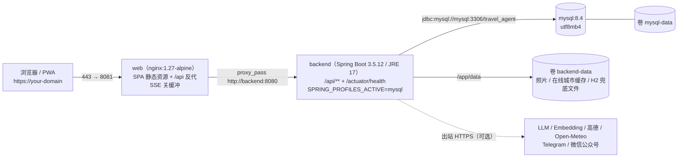
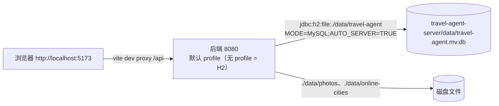

# 部署与运维

> 状态：当前事实 | 适用版本：0.1.0（Spring Boot 3.5.12 / Node 20） | 最后验证：2026-11-19 | 事实来源：docker-compose.yml、docker-compose.infra.yml、travel-agent-server/Dockerfile、travel-agent-web/Dockerfile、travel-agent-web/nginx.conf、travel-agent-server/src/main/resources/application*.yml

> 面向负责上线与运维的同学：从一台干净的服务器把「AI 智能旅行助手」跑起来，并知道它坏了怎么查、数据怎么备。
> 全部命令、服务名、端口、变量名均取自仓库当前 HEAD 的 **源码**（`docker-compose.yml`、两个 Dockerfile、
> `nginx.conf`、`application*.yml` 与 Java 类），可以直接复制执行。

本文适用版本：`travel-agent-server` 0.1.0 / Spring Boot 3.5.12，`travel-agent-web` 0.1.0。

---

## 0. 一页速览（先看这里）

| 项 | 值 | 依据 |
| --- | --- | --- |
| 对外端口 | **8081**（宿主机）→ 容器 `web:80` | `docker-compose.yml` → `web.ports` |
| 后端端口 | 容器内 `backend:8080`（不对外暴露，仅经 `web` 反代） | `docker-compose.yml` → `backend.ports`（已注释） |
| 数据库 | 容器 `mysql`，镜像 `mysql:8.4`，库 `travel_agent`，用户 `travel` | `docker-compose.yml` |
| 数据卷 | `mysql-data` → `/var/lib/mysql`；`backend-data` → `/app/data` | `docker-compose.yml` → `volumes` |
| 必配变量 | 仅 `JWT_SECRET`（缺失时 compose 直接拒绝启动） | `docker-compose.yml` → `${JWT_SECRET:?JWT_SECRET is required}` |
| 一条命令启动 | `JWT_SECRET=$(openssl rand -base64 48) docker compose up -d --build` | `docker-compose.yml` 头部注释 |
| 探活 | `GET /actuator/health`（免登录）、`GET /api/system/status`（需登录） | `SecurityConfig`、`SystemController` |
| 升级前置 | 已应用过旧 `V4` 的库（本地 H2 / 现网 MySQL）**先跑一次 `flyway repair`** | §6.3.1（V4 注释修复导致 checksum 变更） |

---

## 1. 部署拓扑

### 1.1 生产（Docker Compose 全栈）



三条与运维强相关的链路约束：

1. **前端不直连后端**：前端 `axios` 的 `baseURL` 固定为 `/api`（`travel-agent-web/src/api/client.ts`），
   浏览器只与 nginx 通信；同源反代部署时 `CORS_ALLOWED_ORIGINS` 基本用不到。
2. **SSE 必须端到端不缓冲**：`GET/POST /api/agent/stream` 是长连接流式输出（`SseEmitter` 180 秒），
   nginx 已配 `proxy_buffering off`，任何额外网关（CDN / ALB / ingress）也必须关闭缓冲。
3. **MySQL 是唯一有状态依赖**：MySQL 未 healthy 时 `backend` 不会启动（`depends_on.condition: service_healthy`），
   镜像为 MySQL 8.4；`docker-compose.infra.yml` 里的 8.0 只用于本地开发。

### 1.2 本地 / 单机（H2 兜底模式，作为对照）



| 维度 | H2 兜底模式（默认 profile） | MySQL 模式（`mysql` profile） |
| --- | --- | --- |
| 触发方式 | 不设 `SPRING_PROFILES_ACTIVE`（或启动参数不加 `--spring.profiles.active`） | `SPRING_PROFILES_ACTIVE=mysql` 或 `-Dspring-boot.run.profiles=mysql` |
| 连接串 | `jdbc:h2:file:./data/travel-agent;MODE=MySQL;AUTO_SERVER=TRUE` | `jdbc:mysql://${MYSQL_HOST}:${MYSQL_PORT}/${MYSQL_DATABASE}`（参数见 `application-mysql.yml`） |
| 账号 | `sa` / 空密码 | `${MYSQL_USERNAME}` / `${MYSQL_PASSWORD}` |
| H2 控制台 `/h2-console` | 默认**关闭**（`spring.h2.console.enabled: ${H2_CONSOLE_ENABLED:false}`，调试时显式设 `H2_CONSOLE_ENABLED=true`） | **关闭** |
| 适用 | 本地开发、单机试跑、MySQL 不可用时的兜底 | **生产**、多实例、可热备 |

> **一句话决策**：生产一律 MySQL 模式。H2 的 `AUTO_SERVER=TRUE` 只保证「同机多进程」共享，不支持跨主机多实例，
> 且 `*.mv.db` 备份远比 `mysqldump` 脆弱。

---

## 2. 前置条件

```bash
docker version             # 需能看到 Server 段（Docker Engine 20.10+）
docker compose version     # 需输出 v2.x（Compose V2，命令形态为 docker compose）
```

| 依赖 | 要求 | 说明 |
| --- | --- | --- |
| Docker Engine + Compose V2 | 20.10+ | 三个服务都由 compose 编排 |
| 宿主内存 | ≥ 4 GB（推荐 8 GB） | 见第 11 节容量建议 |
| 磁盘 | ≥ 20 GB 空闲 | MySQL 卷 + 镜像层 + 照片 |
| 出站网络 | 构建期拉取镜像与 Maven/npm 依赖；运行时可选 | 运行时出站用于 LLM、高德、Open-Meteo、Telegram |
| JDK / Node | **不需要**装在宿主机 | 两段式 Dockerfile 自包含构建环境 |

---

## 3. Docker 全栈部署步骤

### 3.1 准备 `.env`（推荐，替代命令行内联变量）

`docker compose` 会自动读取项目根目录的 `.env`。**该文件含密钥，禁止入库**（`.gitignore` 已忽略 `*.env.local`，
但 `.env` 本身不在忽略列表里，请存放到仓库外的目录或自行追加忽略规则）。

```bash
# 在仓库根目录（Windows 为 D:\travel-agent，Linux 为等价目录）执行
cat > .env <<'EOF'
# ---- 必配（下一行留空，随后用下方命令生成写入，不要手工敲 Base64）----
JWT_SECRET=

# ---- 生产必改 ----
DEMO_ACCOUNT=false
COOKIE_SECURE=true
CORS_ALLOWED_ORIGINS=https://your-domain.example.com
APP_TIMEZONE=Asia/Shanghai
MYSQL_ROOT_PASSWORD=CHANGE_ME_ROOT
MYSQL_PASSWORD=CHANGE_ME_APP

# ---- 可选能力（留空即降级，不影响启动）----
LLM_API_KEY=
AMAP_KEY=
# 行程地图使用高德「Web 端(JS API)」，与上面的后端 Web 服务 Key 分开申请；构建镜像时注入
VITE_AMAP_KEY=
VITE_AMAP_SECURITY_CODE=
# 高德 MCP server 的 Key：注意是 AMAP_MAPS_API_KEY（单数 KEY），与上面的 AMAP_KEY 不是一个变量
# 配了它并且 MCP_ENABLED=true 才会拉起 npx 子进程；缺 Key 时 MCP 段只降级、不影响启动
AMAP_MAPS_API_KEY=
MCP_ENABLED=false
WEATHER_REAL=false
# 知识库历史版本块保留数（除 ACTIVE 版本外额外保留几个历史版本；0 = 只留 ACTIVE）
RAG_CHUNK_VERSION_RETENTION=2
TELEGRAM_BOT_TOKEN=
CHANNEL_WEBHOOK_ENABLED=false
CHANNEL_WEBHOOK_SECRET=
EOF
```

> ⚠️ **两个新变量目前没有经 `docker-compose.yml` 透传给容器**：`AMAP_MAPS_API_KEY` 与 `RAG_CHUNK_VERSION_RETENTION`。
> 只写进 `.env` **不会**进 `backend` 容器的环境，结果就是 MCP 子进程拿不到 Key（只降级、不报错，容易误判成"配了没用"）、
> 块保留数仍是默认 2。容器部署请加一个 override 文件（compose 会自动合并，**不要提交到仓库**）：
>
> ```yaml
> # docker-compose.override.yml
> services:
>   backend:
>     environment:
>       AMAP_MAPS_API_KEY: ${AMAP_MAPS_API_KEY:-}
>       RAG_CHUNK_VERSION_RETENTION: ${RAG_CHUNK_VERSION_RETENTION:-2}
> ```
>
> 非容器方式（`mvn spring-boot:run` / systemd）直接设进程环境变量即可，无需这一步。

生成密钥并写入（避免 Base64 里的 `+` `/` `=` 出错）：

```bash
# Linux / macOS / Git Bash（需要 openssl）
sed -i "s|^JWT_SECRET=.*|JWT_SECRET=$(openssl rand -base64 48)|" .env
```

```powershell
# Windows PowerShell：用加密强随机数（不要用 Get-Random 充当密钥）
$bytes = New-Object byte[] 48
[System.Security.Cryptography.RandomNumberGenerator]::Create().GetBytes($bytes)
$secret = [Convert]::ToBase64String($bytes)
(Get-Content .env) -replace '^JWT_SECRET=.*', "JWT_SECRET=$secret" | Set-Content -Encoding utf8 .env
```

> 校验写入结果：Linux 上 `grep '^JWT_SECRET=' .env | cut -d= -f2 | base64 -d | wc -c` 应输出 `48`；
> Windows 上 `[Convert]::FromBase64String((Select-String '^JWT_SECRET=' .env).Line.Split('=')[1]).Length` 应输出 `48`。

> `JWT_SECRET` 必须是 **Base64**，且解码后 ≥ 32 字节（`JwtService.MIN_KEY_BYTES`）。
> 非法 Base64 或长度不足会**启动即失败**并报错提示重新生成——这是有意的快速失败，避免线上用弱密钥。

### 3.2 构建并启动

```bash
docker compose up -d --build
```

compose 会按依赖顺序拉起：`mysql`（健康检查通过后）→ `backend` → `web`。
首次构建耗时主要在 `mvn dependency:go-offline` 与 `npm ci`，之后有层缓存会快很多。

前置检查（不启动、只渲染最终配置，能提前暴露变量缺失）：

```bash
docker compose config          # 若 JWT_SECRET 未设置会直接报 "JWT_SECRET is required"
docker compose config --services   # 期望输出三行：mysql / backend / web
```

### 3.3 首次建账号：`DEMO_ACCOUNT` 的取舍

| 场景 | 建议值 | 原因 |
| --- | --- | --- |
| 生产 / 公网可达 | `false` | `DataInitializer` 会在启动时创建 `demo / demo123` 弱密码账号 |
| 演示环境 / 内网试跑 | `true` | 免注册直接体验（compose 默认已是 `false`，需显式打开） |
| 需要临时开通 | 临时 `true` → 注册好正式账号 → 改回 `false` 重启 | **已创建的 demo 账号不会因开关变 false 而被删除**，见下方清理 |

`DEMO_ACCOUNT` 只控制「是否在启动时创建」，不控制「是否允许登录」。若曾以 `true` 启动过，务必手工清理，
并注册一个正式账号（`POST /api/auth/register` 是 `permitAll`）：

```bash
# 删除弱密码演示账号（MySQL 模式）
docker compose exec mysql \
  mysql -uroot -p"${MYSQL_ROOT_PASSWORD}" travel_agent \
  -e "DELETE FROM users WHERE username='demo';"

# 注册正式账号（无注册开关，靠 HTTPS + 限流 + 强密码兜底）
curl -sS -X POST http://localhost:8081/api/auth/register \
  -H 'Content-Type: application/json' \
  -d '{"username":"admin","password":"<强密码>","nickname":"管理员"}'
```

### 3.4 健康检查与验证清单

**逐条执行，全部通过才算部署成功：**

| # | 检查项 | 命令 | 期望 |
| --- | --- | --- | --- |
| 1 | 容器状态 | `docker compose ps` | `mysql` / `backend` / `web` 均为 `running`（或 `healthy`） |
| 2 | MySQL 健康 | `docker compose ps mysql` | `STATUS` 里含 `(healthy)` |
| 3 | 后端探活 | `docker compose exec backend curl -fsS localhost:8080/actuator/health` | `{"status":"UP"}` |
| 4 | 后端镜像自带健康检查 | `docker inspect --format '{{.State.Health.Status}}' $(docker compose ps -q backend)` | `healthy`（`start-period` 60s，稍等一下） |
| 5 | nginx 到后端 | `curl -sS -o /dev/null -w '%{http_code}\n' http://localhost:8081/api/auth/me` | `401`（未登录，链路已通） |
| 6 | 前端页面 | `curl -sS -o /dev/null -w '%{http_code}\n' http://localhost:8081/` | `200` |
| 7 | SPA 回退 | `curl -sS http://localhost:8081/trips/1 \| head -c 60` | 返回 HTML（含 `<!doctype html>`），不是 404 |
| 8 | 登录写 Cookie | 见下方 `curl`，观察 `Set-Cookie` | 含 `travel_agent_token`、`HttpOnly`、`Path=/` |
| 9 | 浏览器登录 | 打开 `http://localhost:8081` 用正式账号登录 | 进入首页，控制台无 `/api` 报错 |
| 10 | 运行能力自检 | 登录后 `curl` `/api/system/status`（带 Cookie） | 见 §8.1 字段说明 |

除 #3 在容器内执行外，其余都用宿主机的 `curl` / `docker` 完成，不额外依赖 openssl、mvn。
登录与自检（把 Cookie 存到文件，便于后续复用）：

```bash
# 进容器内探活（backend 镜像内置 curl 正是为此）
docker compose exec backend curl -fsS localhost:8080/actuator/health

# 登录，保存 httpOnly Cookie
curl -sS -c cookies.txt -X POST http://localhost:8081/api/auth/login \
  -H 'Content-Type: application/json' \
  -d '{"username":"admin","password":"<强密码>"}'

# 运行能力自检（看 llmConfigured / llmVerified / amapConfigured / routeProvider / priceProvider / timezone / rateLimitEnabled）
curl -sS -b cookies.txt http://localhost:8081/api/system/status
```

### 3.5 常用运维命令

```bash
docker compose logs -f backend        # 跟踪后端日志
docker compose logs -f --tail=200 web # 只看 nginx 最近的日志
docker compose restart backend        # 只重启后端（不重建）
docker compose up -d --build backend web   # 改了代码后只重建前后端
docker compose exec backend sh        # 进后端容器（非 root，UID 1000）
docker compose down                   # 停止并删除容器（卷保留）
docker compose down -v                # ⚠️ 连卷一起删：MySQL 数据与照片全部丢失
```

---

## 4. ⚠️ 生产必改项清单（上线前逐条打勾）

> 以下 7 项**每一项都对应一个真实的暴露面或故障模式**，不要跳。改完统一 `docker compose up -d` 生效。

- [ ] **1. `JWT_SECRET` 必须显式配置为固定值**。compose 用 `${JWT_SECRET:?...}` 强制要求，缺失直接拒绝启动；
      即使绕过 compose（如 `java -jar`），未配置时 `JwtService` 会生成一次性随机密钥并打 WARN，**每次重启全体用户掉线**。
      生成方式 `openssl rand -base64 48`，配置后不要再改（改 = 全体重新登录）。
- [ ] **2. `DEMO_ACCOUNT=false`**。否则启动会创建公开弱密码账号 `demo / demo123`。
      `application.yml` 默认是 `true`（本地开箱用），compose 默认已改成 `false`——**不经 compose 部署时必须手工设**。
- [ ] **3. `COOKIE_SECURE=true`**（走 HTTPS 时）。登录 Cookie `travel_agent_token` 由 `AuthCookieService` 以
      `httpOnly + sameSite=Lax` 下发；为 `false` 时它还能在纯 HTTP 明文链路传输。**纯 HTTP 部署不要设 true**，
      否则浏览器不回传 Cookie，表现为「登录成功但立刻 401」。
- [ ] **4. `CORS_ALLOWED_ORIGINS` 收敛为真实域名**。默认是本地 dev 与 preview/e2e 两套端口
      `http://localhost:5173,http://127.0.0.1:5173,http://localhost:4173,http://127.0.0.1:4173`
      （compose 覆盖为 `http://localhost:8081`）；都带 `allowCredentials=true`（`SecurityConfig`），
      **绝不能填 `*`**。经 nginx 同源部署时填网站自己的源即可。
- [ ] **5. `APP_TIMEZONE` 明确固定**。容器默认 UTC，而代码里 `LocalDate.now()`（今天/明天、记账、日程、旅行事件时间）
      全部依赖 JVM 默认时区；`TimeZoneConfig` 启动时钉死它并打印 `应用时区已固定为 {zone}`。
      Dockerfile 已内置 `ENV APP_TIMEZONE=Asia/Shanghai`，请显式确认，不要依赖镜像默认。
- [ ] **6. 数据库密码改为强口令**。`MYSQL_ROOT_PASSWORD` / `MYSQL_PASSWORD` 的 compose 默认值是
      `travel_root_pw` / `travel_pw`。`mysql` 服务**不对外发布 3306**，但弱口令仍是纵深防御缺口。
      必须在首次 `up` 之前设定（初始化后再改变量不会修改既有账号密码）。
- [ ] **7. 宿主机 8081 不要裸奔公网**。compose 只发布 `8081:80`，没有 TLS。公网部署必须加 HTTPS 终结（§7.2），
      并同步把 `COOKIE_SECURE` 设为 `true`。

额外建议（非阻塞项，但生产应逐项确认）：

| 项 | 建议 |
| --- | --- |
| `CHANNEL_WEBHOOK_ENABLED` | 非必要不开；开启则 `CHANNEL_WEBHOOK_SECRET` 必须是强随机串（未配置密钥时端点**恒 401**） |
| `MCP_ENABLED` | 按需开；单个 MCP server 接入失败只告警、不影响启动 |
| `LLM_DAILY_QUOTA` | 生产建议设正值（如 `200`），防止单账号刷爆模型账单 |
| `RATE_LIMIT_ENABLED` | 保持 `true`；多实例时把 `travel.rate-limit.store` 设为 `redis` |
| `/h2-console` | `mysql` profile 已关闭；仍建议在 `SecurityConfig` 放行列表中移除 `/h2-console/**`（见 DEVELOPMENT.md 部署注意事项 4） |

---

## 5. 环境变量权威表

### 5.1 合并与校验方法

- **来源一**：`README.md` §6.1 环境变量表（变量 / 默认值 / 说明）。
- **来源二**：`docs/DEVELOPMENT.md` 开头「环境变量」表（是否必需 / 未配置时的行为）。
- **来源三（权威，已修复补齐）**：`application.yml` / `application-mysql.yml` 的 `${VAR:default}` 占位，
  以及 Java 的 `@Value("${...}")`；全仓库主代码**没有** `System.getenv`。
- 合并去重后共 **61 个**变量（应用侧 54 + 3 个前端构建期变量 + 4 个仅 Docker 面变量，明细见 §5.8）；三源差异见 §5.9。

> **默认值优先级**：环境变量 > `travel-agent-server/.env.local`（`spring.config.import` 加载，`[.properties]` 解析）
> > `application.yml` 默认值。容器内不带 `.env.local`（已列入 `.dockerignore`），所以 compose 环境就是最终来源。

### 5.2 认证与安全

| 变量 | 默认值 | 是否必需 | 作用 | 未配置时的降级行为 |
| --- | --- | --- | --- | --- |
| `JWT_SECRET` | 空 | **必需** | HS256 签名密钥，Base64，解码后 ≥ 32 字节 | 启动生成一次性随机密钥并 WARN，**重启后所有已签发 token 失效**；非法 Base64/长度不足 → 启动失败 |
| `JWT_EXPIRE_HOURS` | `72` | 可选 | token 有效期（小时），httpOnly Cookie 的 `maxAge` 与之对齐 | 72 小时 |
| `COOKIE_SECURE` | `false` | 可选 | 登录 Cookie 是否带 `Secure`；HTTPS 部署设 `true` | Cookie 可在 HTTP 明文链路传输 |
| `CORS_ALLOWED_ORIGINS` | `http://localhost:5173,http://127.0.0.1:5173,http://localhost:4173,http://127.0.0.1:4173` | 可选（**生产应改**） | 允许的前端来源，逗号分隔，带 `allowCredentials` | 本地 dev 5173 与 preview/e2e 4173 源可跨域；同源反代部署不受影响 |
| `DEMO_ACCOUNT` | `true`（yml）/ `false`（compose） | 可选（**生产必须 false**） | 启动是否创建 `demo/demo123` | `true` → 创建弱密码账号；`false` → 日志 `演示账号已禁用` |
| `APP_TIMEZONE` | `Asia/Shanghai` | 可选（**建议显式**） | 应用时区，钉死 JVM 默认时区，影响「今天/明天」、记账、日程与旅行事件时间 | 用 `Asia/Shanghai`；容器为 UTC 且未设置会导致日期整体偏移 |
| `MYSQL_ROOT_PASSWORD` | `travel_root_pw` | compose 必需（**生产必改**） | MySQL root 密码，同时用于 `mysqladmin ping` 健康检查 | 用弱默认值；数据卷初始化后再改变量会导致健康检查失败 |
| `TICKET_TTL_SECONDS` | `300` | 可选 | 短期只读票据有效期（秒）；`agent-stream` 与 `media-read` 按用途隔离 | 300 秒 |

### 5.3 LLM 与 Embedding

| 变量 | 默认值 | 是否必需 | 作用 | 未配置时的降级行为 |
| --- | --- | --- | --- | --- |
| `LLM_ENABLED` | `true` | 可选 | LLM 总开关；`false` 强制关闭模型调用 | 保持启用（但无 Key 时等同不可用） |
| `LLM_API_KEY` | 空 | 可选（**强烈建议**） | OpenAI-compatible API Key | 全链路走规则引擎：功能完整，超纲目的地与生僻说法识别较弱；`llm.calls{result=skipped}` 增长 |
| `LLM_BASE_URL` | `https://api.deepseek.com/v1` | 可选 | 任意 OpenAI-compatible 端点（DeepSeek/Qwen/OpenAI） | 用 DeepSeek 默认端点 |
| `LLM_MODEL` | `deepseek-chat` | 可选 | 模型名（如 `qwen-plus`、`gpt-4o-mini`） | `deepseek-chat` |
| `LLM_TEMPERATURE` | `0.4` | 可选 | 采样温度 | 0.4 |
| `LLM_CONNECT_TIMEOUT_MS` | `5000` | 可选 | 建连超时（毫秒） | 5 秒 |
| `LLM_READ_TIMEOUT_MS` | `30000` | 可选 | 读超时（毫秒） | 30 秒 |
| `LLM_DAILY_QUOTA` | `0` | 可选（**生产建议设正值**） | 每用户每日 LLM 调用上限，`0`=不限；计数落库 `llm_quota_usage`，多实例共享 | 不限额；超限时 `llm.calls{result=quota}` 增长并降级规则引擎 |
| `EMBEDDING_ENABLED` | `false` | 可选 | `true` 时 RAG 走真实 Embedding（OpenAI 兼容 `/embeddings`） | 本地字符 bigram 哈希向量（离线可用，语义精度较低） |
| `EMBEDDING_BASE_URL` | `https://api.siliconflow.cn/v1` | 可选 | Embedding 端点 | SiliconFlow 默认端点 |
| `EMBEDDING_API_KEY` | 空 | 可选（开启 Embedding 时必需） | Embedding Key | 仍走本地哈希 |
| `EMBEDDING_MODEL` | `BAAI/bge-m3` | 可选 | Embedding 模型名 | `BAAI/bge-m3`；**换模型需清空 `rag_document`/`rag_chunk`/`rag_document_version` 重建** |
| `RAG_MIN_SCORE` | `0.05` | 可选 | RAG 检索最低相似度阈值；低于该值的命中不进入回答/引用 | 0.05 |

### 5.3.1 Agent 主链路时间预算（V2.2 收口）

| 变量 | 默认值 | 是否必需 | 作用 | 未配置时的行为 |
| --- | --- | --- | --- | --- |
| `AGENT_BUDGET_ENABLED` | `true` | 可选 | 是否给 `/api/agent/chat` 与 `/api/agent/stream` 创建端到端时间预算 | 默认开启；设 `false` 完全回退旧行为（不建 deadline、所有阶段检查放行） |
| `AGENT_BUDGET_TOTAL_MS` | `30000` | 可选 | 端到端总预算（毫秒），含排队时间；**耗尽不报错**，按 ADR-002 降级（intent→规则、research 跳过、结构化规划→规则规划、审核跳过） | 30 秒 |

预算耗尽时的可观测面：回复里明确写「跳过审核/研究、结果未经完整校验，可稍后重试」；SSE 发 `budget_degraded` 事件；
日志 WARN 带 `runId` 与剩余预算；运行追踪多一条 `taskType=DEGRADE` 任务。
调大该值不会让请求变慢失控——单次 LLM 读超时也会被压到「剩余预算」以内；但**审核阶段内部的外部调用
（高德算路 6s / 天气 5s / MCP 工具）仍受各自超时约束**，不受预算收紧，这是已知边界。

### 5.4 地图与天气

| 变量 | 默认值 | 是否必需 | 作用 | 未配置时的降级行为 |
| --- | --- | --- | --- | --- |
| `AMAP_KEY` | 空 | 可选 | 后端高德「Web 服务」Key；启用快路径（LLM 精简生成 + 高德批量定位，约 3-4 秒） | 退回兜底路径（LLM 生成坐标 + OSM Nominatim，约 6-15 秒），国内网络可能较慢 |
| `AMAP_MAPS_API_KEY` | 空 | 可选（启用高德 MCP 时必需） | **高德 MCP server 子进程**的 Key，经 `travel.mcp.servers[].env` 透传；与 `AMAP_KEY` 是两个变量（单数 `KEY`） | MCP 子进程启动即 `exit(1)`（包在模块加载期校验），本项目侧握手失败→ `WARN` 跳过；应用其余功能不受影响。详见 [高德 MCP 接入](mcp-amap.md) |
| `VITE_AMAP_KEY` | 空 | 行程地图必需 | 前端高德「Web 端(JS API)」Key；作为 Docker 构建参数注入 | 行程地图不渲染，并显示配置提示 |
| `VITE_AMAP_SECURITY_CODE` | 空 | 行程地图必需 | 与 Web 端 Key 配套的安全密钥；作为 Docker 构建参数注入 | 高德脚本可能校验失败，页面显示加载提示 |
| `VITE_FOOTPRINT_BASEMAP` | `amap` | 可选 | 足迹地图底图：`amap`（高德栅格 + MapLibre 球体）或 `osm`（原 OSM/OpenFreeMap） | 默认高德；高德瓦片不可达时运行时回退 OSM。商用前确认高德瓦片授权 |
| `WEATHER_REAL` | `false` | 可选 | `true` 时天气走 Open-Meteo 真实预报（免费无 Key，窗口为今天起 16 天） | 确定性模拟数据；真实模式下网络失败或超范围也自动降级模拟 |

### 5.5 渠道入口

| 变量 | 默认值 | 是否必需 | 作用 | 未配置时的降级行为 |
| --- | --- | --- | --- | --- |
| `TELEGRAM_BOT_TOKEN` | 空 | 可选 | BotFather 签发的 token；长轮询纯出站，**无需公网回调** | 渠道关闭，日志 `Telegram Bot 未配置 token…渠道入口关闭` |
| `TELEGRAM_POLL_TIMEOUT` | `25` | 可选 | 长轮询挂起秒数（Telegram 上限 50） | 25 秒 |
| `CHANNEL_WEBHOOK_ENABLED` | `false` | 可选 | 是否启用 `POST /api/channels/webhook` | 端点拒绝（即使密钥已配也返回 401） |
| `CHANNEL_WEBHOOK_SECRET` | 空 | 可选（开启 Webhook 时必需） | Webhook 的 `X-Webhook-Secret` 凭证（恒时比较） | 端点**恒返回 401** |
| `WECHAT_OA_TOKEN` | 空 | 可选 | 微信公众号服务器配置 Token（明文模式），回调 URL 为 `https://<域名>/api/channels/wechat` | 渠道关闭；被动回复窗口 5 秒，行程规划可能超窗（建议配客服消息） |
| `WECHAT_OA_APPID` | 空 | 可选 | 已认证公众号 AppID，配合 Secret 走**异步客服消息回复**，解除 5s 窗口 | 只配 `WECHAT_OA_TOKEN` 时仍走同步被动回复 |
| `WECHAT_OA_SECRET` | 空 | 可选 | 公众号 AppSecret（与 AppID 成对） | 同上 |

### 5.6 存储与限流

| 变量 | 默认值 | 是否必需 | 作用 | 未配置时的降级行为 |
| --- | --- | --- | --- | --- |
| `PHOTO_MAX_PER_TRIP` | `200` | 可选 | 单行程照片张数上限 | 200 张 |
| `PHOTO_MAX_BYTES_PER_USER` | `524288000`（500 MB） | 可选 | 单用户照片总容量上限（字节） | 500 MB |
| `RATE_LIMIT_ENABLED` | `true` | 可选 | 限流总开关 | — |
| `RATE_LIMIT_AUTH` | `10` | 可选 | 登录/注册：同 IP 在窗口内的上限 | 10 次 |
| `RATE_LIMIT_AGENT` | `30` | 可选 | `/api/agent/**`：同用户上限（直接影响模型花费） | 30 次 |
| `RATE_LIMIT_UPLOAD` | `60` | 可选 | 照片上传：同用户上限 | 60 次 |
| `RATE_LIMIT_DEFAULT` | `600` | 可选 | 其它 `/api/**`：同用户上限 | 600 次 |
| `RATE_LIMIT_SESSION` | `60` | 可选 | `GET /api/auth/me`（会话恢复）独立桶：同用户上限，避免刷新页面被登录桶（`RATE_LIMIT_AUTH`）踢成 429 | 60 次 |
| `RATE_LIMIT_WINDOW_SECONDS` | `300` | 可选 | 限流窗口长度（秒） | 300 秒 |
| `RATE_LIMIT_STORE` | `memory` | 可选 | 计数存储：`memory`（进程内）/ `redis`（多实例共享配额，Redis 故障 fail-open） | 进程内计数：重启清零，多实例各算各的 |
| `PHOTOS_STORE` | `local` | 可选 | 照片存储：`local`（本地磁盘）/ `s3`（S3 兼容对象存储，需同时配 `travel.photos.s3.*`） | 本地磁盘 |

> **限流的 `redis` 模式与照片的 `s3` 模式还需要额外的连接配置**：前者需 `spring.data.redis.*`，
> 后者需 `travel.photos.s3.*`（endpoint / region / bucket / access-key / secret-key）。
> 这些连接项没有独立环境变量，用 §5.9 的 `SPRING_APPLICATION_JSON` 方式注入。
> Redis 不可用时 `RedisRateCounter` 会记 WARN、计 `ratelimit.failopen` 指标并放行（fail-open），不会让整站不可用。

### 5.7 数据库、会话记忆与其他

| 变量 | 默认值 | 是否必需 | 作用 | 未配置时的降级行为 |
| --- | --- | --- | --- | --- |
| `SPRING_PROFILES_ACTIVE` | 空（= H2） | compose 固定为 `mysql` | 选择 datasource profile | H2 兜底模式 |
| `H2_CONSOLE_ENABLED` | `false` | 可选 | 是否启用 `/h2-console`；默认关闭（控制台以 `sa` 空密码直连，暴露即等于匿名读写全库） | 关闭 |
| `MYSQL_HOST` | `localhost` | `mysql` profile 必需 | 数据库主机（compose 注入 `mysql`） | 连 localhost，容器内必然失败 |
| `MYSQL_PORT` | `3306` | 可选 | 数据库端口 | 3306 |
| `MYSQL_DATABASE` | `travel_agent` | 可选 | 库名 | `travel_agent` |
| `MYSQL_USERNAME` | `root` | 可选 | 账号（compose 注入 `travel`） | `root` |
| `MYSQL_PASSWORD` | `root`（yml）/ `travel_pw`（compose） | 可选（**生产必改**） | 密码 | 用弱默认值 |
| `MCP_ENABLED` | `false` | 可选 | 是否接入 `travel.mcp.servers` 里的 MCP server（工具只读，前缀 `mcp_`） | 仅内置工具；日志 `MCP 未启用…仅使用内置工具` |
| `RAG_CHUNK_VERSION_RETENTION` | `2` | 可选 | 知识库**历史版本知识块**的保留数（除 ACTIVE 外额外保留最近 N 个版本的块）；`0` = 只留 ACTIVE | 保留 2 个历史版本；其余由每日 04:30 的 `RagChunkRetentionJob` 清理（只删块，版本行与正文保留） |
| `JAVA_OPTS` | 空 | 可选 | 传给 `java` 的 JVM 参数（Dockerfile `ENTRYPOINT` 使用），如 `-Xmx1g` | 由 JVM 默认堆策略决定 |
| `TZ` | `Asia/Shanghai`（仅 mysql 服务） | 可选 | MySQL 容器时区 | — |
| `CONVERSATION_HISTORY_LIMIT` | `10` | 可选 | 会话记忆喂给模型的最近消息**条数**（一轮问答 = 2 条，`10` 条 ≈ 5 轮，不是 10 轮） | 10 条 |
| `CONVERSATION_RETENTION_DAYS` | `7` | 可选 | 会话消息保留天数；过期由写入侧快路径（每小时最多一次）+ 每日 04:30 定时任务清理 | 7 天 |

> `travel.photos.dir`（照片落盘目录）**不是环境变量**：`LocalPhotoStore` 用 `@Value("${travel.photos.dir:data/photos}")` 读取，
> 只能通过配置文件项覆盖。Docker 下容器工作目录是 `/app`，因此落在 `/app/data/photos`。
> 同理 `data/online-cities`（`OnlineCityService` 的城市目录缓存）也是硬编码相对路径。

### 5.8 统计与来源分布

| 分组 | 数量 | 变量 |
| --- | --- | --- |
| 认证与安全 | 8 | `JWT_SECRET` `JWT_EXPIRE_HOURS` `COOKIE_SECURE` `CORS_ALLOWED_ORIGINS` `DEMO_ACCOUNT` `APP_TIMEZONE` `MYSQL_ROOT_PASSWORD` `TICKET_TTL_SECONDS` |
| LLM 与 Embedding | 13 | `LLM_ENABLED` `LLM_API_KEY` `LLM_BASE_URL` `LLM_MODEL` `LLM_TEMPERATURE` `LLM_CONNECT_TIMEOUT_MS` `LLM_READ_TIMEOUT_MS` `LLM_DAILY_QUOTA` `EMBEDDING_ENABLED` `EMBEDDING_BASE_URL` `EMBEDDING_API_KEY` `EMBEDDING_MODEL` `RAG_MIN_SCORE` |
| 地图与天气 | 6 | `AMAP_KEY` `AMAP_MAPS_API_KEY` `VITE_AMAP_KEY` `VITE_AMAP_SECURITY_CODE` `VITE_FOOTPRINT_BASEMAP` `WEATHER_REAL` |
| 渠道入口 | 7 | `TELEGRAM_BOT_TOKEN` `TELEGRAM_POLL_TIMEOUT` `CHANNEL_WEBHOOK_ENABLED` `CHANNEL_WEBHOOK_SECRET` `WECHAT_OA_TOKEN` `WECHAT_OA_APPID` `WECHAT_OA_SECRET` |
| 存储与限流 | 12 | `PHOTO_MAX_PER_TRIP` `PHOTO_MAX_BYTES_PER_USER` `RATE_LIMIT_ENABLED` `RATE_LIMIT_AUTH` `RATE_LIMIT_AGENT` `RATE_LIMIT_UPLOAD` `RATE_LIMIT_DEFAULT` `RATE_LIMIT_SESSION` `RATE_LIMIT_WINDOW_SECONDS` `RATE_LIMIT_STORE` `RATE_LIMIT_TRUSTED_PROXIES` `PHOTOS_STORE` |
| 数据库与其他 | 11 | `SPRING_PROFILES_ACTIVE` `MYSQL_HOST` `MYSQL_PORT` `MYSQL_DATABASE` `MYSQL_USERNAME` `MYSQL_PASSWORD` `MCP_ENABLED` `RAG_CHUNK_VERSION_RETENTION` `JAVA_OPTS` `TZ` `H2_CONSOLE_ENABLED` |
| 会话记忆 | 2 | `CONVERSATION_HISTORY_LIMIT` `CONVERSATION_RETENTION_DAYS` |
| Agent 时间预算 | 2 | `AGENT_BUDGET_ENABLED` `AGENT_BUDGET_TOTAL_MS` |
| **合计** | **61** | 应用侧 54（两份 yml + Java `@Value` 占位去重）+ 3 个前端构建期变量 + 4 个仅 Docker 面变量（`MYSQL_ROOT_PASSWORD`、`SPRING_PROFILES_ACTIVE`、`JAVA_OPTS`、`TZ`） |

> 口径提示：`TESSERACT_CMD`、`TESSDATA_PREFIX`、`INVOICE_DIR`、`INVOICE_STORE` 已随发票/OCR 退役删除，不再是有效配置项。

来源分布（按定义位置；一个变量可能出现于多份配置文件）：

| 来源 | 数量 | 说明 |
| --- | --- | --- |
| `application.yml` 的 `${VAR:default}` 占位 | 49 | 49 处、49 个不同变量（`AMAP_KEY` 只在 `travel.amap.key`，`AMAP_MAPS_API_KEY` 只在 `travel.mcp.servers[].env`） |
| `application-mysql.yml` 的占位 | 5 | `MYSQL_HOST` / `MYSQL_PORT` / `MYSQL_DATABASE` / `MYSQL_USERNAME` / `MYSQL_PASSWORD` |
| 两份 yml 合计（去重） | **54** | P0 删除发票/OCR 配置后重新核对 |
| Java 代码内独立 env 占位 | **0** | P0 删除 `TESSERACT_CMD` / `TESSDATA_PREFIX` 后，主代码不再有独立 env 占位（`@Value` 只读配置项默认值） |
| 仅由 `docker-compose.yml` / Dockerfile 提供 | 4 | `MYSQL_ROOT_PASSWORD`、`TZ`（mysql 服务）、`SPRING_PROFILES_ACTIVE`、`JAVA_OPTS`（后端 `ENTRYPOINT` 消费） |
| 前端构建期变量 | 3 | `VITE_AMAP_KEY`、`VITE_AMAP_SECURITY_CODE`、`VITE_FOOTPRINT_BASEMAP` |
| `System.getenv` 直接读取 | **0** | 全仓库主代码没有 `System.getenv`（测试代码只用 `System.getProperty`） |

对账：54（yml 去重）+ 3（前端构建期）+ 4（仅 Docker 面）= **61**。复核命令：

```bash
grep -rhoE '\$\{[A-Z_]+' travel-agent-server/src/main/resources/application*.yml | sort -u | wc -l
grep -rhoE '\$\{[A-Z_]+' travel-agent-server/src/main/resources/application-mysql.yml | sort -u | wc -l
grep -rhoE '@Value\("\$\{[A-Z_]+' travel-agent-server/src/main/java | sort -u | wc -l
```

### 5.9 README / DEVELOPMENT.md 的差异（重要）

`RATE_LIMIT_STORE` / `PHOTOS_STORE` / `WECHAT_OA_APPID` / `WECHAT_OA_SECRET` 曾是「文档有、代码读不到」的
变量（设置了不生效）。对应占位符已在 `application.yml` 补齐，现在与 README 描述一致：

| 环境变量 | 对应配置项（默认值） |
| --- | --- |
| `PHOTOS_STORE` | `travel.photos.store`（`local`） |
| `RATE_LIMIT_STORE` | `travel.rate-limit.store`（`memory`） |
| `WECHAT_OA_APPID` / `WECHAT_OA_SECRET` | `travel.channels.wechat.appid` / `.secret`（空） |

| 文档 | 情况 | 本表处理 |
| --- | --- | --- |
| README §6.1 | 未列 `TELEGRAM_POLL_TIMEOUT`、`LLM_*` 超时/温度、`RATE_LIMIT_*` 细项等 | 已补齐（§5.3、§5.6） |
| README §6.1 | `DEMO_ACCOUNT` 写默认 `true` | 与 `application.yml` 一致；compose 覆盖为 `false`——两个默认值都已标注 |
| README §6.1 | `CORS_ALLOWED_ORIGINS` 写 `...:5173` | 与 yml 一致；compose 覆盖为 `http://localhost:8081`，已标注 |
| DEVELOPMENT.md | 只有 5 行（`JWT_SECRET`、`LLM_API_KEY`、`AMAP_KEY`、`APP_TIMEZONE`、`travel.photos.dir`） | 覆盖不足；且 `travel.photos.dir` 是配置项不是环境变量，已从本表排除并在 §5.7 说明 |
| 两者共同 | 未提 `JAVA_OPTS`、`TZ`、`MYSQL_ROOT_PASSWORD` | 已在 §5.2 / §5.7 补充 |

**仍只能通过配置文件项覆盖的**：`travel.photos.dir`（照片落盘目录）在 yml 中是字面量、未暴露环境变量，
Docker 下容器工作目录为 `/app`，因此落在 `/app/data/photos`（已由 `backend-data` 卷持久化）。
这类配置项可用 `SPRING_APPLICATION_JSON` 注入（改 compose 的 `backend.environment`，不用改代码）：

```yaml
    environment:
      # 例 1：改照片目录；例 2：开多实例 Redis 限流（同时设 RATE_LIMIT_STORE=redis）
      SPRING_APPLICATION_JSON: '{"travel":{"photos":{"dir":"/app/data/photos"},"rate-limit":{"store":"redis"}},"spring":{"data":{"redis":{"host":"redis","port":6379}}}}'
```

---

## 6. MySQL 模式 vs H2 模式

### 6.1 关键差异

| 关注点 | H2（默认 profile） | MySQL（`mysql` profile） |
| --- | --- | --- |
| 初始化 | Flyway 建 schema（`V1` 基线 → `V2`–`V11` → `V13`/`V14`(H2)）；`ddl-auto: validate` 只校验 | Flyway 全链 `V1`–`V13`（含 `V8`/`V12`/`V13`(MySQL)）；`ddl-auto: validate`；库需先存在（compose 由 `MYSQL_DATABASE` 创建） |
| 控制台 | 默认关闭；显式设 `H2_CONSOLE_ENABLED=true` 后 `/h2-console` 可用（`SecurityConfig` 放行） | 已禁用，且不应放行 |
| 文件锁 | `travel-agent.lock.db` + `AUTO_SERVER=TRUE`，同机可多进程 | 无；连接池管理 |
| 备份 | 停服后复制 `*.mv.db` | `mysqldump` / `xtrabackup`，可热备 |
| 多实例 | 不支持 | 支持（配合 `pending_plan` 落库、Redis 限流、S3 存储可横向扩展） |
| 字符集 | 由 H2 `MODE=MySQL` 模拟 | `--character-set-server=utf8mb4 --collation-server=utf8mb4_unicode_ci` |

> **schema 只有一个权威：Flyway**。两边 `ddl-auto` 都是 `validate`，Hibernate 只校验不改结构——
> 迁移脚本漏了表/列会**启动失败**而不是被悄悄补上（这是特性）。全新库**不再需要手工执行 `sql/init.sql`**（已弃用）。

### 6.2 切换方式

**本地（不用 Docker 跑后端）**：

```bash
docker compose -f docker-compose.infra.yml up -d     # 只起 MySQL 8.0 + Redis
cd travel-agent-server
mvn spring-boot:run -Dspring-boot.run.profiles=mysql # 或 --spring.profiles.active=mysql
```

> `docker-compose.infra.yml` 的 MySQL 是 **8.0**（并对外发布 3306），与生产 compose 的 **8.4** 不同版本，仅用于本地开发。
> 宿主机已被占用 3306 时先改该端口映射。
>
> ⚠️ 该 compose 仍把**已弃用的** `sql/init.sql` 挂到 `docker-entrypoint-initdb.d/`：首次启动会用旧 schema 建表，
> 而旧 schema 的 `health_record.weight`（`DECIMAL(5,1)`）与 `operation_history.*_state`（`JSON`）和实体不一致，
> `ddl-auto=validate` 会因此启动失败。**要么先删掉 `mysql-data` 卷再让 Flyway 建 schema（推荐），
> 要么用空库（只 `CREATE DATABASE`）**；不要用 init.sql 建出来的库跑新代码。

**生产**：compose 已固定 `SPRING_PROFILES_ACTIVE=mysql` + `MYSQL_HOST=mysql`，无需改动。
**反向切回 H2（应急）**：去掉 `SPRING_PROFILES_ACTIVE`/`MYSQL_*` 后重建 `backend`，后端改用容器内
`/app/data/travel-agent.mv.db`（在 `backend-data` 卷里），代价是与 MySQL 数据不互通——只用于
「MySQL 起不来、先让页面能登录」的临时兜底，不要当常态。

### 6.3 Flyway 迁移链、`validate` 与 checksum repair

- **执行时机**：每次后端启动时、在 Hibernate 初始化**之前**执行未应用的迁移；记录在 `flyway_schema_history`。
- **迁移链**（`travel-agent-server/src/main/resources/db/`）：**14 个版本 / 15 个脚本**（V13 双方言各一份、V14 为 H2 专属）。

  | 版本 | 脚本（目录） | 内容 |
  | --- | --- | --- |
  | 1 | `V1__baseline.sql`（`migration`） | 「V2 之前」的 schema：15 张表 + 14 个索引，等价旧 `sql/init.sql` |
  | 2 | `V2__conversation_message.sql` | 会话消息表 |
  | 3 | `V3__llm_quota.sql` | `llm_quota_usage`（LLM 每日配额计数；唯一约束 `uk_llm_quota_user_date` 由 `V8` 在 MySQL 补） |
  | 4 | `V4__rag_fingerprint.sql` | `rag_document.fingerprint`（**本批修过 1 个注释字符，checksum 已变，见下**） |
  | 5 | `V5__rag_document_user.sql` | `rag_document.user_id`（公共 / 个人知识隔离） |
  | 6 | `V6__pending_plan_status.sql` | `pending_plan` 补 `status` / `version`（确认原子化） |
  | 7 | `V7__trip_version.sql` | `trip.version`（`@Version` 乐观锁） |
  | 8 | `V8__llm_quota_unique.sql`（`migration-mysql`） | **MySQL 专属**：幂等补 `UNIQUE(user_name, usage_date)` |
  | 9 | `V9__list_indexes.sql` | 列表查询复合索引 + 5 张基础表 `IF NOT EXISTS` 自足建表 |
  | 10 | `V10__rag_document_version.sql` | `rag_document_version` + `rag_chunk.version_id` + 存量回填 |
  | 11 | `V11__rag_document_key.sql` | `rag_document.doc_key` + `uk_rag_document_key`（并发首建去重） |
  | 12 | `V12__rag_active_unique.sql`（`migration-mysql`） | **MySQL 专属**：生成列 `active_document_id` + 唯一索引（每文档至多一条 ACTIVE），幂等 |
  | 13 | `V13__baseline_gap.sql`（`migration-mysql`） | **MySQL 专属**：幂等补齐 9 列 + `trip_photo` 表 + 6 个索引 |
  | 13 | `V13__baseline_gap_h2.sql`（`migration-h2`） | 同一份缺口的 H2 方言版（原生 `IF NOT EXISTS`） |
  | 14 | `V14__llm_quota_unique_h2.sql`（`migration-h2`） | **H2 专属**：`llm_quota_usage` 的唯一键（MySQL 侧由 V8 负责，H2 之前从未建过） |

- **两个 profile 的 `flyway.locations`**：默认（H2）= `classpath:db/migration,classpath:db/migration-h2`；
  `mysql` = `classpath:db/migration,classpath:db/migration-mysql`。两边**各自只看到一个 V13**，不会撞重复版本号。
  由此 **H2 库的 `flyway_schema_history` 会缺 V8 与 V12**——Flyway 允许版本号跳空，属预期行为；
  H2 侧没有 `uk_llm_quota_user_date` 唯一约束、也没有「每文档至多一条 ACTIVE」的生成列：配额闸门本身是条件 UPDATE
  （`used_count < limit`）不依赖唯一键，ACTIVE 唯一性由应用层 `SELECT … FOR UPDATE` + 同事务置位保证。
- **`ddl-auto` 两个 profile 都是 `validate`**：Hibernate 只校验实体与库结构是否一致，缺表/缺列/类型不符直接启动失败。
  这是本批最重要的变化——此前 `update` 会把迁移漏掉的列悄悄补上，把「脚本不完整」永久掩盖。
- **`baseline-on-migrate: true` + `baseline-version: 1`**：首次对「已有表但没有 `flyway_schema_history`」的存量库执行时，
  自动插入 V1 基线记录并**跳过 V1 本身**，只跑未应用的增量（V13 在该库上逐条命中「已存在」→ 空转）。
- **索引写法两套**：便携脚本（`V9`/`V10`/`V11`）直接用 `CREATE INDEX`——每个版本只执行一次，不需要 `IF NOT EXISTS`；
  只有「存量库可能已有该对象」的 MySQL 方言脚本（`V8`/`V12`/`V13`）才走 `information_schema` 探测 + `PREPARE` 的空转分支。

#### 6.3.1 升级前必做：V4 checksum repair（一次）

`V4__rag_fingerprint.sql` 第 4 行原写作 `--（…`。MySQL 要求 `--` 后必须是空白/控制字符，`--（` **不是注释**，
Flyway 会把它和后面的 `CREATE TABLE` 拼成一条语句 → `SQLSyntaxErrorException`，**任何全新 MySQL 库都会在 V4 失败**
（H2 容忍这种写法，所以本地一直没暴露）。本批把它改成 `-- （…`（只加一个空格）。

改动让 **V4 的 checksum 变了**：所有**已应用过旧 V4** 的库（本地 H2 开发库、现网 MySQL）升级代码后必须先 `repair` 一次，
否则启动直接报：

```
Migration checksum mismatch for migration version 4
-> Applied to database : 826714073
-> Resolved locally    : -231615481
Either revert the changes to the migration, or run repair to update the schema history.
```

`repair` 只把 `flyway_schema_history` 记录的 checksum/状态对齐到当前脚本：**不执行 DDL、不改业务数据、不重跑迁移**。
**千万不要删 `flyway_schema_history`**（那等于让 Flyway 把全部迁移重放一遍）。

工具：`.tools/flyway-repair/`（`FlywayRepair.java` + `run.ps1` + `README.md`，在 `src/main` 之外、**不参与 mvn 构建**），
子命令 `info | validate | repair | migrate`。空密码用 `-` 占位（PowerShell 会吞空串）：

```powershell
# 本地 H2 开发库（空密码）：必须「在 PowerShell 里用 & 调脚本」。
# 不要写成 `powershell -File ... -DbPassword -`：那条路径下 PowerShell 会把裸 `-` 当参数前缀吞掉，
# 脚本收到的参数不足，表现为 rc=2 且没有任何输出（实测）。
powershell -NoProfile -ExecutionPolicy Bypass -Command "& 'D:\travel-agent\.tools\flyway-repair\run.ps1' -Command repair -JdbcUrl 'jdbc:h2:file:D:/travel-agent/travel-agent-server/data/travel-agent;MODE=MySQL' -DbUser sa -DbPassword - -Locations 'filesystem:D:/travel-agent/travel-agent-server/src/main/resources/db/migration,filesystem:D:/travel-agent/travel-agent-server/src/main/resources/db/migration-h2'"

# 现网 MySQL（非空密码，-File 表单可直接用；-Locations 末尾换成 db/migration-mysql）
powershell -NoProfile -ExecutionPolicy Bypass -File D:\travel-agent\.tools\flyway-repair\run.ps1 -Command repair `
  -JdbcUrl "jdbc:mysql://HOST:3306/travel_agent?useSSL=false&allowPublicKeyRetrieval=true&serverTimezone=Asia/Shanghai" `
  -DbUser root -DbPassword 123456 `
  -Locations "filesystem:D:/travel-agent/travel-agent-server/src/main/resources/db/migration,filesystem:D:/travel-agent/travel-agent-server/src/main/resources/db/migration-mysql"
```

`-Locations` 必须与对应 profile 的 `spring.flyway.locations` **一致**（H2 = `migration` + `migration-h2`；
MySQL = `migration` + `migration-mysql`），否则工具会算出不同的 resolved checksum。`repair` 后跑一次 `-Command validate`，
输出 `[OK] validate passed` 即恢复；已在验证中复现「旧 V4 启动失败 → repair → 启动成功」三段输出。

#### 6.3.2 验证证据与已知遗留

| 环境 | 已验证 |
| --- | --- |
| **真实 MySQL `8.4.10`**（便携版本地实例，独立 datadir / `:3307`，与 `:3306` 的 8.0 服务互不影响） | ① 全新库 `V1..V18`：验收当时 17 个迁移全部成功、`validate` 通过（25 表，启动 16.6s；V19 为后续增量，未纳入该次证据）；② 核心链路：登录 → 规划（`NEED_CONFIRMATION` + 64 位 contentHash）→ 确认（calendar/budget/footprint 三模块 `SUCCEEDED`）→ 追踪（`INTENT→PLAN→PREVIEW→REVIEW→COMMIT`、23 次工具调用）→ `route-legs` 10 段（无 Key → `estimated`）；③ 重启恢复三态：仅重启后端（14.4s，行程指纹与库内 MD5 一致、迁移不重跑）、仅重启 MySQL（后端 3.1s 连接池恢复、写入可用）、整栈重启（12.6s，数据一致）。证据 `.evidence/mysql84-3307-20261119-144026/`，脚本 `.e2e/acceptance/mysql-native-3307-acceptance.ps1` |
| **真实 MySQL `8.0.46`**（本机，**不是 8.4**） | ① 全新库 `V1..V13` 13 个迁移 + `validate` 通过（21 表，启动 14.6s）；② 存量库（`flyway.target=10` 模拟现网）→ 只增量 V11/V12/V13 + `validate` 通过；③ `V8` 幂等：先手工建唯一键再跑，走「已存在 → 跳过」分支，无 `Duplicate key name` |
| H2（2.3.232，`MODE=MySQL`） | 全新库 `V1..V13(h2)` + `validate` 通过；**现有 dev 库副本**升级只增量 V13(h2)（全部 `IF NOT EXISTS` 空转）+ `validate` 通过 |

遗留风险两条：① **Flyway 对 8.4 的官方支持滞后**：Spring Boot 3.5.12 带的 Flyway 在连 8.4.10 时打印
`MySQL 8.4 is newer than this version of Flyway ... latest supported version of MySQL is 8.1`（仅 WARN）；验收当时 17 个迁移
与 `validate` 全部通过（V19 为后续增量），说明 DDL 未踩到差异，但升级 8.4 前建议顺手升级 Flyway（或显式接受该告警）；② 极端旧库若
`health_record.weight` 还是 `DECIMAL(5,1)`、`operation_history.before_state`/`after_state` 还是 `JSON`，`validate` 会报
类型不符，需手工收紧列类型（两处都只是「列更宽松」，不影响读写，可以择机处理）。

#### 6.3.3 迁移失败后的处理

若某次启动在迁移中途失败（例如把 MySQL 专属脚本放到默认目录、H2 解析不了），`flyway_schema_history` 里会留下
`success=false` 的一行，之后**每次启动都会被拒绝**并报 `Detected failed migration to version N ... run repair`。步骤：

1. 确认该迁移确实没有留下半完成的 DDL（PARSE 阶段的失败通常什么都没执行）；
2. 删除失败记录：`DELETE FROM flyway_schema_history WHERE success = FALSE;`
   （H2 文件库可用 `org.h2.tools.Shell`/JDBC；该表的表名与列名是以引号创建的**小写**标识符，
   手写 SQL 需写成 `"flyway_schema_history"`、`"success"`）；
3. 重新启动，Flyway 会从该版本继续。

**运维纪律**：**已发布过的迁移脚本禁止修改**，否则 checksum 校验失败、后端启动直接报 `Migration checksum mismatch`（§8.4）。
唯一例外是 6.3.1 那种「注释语法错误导致全新库必失败」的情形，改动必须配一轮 `repair` 并写进 CHANGELOG。
改 schema 一律新增 `V{n}__描述.sql`；MySQL 方言写得放 `db/migration-mysql/`，H2 方言放 `db/migration-h2/`。

---

## 7. 反代与 HTTPS

### 7.1 现状（`travel-agent-web/nginx.conf`）

| 配置 | 值 | 为什么必须这样 |
| --- | --- | --- |
| 监听 | `listen 80`（容器内），宿主机映射 `8081:80` | compose `web.ports` |
| 上传体积 | `client_max_body_size 12m` | 对齐后端 `spring.servlet.multipart.max-file-size: 10MB` / `max-request-size: 12MB` |
| `/api/` 反代 | `proxy_pass http://backend:8080;` + `proxy_http_version 1.1` | 服务名即 compose 服务名 |
| **SSE** | `proxy_buffering off; proxy_cache off;` | 不关缓冲 → 事件被攒批，聊天面板「半天不出字」或一闪出一整段 |
| 超时 | `proxy_read_timeout 3600s; proxy_send_timeout 3600s;` | `SseEmitter` 超时 180 秒，但长连接与后续事件不可被 60 秒默认值截断 |
| 透传头 | `Host` / `X-Real-IP` / `X-Forwarded-For` / `X-Forwarded-Proto` | `RateLimitFilter` **默认完全不读 `X-Forwarded-For`**，直接用 TCP 源地址计数；只有配置了 `RATE_LIMIT_TRUSTED_PROXIES`（命中受信代理）才从右往左取第一个非受信地址。反代部署必须同时配该变量，否则所有请求按代理 IP 共用一个桶 |
| SPA 回退 | `try_files $uri $uri/ /index.html;` | React Router 深链刷新不 404 |
| 静态缓存 | `/assets/` `expires 30d` + `immutable`；`= /index.html` `no-cache` | 带 hash 的资源长缓存，入口不缓存（保证版本切换立刻生效） |

### 7.2 在 nginx 前面加 HTTPS 终结（推荐做法）

在宿主机再起一层 nginx（或用云 LB）监听 443，转到 compose 的 8081。**必须带上的指令**：

```nginx
# /etc/nginx/conf.d/travel-agent.conf（宿主机 TLS 终结层）
server {
    listen 443 ssl http2;
    server_name your-domain.example.com;
    ssl_certificate     /etc/letsencrypt/live/your-domain.example.com/fullchain.pem;
    ssl_certificate_key /etc/letsencrypt/live/your-domain.example.com/privkey.pem;
    client_max_body_size 12m;                      # 与内层 nginx 一致

    location /api/ {                               # 含 SSE：三件事缺一不可
        proxy_pass http://127.0.0.1:8081;
        proxy_http_version 1.1;
        proxy_set_header Host              $host;
        proxy_set_header X-Real-IP         $remote_addr;
        proxy_set_header X-Forwarded-For   $proxy_add_x_forwarded_for;
        proxy_set_header X-Forwarded-Proto $scheme;
        proxy_buffering    off;                    # 关缓冲
        proxy_cache        off;                    # 关缓存
        proxy_read_timeout 3600s;                  # 拉长超时
        proxy_send_timeout 3600s;
    }

    location / {                                   # SPA 静态资源
        proxy_pass http://127.0.0.1:8081;
        proxy_set_header Host              $host;
        proxy_set_header X-Forwarded-Proto $scheme;
    }
}

server {
    listen 80;
    server_name your-domain.example.com;
    return 301 https://$host$request_uri;
}
```

配套环境变量：`COOKIE_SECURE=true`（HTTPS 下必须），`CORS_ALLOWED_ORIGINS=https://your-domain.example.com`。

### 7.3 SSE 排障口诀

> 「**内层关缓冲、外层关缓冲、CDN 关缓冲、超时都拉长**」。
> 表现为「发消息后 30-60 秒才一次性刷出全部内容」或「流到一半断」，九成是某一层开了 `proxy_buffering` 或超时被切断。

---

## 8. 监控与运维

### 8.1 `/api/system/status` 自检返回什么

登录后 `GET /api/system/status`（需认证；未登录 401）。字段（来自 `SystemController`）：

| 字段 | 类型 | 含义 / 运维用途 |
| --- | --- | --- |
| `llmConfigured` | boolean | `LLM_ENABLED=true` **且** `LLM_API_KEY` 非空 → `true`。`false` 说明整站走规则引擎 |
| `llmVerified` | boolean | 最近一次真实 LLM 调用是否成功（未调用过 = `false`） |
| `llmModel` | string/null | 生效的模型名（未接入时为 `null`） |
| `llmHint` / `geoHint` / `routeHint` / `priceHint` | string | 中文说明，可直接转给用户 |
| `amapConfigured` | boolean | `AMAP_KEY` 是否配置 |
| `geoProvider` | string | `amap` 或 `osm`（兜底路径） |
| `timezone` | string | 实际生效时区（应等于 `APP_TIMEZONE`）；**排查「日期差一天」先看它** |
| `routeProvider` / `routeConfigured` / `amapVerified` / `routeLastError` | string/boolean | 路线来源与「配置 vs 验证」分离；`routeProvider` 取值域 `amap`\|`estimated` |
| `priceProvider` | string | 恒为 `reference-estimate`：价格只有本地参考估算，未接实时房态/库存 |
| `pendingPlanStore` | string | 恒为 `database`（待确认方案落库，多实例可用） |
| `rateLimitEnabled` | boolean | 限流是否开启 |
| `llmQuotaUsed` / `llmQuotaLimit` | int（仅配额开启且已登录时出现） | 当前用户今日已用/上限 |

> P0 起**不再返回 `ocrConfigured` / `ocrHint`**；发票/OCR 能力已退役。

> **MCP 的接入状态不在这个接口里**：`amapConfigured` 只反映 REST 用的 `AMAP_KEY`，与 MCP 子进程的 `AMAP_MAPS_API_KEY` 无关。
> MCP 是否真的接上、注册了几个工具，看启动日志（[高德 MCP 接入](mcp-amap.md) §4.3）。

### 8.2 日志

| 位置 | 内容 |
| --- | --- |
| `docker compose logs backend` | 后端 stdout（Spring Boot 默认控制台日志），格式 `级别 [traceId] ...` |
| `docker compose logs web` | nginx access/error log（容器 stdout） |
| 响应头 `X-Trace-Id` | 每个请求的链路 ID；上游传了合法值（`[A-Za-z0-9_-]{6,64}`）就沿用 |

**用 traceId 捞日志**（排查用户报障的标准动作）：

```bash
# 1) 取到响应头里的链路 ID（未登录 401 也会返回 X-Trace-Id）
curl -sS -D - -o /dev/null http://localhost:8081/api/auth/me | grep -i x-trace-id

# 2) 用该 traceId 过滤全部日志
docker compose logs backend | grep '<traceId>'
```

**关键日志关键字速查**：

| 关键字 | 含义 | 出现时该做什么 |
| --- | --- | --- |
| `未配置环境变量 JWT_SECRET` | 用了临时密钥 | **立即配 `JWT_SECRET` 并重启**（会踢下线，但不该拖到下次重启） |
| `应用时区已固定为` | 时区生效值 | 核对是否为期望时区 |
| `演示账号已禁用` / `已创建演示账号` | `DEMO_ACCOUNT` 生效情况 | 生产见到「已创建」要**关掉并删账号** |
| `RAG 知识库同步完成` | 知识库引导（新增/更新/跳过/写入块数） | 首次启动会 Embedding 全量文档，属正常耗时 |
| `真实 Embedding 调用失败，本进程降级为本地哈希` | Embedding 失败并**本进程锁定降级** | 检查 Key/网络；**恢复需重启** |
| `高德定位失败` / `快速路径数据不足` / `Nominatim 定位不可达` | 定位走兜底或全不通 | 检查 `AMAP_KEY` 与高德配额；国内网络需配高德 |
| `MCP 未启用` / `MCP 服务器 [x] 接入失败，已跳过` | MCP 未开/单个 server 故障 | **不影响启动**，只为该 server 缺少 `mcp_*` 工具 |
| `Telegram Bot 未配置 token` | Telegram 渠道关闭 | 正常（按需开启） |
| `模型给出了不可用的 MCP 工具` | 模型分类越界，交回规则引擎 | 自愈行为，无需处理 |
| `Redis 限流计数失败，本次放行` | 限流 fail-open | 检查 Redis；期间限流不生效 |
| `SSE 事件发送失败` | 客户端提前断开（刷新/关页） | 偶发正常，频繁需查网络与代理超时 |

### 8.3 限流与 LLM 配额怎么观察

**两条独立机制，不要混淆**：

| 机制 | 触发条件 | 观测方式 | 计费影响 |
| --- | --- | --- | --- |
| 接口限流 `RateLimitFilter` | 窗口内超阈值（登录注册按 IP、Agent 与上传按用户） | HTTP `429` + `Retry-After` 头 + JSON `操作过于频繁，请 N 秒后再试` | 无（请求被拦在模型调用前） |
| LLM 每日配额 `LlmQuotaService` | 用户当日调用数 ≥ `LLM_DAILY_QUOTA`（>0 时） | `/api/system/status` 的 `llmQuotaUsed`/`llmQuotaLimit`；指标 `llm.calls{result=quota}`；表 `llm_quota_usage` | 有（超限后降级规则引擎，不再产生费用） |

指标（Micrometer；`/actuator/metrics` **需要登录**，`/actuator/health` 免登录）：

```bash
# 先用 cookies.txt 登录（见 3.4），再查
curl -sS -b cookies.txt http://localhost:8081/actuator/metrics/llm.calls

# 今日各用户 LLM 用量 Top（MySQL 模式）
docker compose exec mysql mysql -uroot -p"${MYSQL_ROOT_PASSWORD}" travel_agent -e \
  "SELECT user_name, used_count FROM llm_quota_usage WHERE usage_date = CURDATE()
   ORDER BY used_count DESC LIMIT 20;"
```

| 指标 | 标签 | 含义 |
| --- | --- | --- |
| `llm.calls` | `result=ok` / `failed` / `skipped` / `quota` | ok=成功；failed=调用失败降级；**skipped=整条链路走规则引擎（没配 Key 或显式关闭）**；quota=配额耗尽 |
| `llm.latency` | — | 模型调用耗时 |
| `structured.planning` | `path` / `result` | 结构化规划的执行路径与结果（重试/回落看这里） |
| `agent.stage` | `stage=intent` / `plan` / `tool` / `commit` | Agent 各阶段耗时（Timer）；**异常路径也会落样本**，所以看 P99 时要配合 `_count` 判断失败占比 |
| `sse.disconnects` | `reason=complete` / `timeout` / `error` / `cancelled` | SSE 断连计数：`complete`=半途断开（正常结束不计）、`timeout`=`SseEmitter` 超时、`error`=发送/引擎异常、`cancelled`=阶段边界发现已取消。语义与取消边界见 [架构](architecture.md) §8.6 |

### 8.4 常见故障排查

| 现象 | 可能原因 | 处理 |
| --- | --- | --- |
| `docker compose up` 报 `JWT_SECRET is required` | 没有设 `JWT_SECRET` | 按 §3.1 生成并写入 `.env`；这是 compose 的有意拦截 |
| 端口被占用（`Bind for 0.0.0.0:8081 failed`） | 宿主机已有服务占用 8081 | `ss -ltnp \| grep 8081`（Windows：`netstat -ano \| findstr 8081`）停掉占用，或把 `web.ports` 改为 `"18081:80"` |
| `mysql` 一直 `unhealthy` | 首次初始化慢 / 密码变量改过 / 磁盘满 | `docker compose logs mysql`；`MYSQL_ROOT_PASSWORD` 在数据卷初始化后修改会导致 ping 失败，需改回原值或进容器 `ALTER USER` |
| `backend` 反复重启 | 启动失败退出 | `docker compose logs --tail=200 backend` 看第一个异常：多为 DB 连接失败、`JWT_SECRET` 非 Base64、Flyway 校验失败 |
| `Migration checksum mismatch for version X` | ① 本批修过 `V4` 的注释（checksum 变了）；② 已发布脚本被误改 | ① 跑一次 `repair`（§6.3.1，只对齐 checksum、不动数据）；② 恢复脚本原文后重启。**两种都绝不要删 `flyway_schema_history`**；确需修正历史，走新增 `V{n}__` 脚本 |
| `Detected failed migration to version X` | 迁移执行到一半失败 | 先确认没有半完成的 DDL，再清理 `flyway_schema_history` 里的失败记录（§6.3.3）；**操作前先备份** |
| `Schema-validation: missing table/column` 或 `wrong column type` | `ddl-auto=validate` 发现实体与库不一致：迁移脚本漏了对象，或极端旧库的列类型更宽松 | 补一个 `V{n}__` 脚本（不要指望 Hibernate 自动补）；类型不符按 §6.3.2 手工 `MODIFY` |
| 页面登录成功但立刻 401 | `COOKIE_SECURE=true` 但实际走 HTTP；或反代丢 `X-Forwarded-Proto` | 纯 HTTP 部署设 `COOKIE_SECURE=false`；HTTPS 部署检查反代是否透传该头 |
| 聊天不吐字、一次性刷完 | 某一层代理开了缓冲 | 按 §7.2 逐一关掉内层/外层/CDN 的 `proxy_buffering` |
| 上传照片报 413 | 体积超过限制 | 上限 10MB/文件、12MB/请求；后端 yml、nginx、外层反代三处都要对齐 |
| 路书 PDF 中文变方块 | 容器缺 CJK 字体 | 镜像已装 `fonts-noto-cjk`；自建镜像补装，或把字体放到 `src/main/resources/fonts/cjk.ttf` |
| 日期整体差一天 | 容器 UTC 且 `APP_TIMEZONE` 未生效 | 查 `/api/system/status` 的 `timezone`；显式设 `APP_TIMEZONE` 后重启 |
| MCP 功能缺失但服务正常 | `MCP_ENABLED=false` 或单个 server 接入失败 | 属**设计内降级**，不影响启动；看日志 `MCP 服务器 [x] 接入失败` 的原因 |
| 图片加载 401/403 | 短期票据过期（默认 300 秒）；或票据 `purpose` 与路径不匹配（照片只认 `media-read`，SSE 只认 `agent-stream`） | 正常机制（`AccessTicketService`）；刷新页面重新签票即恢复；频繁出现时检查浏览器时钟 |
| 注册/登录频繁 429 | 登录限流按 IP（默认 5 分钟 10 次） | 调 `RATE_LIMIT_AUTH`/`RATE_LIMIT_WINDOW_SECONDS`；反代部署除了透传 `X-Forwarded-For`，**还必须在后端配置 `RATE_LIMIT_TRUSTED_PROXIES`**（默认空 = 不信任任何代理、不读 XFF），否则按代理 IP 计数 |
| 容器被 OOM Kill | JVM 默认堆按宿主比例 | 设 `JAVA_OPTS=-Xmx1g -XX:MaxRAMPercentage=70` |

---

## 9. CI 流水线与发布流程

### 9.1 CI 做什么（`.github/workflows/ci.yml`）

| job | 触发 | 步骤 | 作用 |
| --- | --- | --- | --- |
| `backend` | push 到 `main`、所有 PR | `setup-java` 17 + `cache: maven` → `mvn -B verify`（`working-directory: travel-agent-server`） | 单测 + 集成测试（内存 H2，不触网、不调真实模型） |
| `frontend` | 同上 | `setup-node` 20 + `npm ci` → `npm run typecheck` → `npm test` → `npm run build` | 类型检查 + vitest + 生产构建 |
| `e2e` | 同上 | 后台 `mvn -B spring-boot:run` → 轮询 `/actuator/health`（最长 240s）→ `npm run build` → `npx playwright install --with-deps chromium` → `npx playwright test` | 真浏览器冒烟；失败时上传 `backend.log`、`test-results`、`playwright-report`（保留 7 天） |

另有 `concurrency: { group: ci-${{ github.ref }}, cancel-in-progress: true }`：同一分支的新提交会取消旧流水线。

**CI 不覆盖的**：Docker 镜像构建、MySQL 模式的集成测试、真实 LLM/高德调用。发布前请在预发环境补一次
`docker compose up -d --build` + §3.4 的 10 项验证清单（生产发布后至少复跑 #3 #5 #6 #9）。

### 9.2 发布流程建议

```bash
# 1) 生产发布（保留旧镜像以便快速回滚）
git pull
# 1.1) 只在本批（V4 checksum 变更）需要：先对齐历史记录，再启动
powershell -NoProfile -ExecutionPolicy Bypass -File D:\travel-agent\.tools\flyway-repair\run.ps1 -Command repair `
  -JdbcUrl "jdbc:mysql://HOST:3306/travel_agent?useSSL=false&allowPublicKeyRetrieval=true&serverTimezone=Asia/Shanghai" `
  -DbUser root -DbPassword 123456 `
  -Locations "filesystem:D:/travel-agent/travel-agent-server/src/main/resources/db/migration,filesystem:D:/travel-agent/travel-agent-server/src/main/resources/db/migration-mysql"
docker compose up -d --build
docker compose ps

# 2) 走一遍 3.4 验证清单，重点看 #3（探活）/#5（nginx→后端）/#6（页面）/#9（登录）
```

**发布前自检**：`.env` 里 `JWT_SECRET` **未变**（改了会全体下线）；没有修改**已发布**的 Flyway 脚本
（本批 V4 的注释修复是唯一例外，必须配 `repair`，见 §6.3.1）；新增 schema 变更以 `V{n}__描述.sql` 提交并在 PR 中
验证过 MySQL 模式启动；已备份 MySQL（§10.2）；改了 `application.yml` 默认值则同步更新本文 §5。

**回滚**：`git checkout <上一个 tag>` → `docker compose up -d --build`。
**注意**：数据库迁移**不会自动回滚**；若新版本含破坏性变更（删列/改类型），回滚前需恢复发布前的备份。

---

## 10. 持久化卷与备份恢复

### 10.1 卷清单

| 卷 | 容器内路径 | 内容 | 重要性 |
| --- | --- | --- | --- |
| `mysql-data` | `/var/lib/mysql` | 全部业务数据（用户、行程、记账、待确认方案、LLM 配额计数、RAG 向量…） | **最高** |
| `backend-data` | `/app/data` | 照片（`photos/`）、在线城市缓存（`online-cities/`）、H2 库（`travel-agent.mv.db`，仅 H2 模式有） | 高（照片不可再生） |

确认实际卷名（前缀取决于 compose 项目名，默认是目录名 `travel-agent`）：

```bash
docker volume ls | grep travel-agent
docker inspect $(docker compose ps -q backend) --format '{{json .Mounts}}'
```

### 10.2 MySQL 备份与恢复

```bash
# ---- 备份（热备，逻辑备份）----
mkdir -p backups
docker compose exec -T mysql \
  mysqldump -uroot -p"${MYSQL_ROOT_PASSWORD}" \
  --single-transaction --routines --triggers --default-character-set=utf8mb4 \
  travel_agent | gzip > "backups/travel_agent-$(date +%Y%m%d-%H%M%S).sql.gz"

# ---- 恢复到空库（会覆盖同名表，务必先确认）----
gunzip -c backups/travel_agent-20260101-030000.sql.gz | \
  docker compose exec -T mysql mysql -uroot -p"${MYSQL_ROOT_PASSWORD}" travel_agent
```

每日异地备份（cron；口令放受保护凭据文件，`umask 077`，不要写进仓库）：

```bash
# /etc/cron.d/travel-agent-backup
0 3 * * * root cd /opt/travel-agent && \
  docker compose exec -T mysql mysqldump -uroot -p"$(cat /etc/travel-agent/mysql_root_pw)" \
  --single-transaction --default-character-set=utf8mb4 travel_agent \
  | gzip > backups/db-$(date +\%F).sql.gz
```

### 10.3 `backend-data`（照片 / 在线城市缓存）备份恢复

```bash
# ---- 备份：直接打包卷内容 ----
docker run --rm \
  -v travel-agent_backend-data:/data:ro \
  -v "$PWD/backups":/backup \
  alpine tar czf /backup/backend-data-$(date +%Y%m%d).tar.gz -C /data .

# ---- 恢复（先停后端，避免写入竞争）----
docker compose stop backend
docker run --rm \
  -v travel-agent_backend-data:/data \
  -v "$PWD/backups":/backup \
  alpine sh -c 'rm -rf /data/* && tar xzf /backup/backend-data-20260101.tar.gz -C /data'
docker compose start backend
```

> 卷名前缀取决于 compose 项目名（默认 `travel-agent_backend-data`），先用 `docker volume ls` 确认。
> **H2 模式下额外注意**：`travel-agent.mv.db` 带 `.lock.db` 伴随文件，**必须在后端停止后**复制，
> 否则可能拿到不一致的页；恢复后删掉残留的 `travel-agent.lock.db` 再启动。

### 10.4 换机迁移顺序

1. 停服：`docker compose down`（**不要** `-v`）；
2. 备份 `mysql-data`（`mysqldump`）与 `backend-data`（tar）；
3. 新机 `git clone` → 还原 `.env`（`JWT_SECRET` 必须沿用，否则全员重新登录）；
4. `docker compose up -d --build` 让 MySQL 初始化空库；
5. 按 §10.2 / §10.3 恢复数据；
6. 跑 §3.4 验证清单，重点核对 `users` 表数量与照片是否可访问。

---

## 11. 资源与容量建议

### 11.1 规格与占用

| 场景 | CPU | 内存 | 磁盘 | 说明 |
| --- | --- | --- | --- | --- |
| 个人/家庭（≤10 用户） | 2 核 | **4 GB** | 20 GB | MySQL 1 GB + Spring Boot 1-1.5 GB + nginx 与宿主开销 |
| 小团队（≤50 用户） | 4 核 | 8 GB | 50 GB | 照片为主要增长项 |
| 更高并发 | 多实例 | 每实例 ≥ 2 GB | 对象存储 | 需 `travel.rate-limit.store=redis`（`RATE_LIMIT_STORE=redis`）、`PHOTOS_STORE=s3`、MySQL 独立实例 |

| 组件 | 常驻内存 | 说明 |
| --- | --- | --- |
| `mysql:8.4` | 500 MB - 1.5 GB | 受 `innodb_buffer_pool_size` 支配 |
| `backend`（JVM） | 700 MB - 1.5 GB | 堆按 JVM 默认策略；生产建议显式 `JAVA_OPTS=-Xmx1g -XX:MaxRAMPercentage=70`；启动约 30-60 秒（含 Flyway、RAG 引导） |
| `web`（nginx） | 20-50 MB | 静态托管 + 反代 |

### 11.2 磁盘增长来源与治理

| 来源 | 量级依据 | 治理 |
| --- | --- | --- |
| 照片 | 单用户上限 `PHOTO_MAX_BYTES_PER_USER` 默认 500 MB；单行程张数 `PHOTO_MAX_PER_TRIP` 默认 200 | 按用户数 × 上限估算；逼近时下调配额或迁 S3 |
| `pending_plan` | 每次规划一条，TTL **30 分钟**，仅在写入新方案时清理过期行 | 量很小；量大时定期 `DELETE FROM pending_plan WHERE created_at < NOW() - INTERVAL 1 DAY` |
| `conversation_message` | 按「用户 + 会话」保留最近 10 条消息（约 5 轮）喂给模型；超过 `CONVERSATION_RETENTION_DAYS`（默认 7 天）的消息自动清理（写入侧快路径每小时最多一次 + 每日 04:30 定时任务） | 清理已自动化；需要时再定期归档 |
| `rag_chunk` | 10 篇内置知识 × 段落数；版本化之后旧块不随指纹变化删除，但**只保留最近 `RAG_CHUNK_VERSION_RETENTION`（默认 2）个历史版本**，更老的块由每日 04:30 的 `RagChunkRetentionJob` 清理（版本行与正文保留）；**切换 Embedding 模型需重建** | 变更前清空 `rag_chunk`、`rag_document_version` 与 `rag_document`，重启自动重建（见 [数据模型](data-model.md) §7.3） |
| MySQL 表空间 | `mysql-data` 卷 | 按 §10.2 备份并监控卷使用率 |

**建议的监控阈值**（无内置告警，需外部接）：宿主机磁盘 > 80%、容器内存 > 85%、`/actuator/health` 连续失败、
`llm.calls{result=failed}` 5 分钟增长 > 10、日志中 `ERROR` 速率突增。

---

## 12. 附：自检与对账

本文以仓库当前 HEAD 的源码为准做了逐项核对：

- **环境变量总数：61**——应用侧 54（= 两份 yml + Java `@Value` 占位去重数）
  \+ 3 个前端构建期变量（`VITE_AMAP_KEY`、`VITE_AMAP_SECURITY_CODE`、`VITE_FOOTPRINT_BASEMAP`）
  \+ 仅 Docker 面 4（`MYSQL_ROOT_PASSWORD`、`SPRING_PROFILES_ACTIVE`、`JAVA_OPTS`、`TZ`）。分组明细见 §5.8；
- **来源分布**：`application.yml` 49 个不同占位、`application-mysql.yml` 5 个、
  `docker-compose.yml`/Dockerfile 4 个、`System.getenv` 直接读取 **0** 个；**Java 代码内不再有独立 env 占位**
  （P0 删除的 `TESSERACT_CMD` / `TESSDATA_PREFIX` 是最后一处）；
- **刻意不进表的配置项**（无环境变量占位，只能走配置文件项或 `SPRING_APPLICATION_JSON`）：
  `travel.photos.dir`、`travel.photos.s3.*`、`travel.mcp.servers`、
  MCP server 的 `command`/`url`/`env`——见 §5.7 末与 §5.9 的注入示例（`travel.jwt.ticket-ttl-seconds` 已改为环境变量 `TICKET_TTL_SECONDS`，默认 300）；
- **Docker 服务/端口**：`mysql`（3306，仅容器网络）、`backend`（8080，仅容器网络）、`web`（宿主机 8081 → 容器 80），
  与 `docker-compose.yml` 逐字一致；镜像 `mysql:8.4`、`nginx:1.27-alpine`、`eclipse-temurin:17-jre`；
- **README / DEVELOPMENT.md 差异**：`RATE_LIMIT_STORE`、`PHOTOS_STORE`、`WECHAT_OA_APPID`/`WECHAT_OA_SECRET`
  已通过补充 `application.yml` 占位符变为**真实可用**的环境变量（§5.9），DEVELOPMENT.md 的 5 行表属
  有意精简的「最小集」，完整清单元数据以本文 §5 为准；P0 退役的 `TESSERACT_CMD` / `TESSDATA_PREFIX` /
  `INVOICE_DIR` / `INVOICE_STORE` 不再计入。

相关文档：[快速上手](getting-started.md)（本地开发）· [架构](architecture.md)（SSE 与 Agent 引擎）·
[数据模型](data-model.md)（表结构与 Flyway 细节）· [高德 MCP 接入](mcp-amap.md)（真实地图数据源）·
[开发约定](../DEVELOPMENT.md)。
